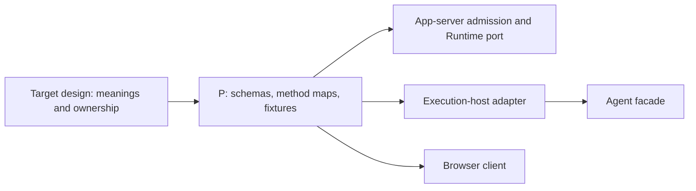

# 01 — Protocol Contracts

Status: Planned. This document specifies implementation work; none of its
checkboxes or acceptance cases claims an implemented feature.

## 1. Outcome and scope

Create one dependency-leaf protocol package used by app-server, the execution
host, and the browser client. A developer must be able to determine the sender,
receiver, parameter shape, success meaning, and failure behavior of every v1
method without importing Agent internals or inferring it from a handler.

This step owns P: serializable contracts, runtime validators, method allowlists,
and fixtures. Connection management belongs to [03](./03-runtime-host-and-connection.md)
and [04](./04-appserver-session-application.md); durable execution belongs to
[02](./02-durable-session-execution.md). This step does not implement those owners.

The [target design](../app-server-runtime-design.md), especially sections 3–7,
defines the required behavior. This document turns that behavior into a shared
contract and a buildable package, not a Codex-compatible protocol.

## 2. Prerequisites and source map

Read the repository [rules](../../../AGENTS.md), [architecture](../../architect.md),
and the [implementation index](./README.md) before making changes.

| Existing source | What to inspect before changing it |
| --- | --- |
| [Agent facade](../../../packages/agent/src/agent.ts) and [exports](../../../packages/agent/src/index.ts) | Existing adapter API and the compatibility boundary for CLI. Wire methods need not rename these methods. |
| [Session contracts](../../../packages/agent/src/session/session-contracts.ts) | Current `SessionSnapshot` is execution metadata, not the target observation snapshot. Current `RunResult` contains provider-shaped messages. |
| [Event envelope](../../../packages/agent/src/session/event-envelope.ts) | Current `runtimeId`, `sequence`, and `run_settled` semantics cannot be renamed into service identity, view revision, and durable settlement. |
| [Server](../../../packages/server/src/server.ts) | Current REST errors, direct Agent calls, and SSE payloads to replace. |
| [Root package](../../../package.json), [root TypeScript config](../../../tsconfig.json), and [server config](../../../packages/server/tsconfig.json) | Workspace discovery, build order, and aliases. Current root build does not build a protocol or host package. |
| [DevUI](../../../packages/devui/public/app.js) | A plain browser script currently has no workspace-module loader. Browser consumption needs an explicit delivery path. |

Proposed placement: `packages/app-protocol/`, published only within this
workspace as `@loopiq/app-protocol`. Keep definitions organized around connection,
Session, Run, and observation contracts. A small RPC envelope definition belongs
with these contracts; do not add a generic application framework.

P may depend on a browser-compatible schema library. It must not import
`@loopiq/agent`, `@loopiq/ai`, Node filesystem APIs, Bun APIs, or concrete stores.
Runtime-domain types remain owned by Agent; R1 maps them to P. The server's
Runtime client port lives with its consuming subsystem and uses P's data types.

## 3. Contracts and invariants

### 3.1 Envelope and identity

Use JSON-RPC 2.0 over WebSocket: one JSON object per application message and no
batch arrays. Requests have `id`, `method`, and `params`; responses have the
same attempt ID and exactly one of `result` or `error`; notifications have no
ID. Concurrent requests remain supported. No business Ping method is needed.

Define validators for both requests and responses. Dispatching a malformed
response as an inbound method can deadlock callers or fabricate work. Unknown
responses and responses from obsolete link generations must never settle a
different pending call.

Use the identity meanings in design section 3.1. In particular:

- RPC IDs identify attempts on one connection. Backend attempts have their own
  IDs; they do not inherit frontend connection identity.
- `submissionId` identifies a logical start and survives reconnect. Preserve it
  while forwarding; do not substitute the RPC ID.
- `runtimeServiceId` survives process restarts; `runtimeBootId` changes on process
  restart; replacing a socket changes neither the service nor the boot identity.
- Public `sessionId` is the Runtime Session UUID. `runId` identifies a complete
  task, not one model call. `itemId` and `toolCallId` have separate purposes.
- View revisions order one loaded view. They are not persisted event-replay
  offsets. Each frontend observation has a separate `observationId`.

Request-ID representation, protocol-version encoding, initialization payload
field names, and explicit empty success payloads must be fixed in D01-02 before
downstream implementation starts. These are wire-encoding choices within the
existing design; record the chosen forms in executable schemas and fixtures.
Do not leave different endpoints to choose them independently.

### 3.2 Method ownership

Create distinct request maps for each permitted direction. Sharing a method
name across endpoints does not make the endpoint contracts interchangeable.

| Direction | Methods | Contract boundary |
| --- | --- | --- |
| Frontend → app-server | `connection/initialize`, `runtime/read` | Frontend token/version initialization; current configured Runtime availability. |
| Frontend → app-server | `session/list`, `session/read`, `session/rename` | App-server catalog operations. No transcript or implicit Session load. |
| Frontend → app-server | `session/create`, `session/delete`, `session/delete/read` | Public lifecycle operations coordinated with Runtime. Create includes a public name; backend create does not. |
| Frontend → app-server | `session/observe`, `session/ready`, `session/unobserve` | A4 observation operations. `ready` confirms the returned snapshot boundary. |
| Frontend → app-server | `run/start`, `run/read`, `run/result`, `run/steer`, `run/abort` | Execution commands/queries addressed through the stored Session binding. |
| Runtime → app-server | `connection/initialize` | Runtime token, protocol version, service identity, and process boot identity. |
| App-server → Runtime | `runtime/inventory` | Complete inventory/reconciliation input; conversation text is excluded. |
| App-server → Runtime | `session/create`, `session/readSnapshot`, `session/delete`, `session/delete/read` | Durable Runtime lifecycle and bounded history/current-view queries. |
| App-server → Runtime | `run/start`, `run/read`, `run/result`, `run/steer`, `run/abort` | The same business identities as the frontend command, with independent RPC attempt IDs. |

Notifications include Runtime → app-server `session/update`, and app-server →
frontend observation updates, `catalog/changed`, and `runtime/status`. The
connection contract must also convey readiness to the initialized Runtime as
described in design section 4.1. Specify exact recipients in the notification
registry. Every frontend Session update carries its observation ID; Runtime
updates do not depend on frontend subscriptions.

Add the planned app-server → frontend control notification
`session/observationExpired` with `{ observationId, reason }`. This supplies the
invalidation signal required by design section 7, including when no `ready`
request is pending. Its reason is `resyncRequired` for buffer/deadline/epoch or
revision failures, `runtimeUnavailable` when recovery must wait for readiness,
or `sessionDeleted` when observation ends without retry. It carries no history
and needs no response. Send it while the frontend link remains usable; socket
closure itself invalidates that link's observations. A lost notification must
not keep a closed observation active. Steps 05/06 implement the producer/consumer.

Requests carry named-object parameters. Each map must specify required versus
optional fields, accepted result variants, method-specific limits, and endpoint
allowlists. Initialization is one successful request/response exchange; there
is no additional `initialized` notification.

### 3.3 Public data and success meanings

Implement validators for the design's `RunIdentity`, `RunView`, `RunLookup`,
`RunResultView`, `HistoryItem`, `SessionSnapshot`, `SessionUpdate`, and public
catalog entries. Preserve discriminated unions rather than returning loosely
typed dictionaries. Keep wire Session snapshots distinct from existing
Agent snapshots, even if they have similar names.

| Operation/result | Meaning that schemas and examples must preserve |
| --- | --- |
| Runtime initialize success | Identity accepted; catalog synchronization can still be pending. |
| `run/start` success | Same submission recognized or durable acceptance completed; execution may already have emitted output. |
| `run/read` | Known Run, authoritative `notAccepted`, or explicit `unknown`; absence is not always proof of rejection. |
| `run/steer` success | Input queued in the exact active Run; model consumption and durable steering replay are not promised. |
| `run/abort` success | Exact Run settled; return the actual outcome, which may be normal completion. |
| `session/observe` success | Recovering observation and snapshot created; the frontend still needs to install it and call `session/ready`. |
| `session/delete` success | Runtime history removal completed and app-server catalog removal committed. |

Display content is text, including serialized tool arguments/results. Provider
objects, secrets, authorization headers, JavaScript errors, promises, and Run
handles do not cross the boundary. Unknown token usage stays unknown; missing
legacy Run associations stay `null`.

### 3.4 Errors and limits

Implement the protocol errors and all business reasons in design section 5.2.
Business errors use `-32000` with `error.data.reason`. Separately represent the
caller's delivery knowledge: `rejected`, `uncertain`, or `confirmed`. A timeout
or lost connection does not prove that Runtime rejected or stopped execution.

Record the shared defaults in one place: 64 KiB input; 32 MiB JSON message;
16 MiB snapshot/result; 30-second ordinary RPC timeout. Transport and observation
owners enforce their own queue and timing limits from design section 4.3.
Size limits count encoded UTF-8 bytes, not JavaScript string length.

## 4. Implementation flow



The dependencies above are consumer dependencies on P. P does not depend on
these consumers. Define a small typed Runtime client port at A3's boundary;
A2 and A4 use it without knowing the socket implementation. Keep socket
correlation and business orchestration out of P.

## 5. Ordered work packages

- [ ] **D01-01 — Package and dependency setup.** Add the workspace package,
  exports, build/typecheck/test scripts, and browser-compatible schema support.
  Update root build order and aliases only where required. Verify P builds in
  isolation and does not pull Agent/provider code into browser output.
- [ ] **D01-02 — Freeze v1 wire shapes.** Implement envelope schemas, identity
  fields, initialization payloads/results, protocol version, and error shapes.
  Document the chosen encodings with valid and invalid fixture objects. Define
  handling for null error correlation IDs separately from normal request IDs.
- [ ] **D01-03 — Complete method registries.** Add both endpoint request maps,
  notification recipients, parameter/result validators, and the success
  meanings above. Export types from the schemas where supported; avoid manually
  maintaining a second contradictory set. Cover every method in design section 5.
- [ ] **D01-04 — Define data and port contracts.** Add Run, item, snapshot,
  inventory, catalog, observation, and availability types. Write the Runtime
  client port used by A2/A4, with no concrete socket or Agent dependency.
  Establish how R1 converts Agent results into these contracts.
- [ ] **D01-05 — Contract fixtures and boundaries.** Test request/response
  round trips, wrong endpoint/method combinations, size validation, and public
  payload exclusion. Add compile/build checks for dependency direction.
- [ ] **D01-06 — Browser consumption and handoff.** Choose a minimal browser
  export/build path compatible with the existing static DevUI. Demonstrate
  loading P's browser-safe exports without a Node shim; 06 will wire the UI.
  Record exported names and remaining implementation-owned mappings for 02–06.

## 6. Failure cases and acceptance

These are required tests to add, not results obtained during documentation.

| ID | Trigger | Required observation |
| --- | --- | --- |
| T01-01 | Parse valid request, success, error, and notification fixtures. | Distinct variants survive round trips; responses preserve attempt IDs; notifications require no response. |
| T01-02 | Send a batch array, malformed JSON, invalid envelope, unknown method, or invalid params. | Correct protocol rejection; no handler invocation or silent array iteration. |
| T01-03 | Use a frontend token/payload on the Runtime endpoint or invoke a direction-disallowed method. | Shape/allowlist rejection; no endpoint promotion. Actual authentication is verified in 03/04. |
| T01-04 | Interleave two request IDs and reverse their responses. | Fixtures and types permit independent responses; execution order is not inferred from the array/order of calls. |
| T01-05 | Round-trip all Run lookup/outcome and observation variants. | `unknown`, `notAccepted`, `interrupted`, legacy null associations, and observation boundaries remain distinguishable. |
| T01-06 | Attempt to serialize provider headers, handles, errors, or extra internal state. | Boundary mapping/validation excludes internal payloads; the public fixture contains only permitted data. |
| T01-07 | Validate multibyte input and snapshot/result sizes near each limit. | Byte limits are enforced; an oversized full response is explicit, never silently truncated. |
| T01-08 | Build P and load its browser entry. | No Agent/provider/Node/Bun runtime import is needed; existing Agent and CLI builds still resolve. |
| T01-09 | Encode timeout, disconnect, and a known Runtime rejection. | Delivery uncertainty is separate from a business error; fixtures never invent a failed Run for transport loss. |
| T01-10 | Encode observation expiry for resynchronization, Runtime unavailability, and deletion. | The exact observation ID and reason survive validation; the control message has no RPC response or execution side effect. |

## 7. Validation commands

Run commands from the repository root. First inspect scripts if the checkout
has advanced. Existing baseline commands are:

```sh
npm run build
npm run test -w @loopiq/agent
npm run test -w @loopiq/cli
```

The following commands are proposed interfaces to create in D01-01. They do
not exist at the inspected baseline:

```sh
npm run build -w @loopiq/app-protocol
npm run typecheck -w @loopiq/app-protocol
npm run test -w @loopiq/app-protocol
```

Add the browser-entry smoke check to the package's test/build validation and
record the exact command in the implementation handoff. A test command using
`passWithNoTests` must still discover the T01 cases. A green empty suite is not
evidence that the contract is implemented. Do not run real-provider smoke tests.

## 8. Migration and documentation updates

Existing REST/SSE and direct CLI behavior remain available while this package
is introduced. Compatibility does not require exposing the old SSE event
envelope as the new public protocol. The execution host performs the mapping.

Update [architecture](../../architect.md) when P exists, recording its exports,
dependency rules, and browser delivery path. Keep this execution document's
contract links pointed at the implemented schemas once available. Update the
target design if an implementation changes public behavior; encoding details
may be documented beside the schema without copying every type into prose.

## 9. Completion checklist

- [ ] Every v1 method and notification has a direction, schema, result meaning,
  and failure fixture; optional features have no accidental active endpoints.
- [ ] Wire encodings left to this step are decided and tested before 02–06
  depend on them.
- [ ] P builds independently and is consumable by the plain browser client.
- [ ] The Runtime port imports public types only; Agent internals remain private.
- [ ] T01-01 through T01-10 have implementation evidence and executed results.
- [ ] Update the [index](./README.md) with actual tests, commands, commits, and
  any remaining limitations before marking this step complete.
