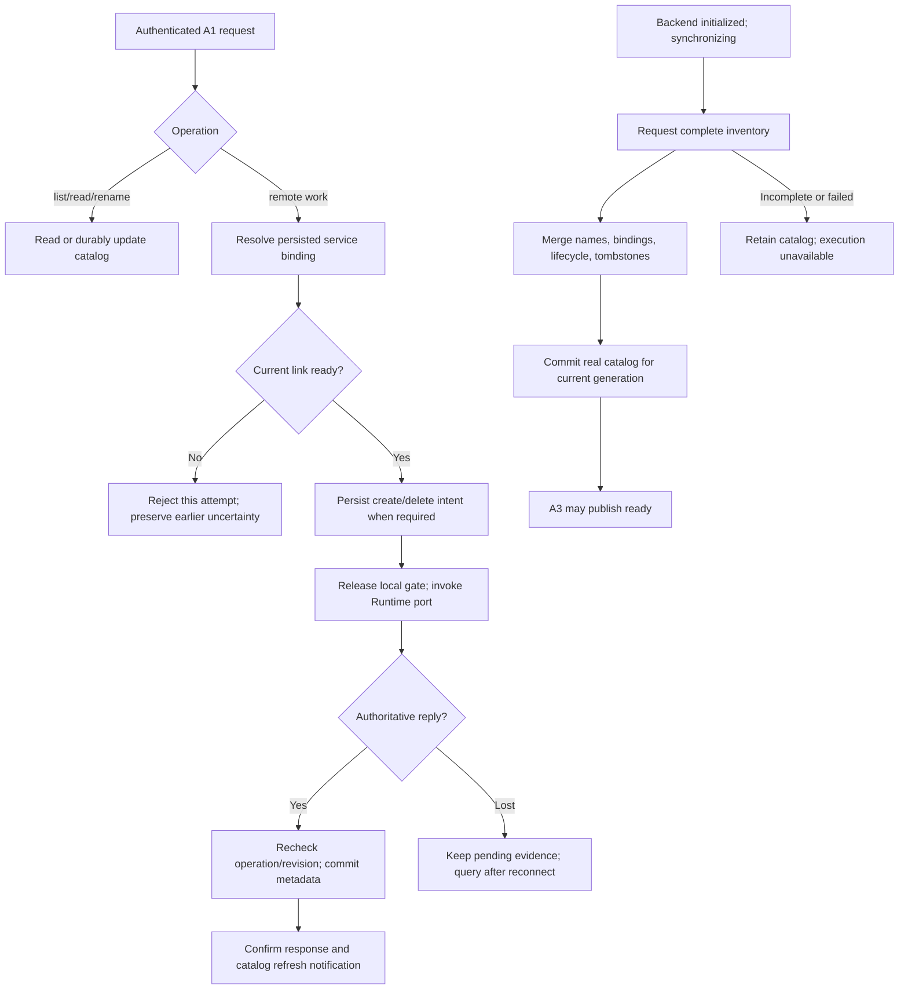

# AppServer Session Application

Status: Planned

## 1. Outcome and scope

Implement A1 client access and A2 Session application so app-server owns the
public catalog and routes execution through A3. The app-server owns no Agent,
provider, execution environment, transcript, or tool process. The
[consolidated design](../app-server-runtime-design.md) defines the target behavior.

This stage supplies authenticated frontend RPC ingress, persistent bindings and
names, inventory reconciliation, create/delete coordination, and Run routing.
It completes production readiness for [03](./03-runtime-host-and-connection.md):
authentication alone leaves Runtime synchronizing until a successful inventory
merge has been committed to the real catalog.

Supply connection, binding, and availability context to observation handlers in
[05](./05-session-observation.md). DevUI and legacy-route cutover belong to
[06](./06-devui-migration-and-cutover.md). Model/credential settings remain local
to Runtime; the old UI does not imply a v1 remote configuration API.

## 2. Prerequisites and source map

Read [architecture](../../architect.md), [multi-Session ownership](../../techniquedocs/multi-session-runtime.md),
[Agent lifecycle](../../techniquedocs/agent-runtime.md), and
[Session storage](../../session.md). Use [01](./01-protocol-contracts.md) for wire
schemas and [02](./02-durable-session-execution.md) for authoritative existence,
creation fingerprints, submission records, and deletion receipts.
Stage 03's D03-01 through D03-08 handoff supplies the Runtime port and connection
status; full 03 completion is not a prerequisite. Close its D03-09/D03-10 and
this stage's production reconciliation together at M2.

| Current source | Evidence and migration requirement |
| --- | --- |
| [server.ts](../../../packages/server/src/server.ts) | Bootstraps a concrete Agent; REST handlers call it directly; `/api/runtime` exposes a browser-selected Session and SSE forwards Agent events. Replace this composition with A1/A2/A3/A4. |
| [runtime-factory.ts](../../../packages/server/src/runtime-factory.ts) | Chooses an existing cwd-matching Session or creates one. New server startup must only load its catalog and listen; Session creation is explicit. |
| [server package](../../../packages/server/package.json) | Depends on `@loopiq/agent`. Isolate any temporary legacy dependency from the new mode here; 06 removes it after browser cutover. |
| [provider-credential-jobs.ts](../../../packages/server/src/provider-credential-jobs.ts) | Adapter jobs currently call Agent credential methods. They cannot remain an alternate server-owned Agent path after cutover. |
| [agent.ts](../../../packages/agent/src/agent.ts) | `getSession` currently opens resources, while proposed `session/read` reads public metadata only; do not reuse its behavior as an app-server catalog read. |
| [agent-session-manager.ts](../../../packages/agent/src/session/agent-session-manager.ts) | Current creation chooses its own UUID and current list skips some unreadable entries; stage 02 must supply stable-ID creation and complete inventory evidence. |

Proposed folders are `packages/server/src/client-access/` for A1 and
`packages/server/src/sessions/` for A2/catalog persistence. A2 imports protocol
contracts and a Runtime client port, never Agent or provider implementations.

Agree inventory completeness, creation matching, and private operation metadata
with 01/02. Keep the public `SessionCatalogEntry` shape; no ad hoc receipt fields.

## 3. Contracts and invariants

### Client access and application boundary

Frontend connects to `/ws/client` and sends `connection/initialize` with version
and the frontend token. A1 owns the 10-second initialization deadline, endpoint
method allowlist, envelope/parameter validation, writer bounds, and connection
cleanup. A Runtime token or method cannot promote this connection to `/ws/runtime`.
Initialization has one result and no second `initialized` notification.

Authenticate and validate before business admission. Dispatch responses and
initialization/control messages independently of Session mutation queues.
After admission, use asynchronous handler tasks; a pending remote abort cannot
block the reader, the same Run's queries, another Session, or heartbeat handling.
Do not hold a catalog or Session mutation gate over a remote call or model work.

On frontend close, discard queued operations that have not begun admission and
remove its waiters/observations. A Runtime-accepted start or signaled abort keeps
its meaning after the client disappears. Observation cleanup never calls delete,
close Session, or abort. Stage 05 owns bidirectional subscription-index cleanup.

| Frontend operation | A2 responsibility |
| --- | --- |
| `runtime/read` | Return configured service identity and A3 availability; it is not a provider-settings bootstrap. |
| `session/list`, `session/read` | Read catalog metadata and availability without opening a Runtime Session. |
| `session/rename` | Persist a nonempty trimmed name and new metadata revision; no backend rename exists. |
| `session/create`, `session/delete`, `session/delete/read` | Coordinate persisted lifecycle metadata with Runtime evidence. |
| `run/start`, `run/read`, `run/result` | Resolve binding and call `startRun`, `readRun`, or `readRunResult`; preserve domain identities and typed results. |
| `run/steer`, `run/abort` | Forward exact Session/Run identity to `steerRun` or `abortRun`; never substitute the current Run. |
| `session/observe`, `session/ready`, `session/unobserve` | Route to A4 after the relevant connection/binding checks; apply 05's lifecycle semantics. |

### Catalog durability and authority

Serialize writes to one `catalog.json`: write a temporary file, fsync it, rename
atomically, then sync its directory before acknowledging metadata success.
Publish the committed view and `catalog/changed` consistently with that boundary.
I/O failure cannot produce confirmed success; a crash may leave either complete
file version, never an accepted partial catalog.

Persist bindings, display names, timestamps, metadata revisions, and private
create/delete reconciliation state. Exclude prompts, transcripts, tool results,
credentials, and token-delta journals. App-server is the sole catalog writer;
independent Session handlers share one serialized durable store, not separate
read/modify/write copies that can overwrite each other's changes.

`sessionId` equals the Runtime Session UUID and is never reused. Resolve the
persisted `runtimeServiceId` on every remote operation. A frontend-supplied URL,
service ID, or another newly connected Runtime cannot redirect that binding.
Runtime validates cwd/configuration and reports the actual absolute cwd; A2
stores that value without checking or resolving it on the app-server machine.

App-server owns `name`, `metadataRevision`, and catalog `updatedAt`. Runtime owns
existence, cwd, execution status, history, and execution `lastActivityAt`.
Increment revisions only on committed metadata changes; no-op reconciliation
must not invent activity or rewrite an offline rename. `catalog/changed` prompts
authenticated clients to refresh; it conveys no transcript and creates no observation.

### Reconciliation and availability

After every backend initialization, request a complete `runtime/inventory` for
that link generation. Inventory includes Session metadata and deletion tombstones,
never conversation content. Do not treat a partially successful filesystem scan
or a swallowed read error as authoritative absence.

Merge by Session ID against the latest catalog under its short mutation/commit
coordination. Preserve app-server names and bindings; insert newly discovered
Sessions with the configured/default title rule; record Runtime-reported cwd and
activity. A direct CLI Session may be discovered yet remain `SESSION_LOCKED`
for execution while the CLI holds its lease; discovery grants no takeover right.

An inventory match may complete a pending create only with matching immutable
creation evidence. A completed deletion tombstone removes a catalog row. Missing
ordinary Sessions become `missing`, preserving their metadata. Pending deletion
keeps its operation evidence until a definitive outcome is known; absence alone
cannot complete deletion or restore that row to ordinary `ready`.

On failed/incomplete inventory, retain existing catalog evidence and keep the
link unavailable. Stage 03 publishes `ready` only after a successful merge commit
for the current generation. Fence stale scans and stale commit completions so
they cannot overwrite newer catalog mutations or mark a replacement link ready.
Catalog reads and rename still work offline; execution status then means last-known.

### Mutation coordination and outcome meaning

For create, require readiness and bind the new ID to the configured Runtime.
Persist `creating` and immutable request evidence, release local gates, then call
`session/create` with that ID and cwd request; omit the display name. On matching
success, persist actual cwd and `ready` before confirming the returned effective
settings. Creation implies no Run, observation, or automatic replacement UUID.

Same-ID creation preserves immutable parameters; differences return `CREATION_CONFLICT`.
Lost replies retain evidence for reconciliation and manual same-ID retry after
definitive absence. Never resend automatically or overwrite a later rename with the initial
display name. Explicit configuration/workspace rejection is reported as such;
any pending row remains explainable and cannot be presented as a ready Session.

For delete, require readiness, persist `deleting` with stable `operationId`,
release catalog gates, and forward that operation. Runtime rejects busy Sessions
before durable deletion intent; that definitive busy result restores the row to
`ready`. Intent blocks new Runs; Runtime removes only Session-owned history and
resources, then completes its tombstone. Remove the catalog row and confirm only
after completed deletion evidence and the catalog removal's own durable commit.

Resolve lost delete replies with `session/delete/read` and the original operation
ID. `notStarted` requires authoritative knowledge; unavailable storage/Runtime is
an error. Keep pending evidence through interruption; no offline or automatic
client delete retry is added. Project files remain outside cleanup scope.

Forwarded starts retain submission ID and original input. `RUNTIME_OFFLINE` or
`RUNTIME_SYNCING` says this attempt was not forwarded; it cannot settle an older
attempt. A3 timeout/loss is uncertain, not a fabricated `RunOutcome`. Abort returns
the actual durable terminal outcome after reservation release, even if normal
completion won; lost steering acknowledgments never trigger an automatic resend.

## 4. Implementation flow



Run commands follow the same binding/readiness path without persisting their
input or outcomes in the catalog. Each remote await occurs outside catalog gates.
Before applying a response, check the operation identity and latest metadata
revision so a delayed create/delete callback cannot overwrite concurrent rename
or a newer reconciliation result.

## 5. Ordered work packages

- [ ] **D04-01 — Define the A2 port and catalog model.** Use 01's wire types and
  03's connection generation; separate public entries from private operation
  evidence. Specify complete-inventory matching with 02, including tombstones,
  locked Sessions, and unavailable scans. Freeze authoritative tombstone routing
  after public row removal so old IDs still return `SESSION_DELETED` without rebinding.
- [ ] **D04-02 — Implement durable catalog storage.** Add validation, serialized
  updates, atomic replace plus file/directory sync, and deterministic load failure.
  Preserve a corrupt/unreadable file for diagnosis; never silently replace it with
  an empty catalog. Add persistence fault injection before using real Sessions.
- [ ] **D04-03 — Implement client ingress.** Add `/ws/client`, frontend-specific
  token/version validation, method allowlists, payload limits, independent response
  handling, and bounded writers. Reject unauthenticated business calls and protocol
  batches. Connection closure cleans only that client's transient resources.
- [ ] **D04-04 — Add catalog reads, binding, and rename.** Implement `runtime/read`,
  `session/list`, `session/read`, and offline `session/rename`. Verify local reads
  do not open Agent resources. Notify catalog changes only after durable commits.
- [ ] **D04-05 — Implement inventory merge/readiness.** Merge complete inventories
  into current catalog state, preserve names, reconcile creating/deleting rows,
  discover CLI Sessions, and retain missing evidence. Wire the real reconciler
  into 03; stale generations and failed commits cannot authorize new execution.
- [ ] **D04-06 — Implement stable-ID creation.** Persist intent before dispatch,
  preserve immutable request evidence, validate success matching, store actual
  Runtime cwd, and commit `ready`. Test loss before forwarding and after Runtime
  creation without starting a model call or silently generating another ID.
- [ ] **D04-07 — Implement deletion coordination.** Persist operation ID, forward
  outside the catalog gate, restore on definitive busy, query uncertain operations,
  and remove only after complete tombstone evidence. Make restart reconciliation
  finish a confirmed deletion without touching workspace contents.
- [ ] **D04-08 — Route Run commands.** Forward start/read/result/steer/abort through
  the bound ready Runtime port, preserving IDs, typed errors, and uncertainty.
  Test delayed abort and cross-Session progress; add no server execution queue.
- [ ] **D04-09 — Replace server composition.** Bootstrap catalog/A1/A2/A3 and A4's
  interface instead of `createDefaultRuntime`. New-mode imports/handlers cannot
  reach Agent construction or provider events. Record any temporary legacy entry
  and manifest dependency for removal by 06; never fall back to it from the new mode.
- [ ] **D04-10 — Integrate failure tests and docs.** Run real 03+04 synchronization,
  catalog restart, lost create/delete replies, and binding tests. Hand A4 the
  connection/binding hooks and give 06 accurate availability and mutation semantics.

## 6. Failure cases and acceptance

Use temporary catalog directories, a fake Runtime port for local boundaries,
then real separate app-server/Runtime processes for restart and reconciliation.
Use storage and response barriers to make each uncertainty window reproducible.

| Test | Trigger | Exact assertion |
| --- | --- | --- |
| T04-01 | Send unauthenticated methods, Runtime-only methods, invalid params, or a batch to `/ws/client`. | Each is rejected by the appropriate protocol/auth rule; no catalog commit or Runtime call occurs; endpoint role never changes. |
| T04-02 | Hold one abort response while sending other Session commands, replies, and controls. | Independent work completes; no reader, global catalog gate, or per-Session mutation gate is held during remote settlement. |
| T04-03 | Restart offline, list/read metadata, then rename using surrounding whitespace. | Trimmed nonempty name and incremented revision survive another restart; no Runtime call, Session open, or model-context mutation occurs. |
| T04-04 | Inject failure at temporary write, fsync, rename, or directory sync; crash around catalog replacement. | No failed commit is acknowledged as confirmed; restart reads a complete old or new catalog, never truncated JSON or an invented empty catalog. |
| T04-05 | Concurrently rename two Sessions and reconcile inventory; repeat unchanged inventory. | Both names survive serialized commits; revisions reflect committed changes; repeated unchanged inventory does not invent metadata/activity changes. |
| T04-06 | Supply complete inventory with a new CLI Session, actual cwd/activity metadata, and an absent known Session. | New Session is inserted with a default title, existing name/binding is preserved, authoritative fields update, and unexplained absence becomes `missing`. |
| T04-07 | Fail or partially complete an inventory scan; separately fail its catalog commit. | Existing names/lifecycle evidence remain; no absent row is removed, no deletion is inferred, and A3 never reports ready for that attempt. |
| T04-08 | Replace backend generation while an inventory/merge callback is delayed. | Old completion cannot mark the replacement ready or overwrite later committed metadata; replacement requires its own successful merge. |
| T04-09 | Bind a Session to service A, then send a frontend URL/service override or connect service B. | Operation cannot reach B or the supplied URL; persisted binding remains A. |
| T04-10 | Create with a stable ID and a path existing only on Runtime; then duplicate the same request. | One Runtime Session exists, returned cwd is Runtime-authoritative, one ready row is committed, and no Run/subscription is created. |
| T04-11 | Lose creation response after durable Runtime create; restart app-server. | Matching inventory completes the original row/ID without another create or provider call; differing immutable parameters conflict. |
| T04-12 | Reject creation for invalid cwd/configuration, or find definitive absence after a lost pre-forward attempt. | No ready Session is claimed; original pending evidence remains explainable; only explicit same-ID user retry can attempt creation again. |
| T04-13 | Delete while offline, then delete a busy Session while ready. | Offline produces no new backend delete; busy produces no Runtime deletion intent and restores catalog `ready`; history/project files remain. |
| T04-14 | Lose delete response after intent, crash during cleanup, then reconnect. | Original operation ID remains pending; only completed tombstone evidence permits durable catalog removal and success; project files remain byte-identical. |
| T04-15 | Omit a deleting Session from inventory without a completed tombstone; make deletion query unavailable. | Row and operation evidence remain pending; unavailable does not become `notStarted`, `deleted`, or ordinary `ready`. |
| T04-16 | Retry start after a lost backend/frontend acknowledgement, using the same submission ID. | Same accepted Run is recovered; no second execution is caused by A2; timeout/loss remains uncertainty until authoritative query. |
| T04-17 | Normal completion races abort, or an old Run ID is steered after a new Run starts. | Abort returns the actual retained outcome; stale control is rejected without retargeting; lost steering replies are not automatically resent. |
| T04-18 | Complete deletion, then deliver a delayed start/create retry for the old Session ID. | Runtime returns `SESSION_DELETED`; catalog does not recreate the Session and no tool runs. |
| T04-19 | Close one frontend or overflow its writer while another observes execution. | Only that client's queued unadmitted work/waiters/observations are removed; Runtime and the healthy frontend continue. |
| T04-20 | Bootstrap the new production mode with no Runtime; exercise its routes and inspect reachable imports. | Catalog reads/rename work, zero Agents are constructed, and no reachable new-mode import depends on Agent/provider implementations; any temporary legacy entry/dependency is explicitly isolated for 06 removal. |

T04-06 through T04-08 establish the readiness evidence consumed by T03-03.
T04-11 and T04-14 require durable 02 behavior; in-memory fake success is insufficient.
Observation handoff and browser submission persistence remain 05/06 acceptance work.

## 7. Validation commands

Existing commands, run from the repository root:

```sh
npm run test -w @loopiq/server
npm run test -w @loopiq/agent
npm run build
git diff --check
```

Existing server tests cover credential jobs; root build covers AI, Agent, and CLI.
New application/process suites must prove the new contract.

Proposed commands, available only after the implementation adds their suites/scripts:

```sh
npm run test -w @loopiq/server -- src/client-access src/sessions src/execution-connection
npm run test:process -w @loopiq/server
```

The process suite must include real catalog commits and use no paid model calls.
Inspect the server manifest/imports and exercise composition paths to verify
removed Agent/provider dependencies; a text search alone is insufficient.

## 8. Migration and documentation updates

Replace implicit default-Session startup and its protected-delete special case
with the explicit catalog lifecycle. Preserve the authoritative design's busy
deletion rule and all project files. Stop exposing `/api/runtime` as model and
browser-selection authority in the new mode; 06 owns client cutover messaging.

Inventory old routes and credential jobs. Any temporary legacy entry or manifest
dependency remains unreachable from the new mode; 06 removes both after equivalent
browser flows pass. O2 stays optional. Static assets remain ordinary HTTP.

Update architecture, multi-Session, and server/tool usage docs with code changes.
Document catalog location/schema, recovery, offline behavior, and legacy isolation.
Stage 02 owns storage/Agent lifecycle documentation; 06 owns final legacy cleanup.

Choose catalog location, default title text, failed-create evidence schema, and
post-removal tombstone routing in D04-01/D04-02. Preserve uncertainty evidence;
add no public lifecycle values, silent rebinding, or automatic mutation retries.

## 9. Completion checklist

- [ ] A1 enforces endpoint authentication, validation, bounds, and independent control handling.
- [ ] A2 uses a Runtime port and has no concrete Agent/provider dependency.
- [ ] Catalog commits are durable, serialized, and free of transcript/credential data.
- [ ] Binding checks and offline reads/rename obey metadata authority.
- [ ] Complete current-generation inventory commits gate production Runtime readiness.
- [ ] Create/delete survive lost replies and restart using the original identities.
- [ ] Run routing preserves durable identity, actual outcomes, and uncertain delivery.
- [ ] No remote wait holds a catalog/Session gate or blocks other Sessions.
- [ ] Process tests pass, documentation is updated, and 05/06 receive their integration hooks.
