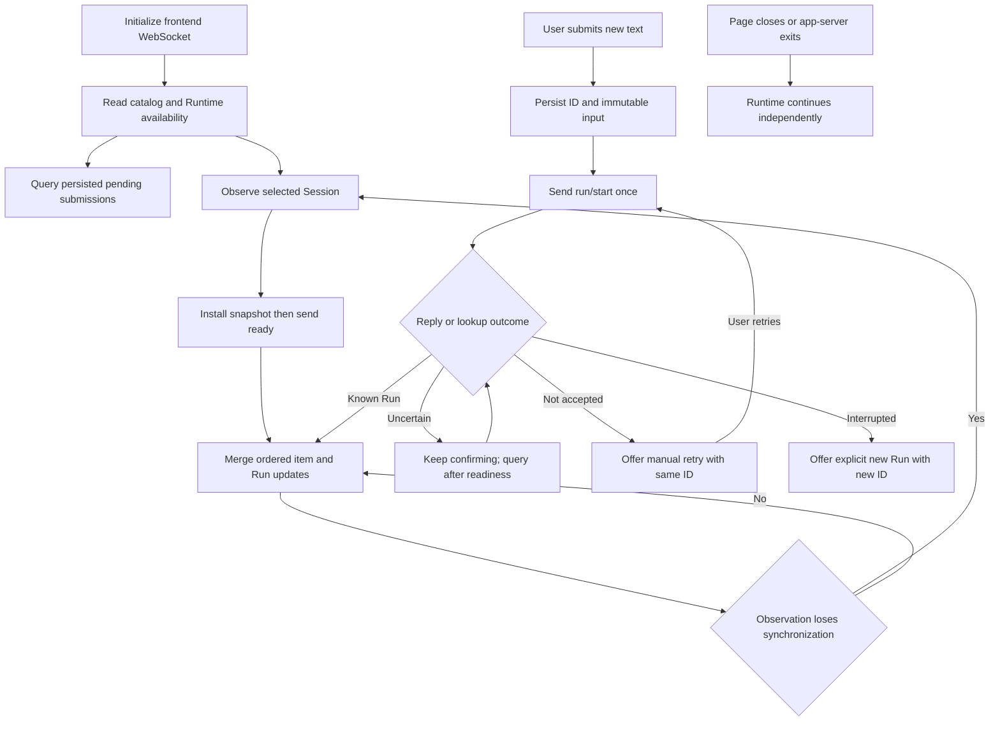

# DevUI Migration and Process Cutover

Status: Planned

This plan completes the [authoritative design](../app-server-runtime-design.md)
with browser RPC and independent-process acceptance. Current DevUI uses REST/SSE.

## 1. Outcome and scope

The browser lists/selects/creates/renames Sessions, observes history and live
items, starts text Runs, steers/aborts an exact Run, reads results, and deletes
idle Sessions through `/ws/client`. Reload and reconnect never repeat execution.

Cutover covers launch/build wiring, operator instructions, and same-host/remote-host
process acceptance. Browser/app-server loss leaves a healthy Runtime executing;
Runtime failure preserves durable outcomes and exposes interrupted work.

The direct CLI keeps its Agent entry path; HTTP/SSE `devui-control` migration
is optional. Model/key/tool editing, attachments, approvals, Runtime questions,
pagination, and other O1–O5 features remain excluded from this frontend scope.

## 2. Prerequisites and source map

| Prerequisite | Required handoff before dependent work |
| --- | --- |
| [01 Protocol contracts](./01-protocol-contracts.md) | Browser-consumable validators/types, method schemas, version negotiation, and typed delivery classification. |
| [02 Durable execution](./02-durable-session-execution.md) | Submission lookup/deduplication, stable items, final results, crash outcomes, and CLI-compatible shared storage. |
| [03 Runtime host and connection](./03-runtime-host-and-connection.md) | Independent executable, two-link failure semantics, authenticated reconnect, and host/process ownership. |
| [04 Session application](./04-appserver-session-application.md) | Catalog operations, production readiness, stable create/delete reconciliation, and Runtime-local cwd authority. |
| [05 Session observation](./05-session-observation.md) | Snapshot/ready handshake, active text, revisions, bounded delivery, and observation invalidation. |

Browser reducers can start with protocol fixtures. Release acceptance requires
all predecessors, including durable state, production readiness, and process tests.

| Existing source | Current behavior to replace or preserve |
| --- | --- |
| [Browser app](../../../packages/devui/public/app.js) | Fetches `/api/runtime`, uses EventSource, keeps one assistant bubble, and has no persistent pending submissions. |
| [Page](../../../packages/devui/public/index.html) | Native module entry, text composer, abort, chat, and trace; retain the framework-free architecture unless needed otherwise. |
| [Server](../../../packages/server/src/server.ts) | Serves static assets, creates an Agent, exposes Session/Run/provider/configuration HTTP routes, and forwards SSE. |
| [Runtime factory](../../../packages/server/src/runtime-factory.ts) | Selects/creates a default browser Session in-process; this is not a remote Runtime launcher. |
| [Root package](../../../package.json) | `devui` delegates to server; `build` covers only ai, agent, and cli. |
| [Server package](../../../packages/server/package.json) | `server` runs `bun run src/server.ts`; tests use Vitest; no current server build script. |
| [DevUI package](../../../packages/devui/package.json) | Static frontend package with no current build or test script. |
| [CLI package](../../../packages/cli/package.json) and [CLI tests](../../../packages/cli/src/cli.test.ts) | Direct Agent consumer with compiled entry and machine-output tests; preserve this behavior. |
| [Control client](../../../.github/agent-tools/devui-control/client.mjs) and [tool README](../../../.github/agent-tools/devui-control/README.md) | Discover `/api/runtime` and consume Session SSE; they need explicit old-mode support documentation. |
| [Repository instructions](../../../AGENTS.md) | Advertise `devui-control`; update that claim when its target server changes. |

Proposed files: `packages/devui/public/rpc-client.js`, `pending-submissions.js`,
and `session-observation.js` in that directory; none exists yet. Consume P's
browser output instead of copying schemas or importing Agent/provider objects.

## 3. Contracts and invariants

### 3.1 Browser connection and RPC lifecycle

Open `/ws/client`, send `connection/initialize` with the frontend token and
protocol version, and wait for its one success response. The token belongs in
initialization, never URL parameters, chat history, trace output, or the pending
store. Use WS only for permitted loopback development and WSS for public use.

Use fresh connection-scoped RPC IDs. Validate messages through P and route
responses before awaiting handlers that depend on those responses.
On close, reject outstanding waiters as locally uncertain where forwarding may
have happened. Discard obsolete-connection replies and all old observation state.
Reconnect with the agreed jittered 1–15 second backoff, then initialize again.
Browser WebSocket answers control Ping itself; add no business ping method.

Track frontend and Runtime readiness separately. Catalog reads and rename work
offline; remote work requires Runtime readiness. A timeout is not a failed Run,
and `RUNTIME_OFFLINE` on a new attempt says nothing about an earlier submission.

### 3.2 Pending start submissions

Before `run/start`, persist a versioned record with Session ID, UUID submission
ID, immutable original text, and unresolved state. Proposed storage is
`localStorage`, namespaced by app-server identity, Runtime binding, Session, and
submission ID. Failure blocks sending; reload validates records. Store no secrets.

Require storage success before clearing the composer or showing input as sent.
Keep a pending bubble by submission ID, reconciled with `uncommittedInputs` or
the committed user item. Late replies and snapshot/live overlap cannot duplicate
it. The store retains unresolved intent, not a full conversation cache.

On lost acknowledgment, reload, or either-link recovery, query `run/read` using
the original submission ID. Queries may retry after reconnect; execution sends
never retry automatically. Track these authoritative outcomes:

| Lookup | Browser behavior |
| --- | --- |
| Known accepted/running/settling | Retain identity, attach observation, and show current progress. |
| Known settled | Merge actual outcome and obtain recorded result; do not reopen a completed task because its start reply arrived late. |
| `notAccepted` | Offer manual retry with the same submission ID and exact original text, using a new RPC ID. |
| `unknown`, unavailable, or storage failure | Keep “Confirming submission” or “Status unknown”; do not claim failure or offer an automatic execution resend. |
| Known interrupted | Show interruption and offer an explicit new Run with a new submission ID. |

A negative lookup can race a delayed original request. Manual same-ID retry
must converge to its one accepted Run. Editing original input creates a new
user decision and new ID; reusing the old ID with changed input is a conflict.
Retire the pending record only after installing authoritative state and its
corresponding durable input representation. A start acknowledgment alone is
insufficient while the user item has not committed.

Tabs may query the same record but never replay it on startup. Remove local
Session state only after confirmed deletion; tombstones never trigger recreation.

### 3.3 Observation installation and merge

After initialization/readiness, install a fresh snapshot atomically: epoch,
boundary, Run state, durable/active items, and uncommitted inputs. Send
`session/ready` with its observation ID, epoch, and boundary; keep catalog
metadata revisions separate from observation revisions.

Maintain item maps keyed by Session/item ID and pending input by submission ID.
Render through `textContent`; tool output and history are untrusted display text.
Apply only the current observation's next view revision and matching-base item
delta; newer complete upserts replace item content. Ignore already-applied
duplicates. A gap, changed epoch, expired observation, or unknown base starts
a new snapshot rather than appending a suffix to incomplete text.

For `session/observationExpired`, `resyncRequired` starts a fresh snapshot,
`runtimeUnavailable` waits for readiness, and `sessionDeleted` stops observation.
Match its observation ID; ignore obsolete signals and never resubmit a Run.

Session switching invalidates old install callbacks. Late snapshot, ready, start,
or abort responses affect only their original Session/Run. Disconnect leaves the
last view visibly stale until synchronization establishes current status.

### 3.4 Run controls and first-version UX

Steering captures the exact Session/Run ID at submission. A successful response
means queued input, not model consumption or durable steering recovery. If the
response is lost, preserve a visible “Steering delivery unknown” entry and do
not automatically resend, invent a deduplicated steering ID, or convert it to
a new Run. A later user resend is an explicit choice and may duplicate input.

Abort targets the captured Run and shows “Stopping” while waiting for its actual
settled outcome. Completion may win. A timeout leaves status uncertain and
triggers a query; it does not establish `aborted`. `STALE_RUN` never silently
retargets steering or abort to a newer Run. Page close only drops observation.

| UX surface | Included behavior and boundary |
| --- | --- |
| Session list | Persistent names, availability, creating/deleting/missing states, and selection; cached status is labeled last-known. |
| Create | Stable Session UUID, optional existing absolute Runtime-local cwd, and display name; no implicit model call. |
| Rename | Offline-capable catalog metadata change; do not relabel the model prompt or rewrite history. |
| Composer | New text Run when idle; clearly identified steering when an exact active Run is known; no offline mutation queue. |
| Run/result view | Accepted/running/settling/settled and actual outcome; retain known termination details and partial/unavailable usage labels. |
| Recovery | Pending input, confirming/unknown/interrupted states, manual same-ID retry, and fresh observation progress. |
| Delete | Explicit permanent deletion of an idle Session; preserve project files; busy/offline rejection and pending cleanup stay visible. |
| Oversize history | Show `SNAPSHOT_TOO_LARGE`; keep catalog/Run queries and bounded result access; do not render a silently shortened transcript. |
| Trace | Normalized events and connection state useful for debugging, with no raw provider headers or credential data. |

Before create/delete, persist a separate versioned unresolved-lifecycle record:
creation Session UUID and immutable parameters, or Session/deletion operation ID.
Retain it across reload until authoritative resolution; it is uncertainty
evidence, not a replay queue. Connection authentication remains separate from
excluded model/key/tool editing; required excluded interactions stay unsupported.

## 4. Implementation flow



## 5. Ordered work packages

- [ ] **D06-01 — Add the browser RPC owner and protocol consumption.**
  Introduce the proposed RPC module and consume 01's browser-safe P output.
  Implement initialization, correlation, timeout/close classification, routing,
  and generations. Add DevUI tests/fixtures; no current test runner is configured.
  Exit: malformed/stale replies fail safely and do not alter conversation state.

- [ ] **D06-02 — Persist and reconcile pending submissions.**
  Add versioned pre-send persistence; cover storage failure, reload, two tabs,
  lost replies, same-ID retry, changed-input conflict, and interrupted restart.
  Exit: one logical submission produces one accepted identity in loss fixtures.

- [ ] **D06-03 — Replace event-driven bubbles with observation state.**
  Add item/Run maps; install active bases before ready, merge by revision,
  handle expiry reasons, reconcile pending bubbles, and fence stale selections.
  Exit: recovering text and final results match 05's race fixtures exactly.

- [ ] **D06-04 — Wire Session controls and recovery UX.**
  Add controls/uncertainty states. Persist unresolved create/delete identity and
  immutable parameters before send; query after reload, without automatic replay.
  Preserve exact targets and clear records only on authoritative resolution.
  Exit: each included UX row has a tested success, rejection, and loss outcome.

- [ ] **D06-05 — Prepare package and launch cutover.**
  Preserve Bun's source-based server launcher as app-server only. Add the
  independent execution-host launcher from 03; `npm run devui` must not own
  Runtime or couple it to that command's terminal lifetime.
  Keep ai→agent→cli build ordering and include P/browser artifact generation
  before its consumers; add explicit host/server type checks or builds as 03
  requires. A root build must validate new workspaces rather than bypass them.
  Exit: clean-checkout launch instructions start both processes reproducibly.

- [ ] **D06-06 — Run process acceptance before removing old browser paths.**
  Use temporary storage, fake providers, controllable tools, and real processes.
  Test app-server SIGKILL, Runtime crash boundaries, both-link reply loss,
  concurrent Sessions, same-directory use, and remote cwd resolution.
  Exit: release evidence covers both browser behavior and process/storage truth.

- [ ] **D06-07 — Remove REST/SSE usage and document compatibility.**
  After browser equivalence passes, remove REST/SSE and raw Agent event usage,
  the server's `@loopiq/agent` dependency, obsolete factory/credential-job imports,
  and temporary legacy entries. Serve static assets and ordinary HTTP health
  endpoints; health routes are planned additions, absent in the current server.
  Proposed cutover convention: removed application HTTP APIs return 410 JSON
  with `code: "LEGACY_HTTP_UNSUPPORTED"` and a migration message. This is an HTTP
  convention, not a JSON-RPC reason. Document `devui-control` support explicitly.
  Exit: no automatic legacy fallback or API response containing static HTML.

## 6. Failure cases and acceptance

These planned checks use fake providers and record accepted IDs/tool invocations.

| ID | Trigger | Exact observable assertion |
| --- | --- | --- |
| T06-01 | Bootstrap the new browser with valid/invalid initialization. | Valid path uses `/ws/client` and P validation; invalid token/version admits no application call or transcript update. |
| T06-02 | Fail pending-store write before a new start. | Zero `run/start` frames are sent; composer retains the original text and shows the persistence failure. |
| T06-03 | Complete a Run before its start response reaches the UI. | Late response preserves the settled state and renders one user bubble and one copy of each final item. |
| T06-04 | Lose acceptance acknowledgment on either link, then reload/reconnect. | Browser queries the same submission ID; persisted acceptance count and provider/tool start count are each one. |
| T06-05 | Return `notAccepted`, delay the original request, then click retry. | Retry uses original submission ID/text and a fresh RPC ID; both arrivals resolve to the same Run. |
| T06-06 | Reload during `unknown`, unreachable, or ambiguous storage state. | UI remains confirming/unknown; no automatic start frame or fabricated failed/aborted outcome appears. |
| T06-07 | Reuse a retained submission ID with edited text. | `SUBMISSION_CONFLICT` is shown; original Run and text remain unchanged. |
| T06-08 | Deliver pending input, snapshot input, and committed user upsert. | One bubble survives, keyed first by submission and then associated with the stable item; persisted record clears only after authoritative input installation. |
| T06-09 | Reload while Runtime streams `abc`, then deliver `def`. | Snapshot installs `abc` before ready; matching delta yields exactly `abcdef`, with no new execution. |
| T06-10 | Switch Sessions while old snapshot/control replies are delayed. | New selection keeps its own items and controls; delayed replies affect only the original Session/Run. |
| T06-11 | Lose steering response after enqueue. | UI shows delivery unknown; reconnect emits no steering resend and no replacement Run. |
| T06-12 | Complete concurrently with abort; separately return `STALE_RUN`. | UI displays the actual completed outcome; stale request never aborts or steers the newer Run. |
| T06-13 | Close the last browser page during tool execution. | Tool completes once and durable terminal exists; reopening recovers output without starting another Run. |
| T06-14 | Disconnect Runtime, then list, rename, create, and delete. | List/rename succeed against catalog; new create/delete are rejected and no deferred mutation runs automatically after reconnection. |
| T06-15 | Delete a busy Session, then delete an idle one with lost reply and reload. | Busy history remains; reloaded client queries the persisted operation ID; catalog disappears only after confirmed deletion and workspace marker remains. |
| T06-16 | Lose create response and refresh the browser. | Reconciliation uses the original Session UUID and never creates a second Session implicitly. |
| T06-17 | Observe history above the snapshot limit. | UI shows the explicit size error, keeps the saved Session selectable, and can display a supported-size `run/result` without truncating history. |
| T06-18 | Deliver each expiry reason, then an obsolete expiry/delta. | `resyncRequired` resnapshots; `runtimeUnavailable` waits; `sessionDeleted` stops; obsolete signals do nothing and no Run is resubmitted. |
| T06-19 | SIGKILL app-server while a managed tool is active. | Runtime PID and boot ID remain unchanged, tool completes once, and restarted app-server restores catalog plus final output. |
| T06-20 | SIGKILL Runtime before/after acceptance and before/after settlement durability. | No unrecorded execution starts; durable terminals survive; accepted nonterminals recover interrupted; tool count never increases from automatic replay. |
| T06-21 | Deploy same-host and remote-host with the same explicit cwd string. | Both use the same wire behavior; only Runtime validates/resolves cwd, and an app-server-local-only directory cannot satisfy remote creation. |
| T06-22 | Start four Sessions, including two sharing a cwd, then a fifth. | Four progress independently; fifth gets `CAPACITY_EXCEEDED`; shared workspace marker is visible without a worktree or directory lock. |
| T06-23 | Build and launch from a clean checkout using documented commands. | P/browser output is available, source-based server/host launch succeeds, and stopping app-server leaves Runtime alive. |
| T06-24 | Call every removed HTTP API and run the unmigrated control client. | Each API returns HTTP 410 JSON with `LEGACY_HTTP_UNSUPPORTED`; tool exits nonzero on discovery, and its docs identify new mode as unsupported. |
| T06-25 | Run existing direct CLI tests against shared v2-capable Agent code. | CLI still calls Agent directly; machine output/completion tests pass and no app-server connection is required. |
| T06-26 | Show a failed tool result, partial usage, and an unsupported interaction. | Tool error remains an item; usage is labeled partial/unavailable as supplied; unsupported interaction is never implicitly approved. |
| T06-27 | Inspect final server manifest/import graph and request an obsolete route. | Server has no `@loopiq/agent` dependency or reachable factory/credential-job execution path; no request activates a legacy Agent fallback. |

## 7. Validation commands

Existing root/package commands to run after implementation:

```sh
npm run build
npm run test -w @loopiq/agent
npm run test -w @loopiq/server
npm run test -w @loopiq/cli
```

Proposed additions, not current runnable coverage: DevUI `test`/`build` scripts,
tests under `packages/devui/test/`, and the process suite at
`packages/server/src/client-access/process-cutover.test.ts`. Add these to workspace
testing and document the browser test dependency before removing old paths.

Verify existing `npm run devui` now starts app-server only. The proposed root
`npm run execution-host` delegates to `npm run start -w @loopiq/execution-host`,
whose proposed source entry is `bun run src/main.ts`; neither script/file exists
today. Run 03's proposed host build/test/process scripts after adding them.
Extend root build with P, host/server checks, and browser artifacts before
claiming release coverage. `npm run check` writes fixes; `npx biome check` inspects.

## 8. Migration and documentation updates

Update [architecture](../../architect.md), [multi-Session runtime](../../techniquedocs/multi-session-runtime.md),
and [CLI readiness](../../features/cli-headless-readiness.md) for transport,
storage, and process ownership; preserve explicit direct-CLI support.

Add a proposed operator guide at `docs/techniquedocs/app-server-deployment.md`
(not existing) covering two independent launch commands, stable Runtime service
identity, separate tokens, WSS, local execution configuration, Agent Home/catalog
locations, readiness, restart/crash cleanup, and default protocol size limits.
Document supervision/logs and remove obsolete server-owned provider setup instructions.

Update [devui-control documentation](../../../.github/agent-tools/devui-control/README.md)
and its [skill manifest](../../../.agents/skills/devui-control/SKILL.md), plus
[AGENTS.md](../../../AGENTS.md). If migration is deferred, label it an old
REST/SSE client unsupported by the new app-server, with explicit failure behavior.
Optional RPC migration requires separate recovery tests.

Record the cutover commit/support matrix: browser RPC, static/health HTTP, and
direct CLI supported; old application REST/SSE unsupported; `devui-control`
status explicit. Older binaries need not read v2; rollback cannot rewrite it silently.

## 9. Completion checklist

- [ ] 01–05 handoffs are integrated; protocol types/validators are shared with browser code.
- [ ] Pending starts persist before send and recover only through same-ID queries/manual retry.
- [ ] Snapshot installation, item merging, and Session switching pass race tests.
- [ ] Steering uncertainty, exact-target abort, and actual terminal outcomes are visible.
- [ ] Included Session UX works without introducing frontend execution settings or O1–O5.
- [ ] Source launch scripts, root build/test coverage, and independent supervision are documented.
- [ ] T06-01 through T06-27 pass with process, storage, and browser evidence.
- [ ] REST/SSE removal and optional control-tool compatibility are explicitly documented.
- [ ] Direct CLI regression checks pass; no CLI transport migration is included.
