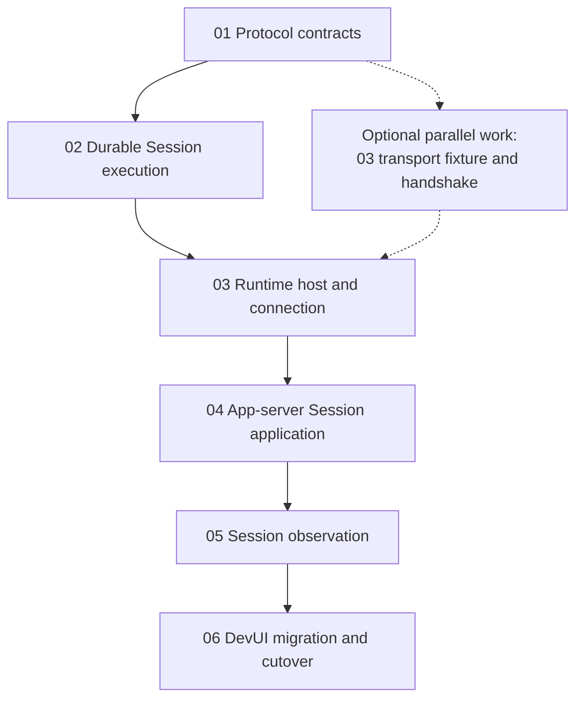

# App-server Implementation Plan

Status: In progress, 2026-10-11. Implementation has started with the RPC envelope
slice in document 01. Only behavior backed by an implementation/evidence record
is implemented; unchecked work and the remaining stages are planned. No
independent host or migrated UI exists yet.

Source inspection baseline: `43f8e3194b627de1d1d640183a0a20f349e26bc7`.
Recheck the checkout when implementation begins; source links identify owners,
not a claim that these files will remain unchanged.

## 1. Purpose and authority

Use these documents to implement the
[App-server and Runtime Design](../app-server-runtime-design.md). That design
defines the target behavior. This index defines order and acceptance coverage;
each numbered document supplies source entry points, contracts, work packages,
failure cases, validation commands, and migration duties.

The [delivery tracker](./delivery-plan.md) records the development branch,
small PR sequence, four integration milestones, owner-operated E2E acceptance,
and actual progress. Use it to coordinate reviews; the numbered documents keep
their detailed implementation and automated acceptance requirements.

The [current architecture](../../architect.md) and its linked subsystem documents
describe implemented code. Read them before editing code and update them with
each behavioral change. The [decision log](../app-server-runtime-split.md) and
[Codex comparison](../codex-app-server-comparison.md) provide background; their
earlier alternatives do not override the consolidated design.

When source and target differ, implement the stated migration. When execution
reveals a contradiction in the target, record and resolve it in the owning
document and target design before dependent work relies on a new behavior.
Do not silently weaken a guarantee to make a test pass. Routine encoding and
library choices belong to the indicated work package and do not reopen the
confirmed product decisions.

## 2. Documents and ownership

| Step | Execution document | Owners touched | Deliverable | Status |
| --- | --- | --- | --- | --- |
| 01 | [Protocol contracts](./01-protocol-contracts.md) | P; consumer boundary types | Shared validated wire contract and browser-safe package. | In progress |
| 02 | [Durable Session execution](./02-durable-session-execution.md) | R2; existing Session storage and facade | Durable acceptance, identity-based control, retained queries/results, recovery, and compatible CLI behavior. | Planned |
| 03 | [Runtime host and connection](./03-runtime-host-and-connection.md) | R1 + A3 | Independently running host and one authenticated, bounded, reconnecting backend link. | Planned |
| 04 | [App-server Session application](./04-appserver-session-application.md) | A1 + A2; A3 readiness integration | Frontend RPC admission, durable catalog, lifecycle coordination, and authoritative inventory merge. | Planned |
| 05 | [Session observation](./05-session-observation.md) | R1 output mapping; R2 capture; A4 | Consistent snapshot/live handoff, routing, and recovery without durable token replay. | Planned |
| 06 | [DevUI migration and cutover](./06-devui-migration-and-cutover.md) | Frontend; bootstrap/deployment integration | Browser workflows, pending-submission recovery, old-interface cutover, and system acceptance. | Planned |

R3's model, credential, tool, and environment ownership remains in Runtime.
Reuse those subsystems. Moving configuration into app-server or designing a
second runtime implementation is outside these tasks.

Each document follows the same nine-section structure. `Dxx-nn` identifies an
implementation work package; `Txx-nn` identifies an acceptance case. A document
can span several commits. A checked task means its code and targeted tests are
complete, not merely that a file or interface was created.

## 3. Order, dependencies, and runnable milestones

The default execution order is 01 → 02 → 03 → 04 → 05 → 06. Complete each
document's local failure tests as its behavior is introduced. Step 03 has an
initial handoff and a later integration gate: D03-01 through D03-08 supply the
connection capability needed to start 04; D03-09 and D03-10 close against 04's
real catalog. Finish 03 and 04 together at M2 before integrating 05. Isolated
projection tests for 05 may start once 01/02 contracts are stable. This avoids
requiring a completed catalog before its prerequisite transport can be handed off.

After 01, 03's connection skeleton can be developed with a controllable adapter
while 02 implements durability. This only validates transport behavior. The
real host still depends on 02, and production `ready` depends on 04's successful
inventory/catalog reconciliation. A fixture that acknowledges a sync callback
does not establish those guarantees.

| Milestone | Required steps | Runnable demonstration |
| --- | --- | --- |
| M1 — Durable local execution | 01–02 | Fake-provider Agent tests start, deduplicate, control, query, and recover Runs. Existing direct CLI tests still pass. |
| M2 — Two-process service | 03–04 | A small WebSocket test client creates a Session, starts work, queries results, and verifies that stopping app-server leaves Runtime executing. Production inventory gates readiness. |
| M3 — Recoverable observation | 05 | The test client loads history and active text, receives updates, disconnects, and recovers while completion races snapshot installation. |
| M4 — Browser cutover | 06 | DevUI performs the complete workflows; process failure, storage failure, and old-interface behavior have recorded acceptance evidence. |

Do not wait for the browser migration to exercise remote execution. The M2/M3
client is a test fixture using P, not another supported product client or a
migration of the direct CLI.

## 4. Cross-document handoffs

| Producer → consumer | Required handoff | What cannot be assumed |
| --- | --- | --- |
| 01 → all | Endpoint registries, public schemas, error/delivery classifications, byte limits, and browser consumption path. | TypeScript types alone do not validate received JSON. |
| 02 → 03/04 | Facade operations for stable-ID lifecycle, durable Run commands/queries, inventory, and writer/recovery errors. | Current `run()` plus a later receipt write does not provide atomic acceptance. |
| 02 → 05 | Stable message/Run associations, committed-history boundary, ordering access, and durable terminal information. | Compacted model context is not display history; existing metadata snapshots are insufficient. |
| 03 → 04 | Authenticated link generation, pending-call handling, synchronization hook, and explicit availability. | Initialize success is not permission to execute before catalog reconciliation. |
| 04 → 05/06 | Persisted bindings, create/delete reconciliation, offline metadata operations, and admission rules. | Socket identity cannot replace Session ownership. |
| 05 → 06 | Snapshot plus observation ID/epoch/boundary, ordered updates, expiration/recovery behavior, and bounded responses. | Installing a snapshot neither starts nor retries a Run. |

Runtime keeps its listeners and local view active while the backend link is
down. App-server owns frontend subscriptions. No stage may use loss of frontend
observers as a signal to stop a Run or delete history.

Use test barriers at acceptance persistence, settlement persistence, snapshot
capture, and frontend readiness to reproduce races. Keep these controls in test
fixtures or at existing IO/adapter boundaries; do not add production API methods
that let a client pause persistence.

## 5. Requirement and acceptance coverage

All rows below are planned acceptance requirements. The step references point
to each document's acceptance table; implementations must add exact test paths
and executed results to the completion record. An isolated unit test does not
replace the system test when a row spans processes.

| ID | Requirement / target-design reference | Primary steps and acceptance tables | System evidence required |
| --- | --- | --- | --- |
| AC-01 | Dependency boundary: app-server owns no Agent, providers, or transcript (§2, §9). | [01: T01-08](./01-protocol-contracts.md#6-failure-cases-and-acceptance), [04: T04-20](./04-appserver-session-application.md#6-failure-cases-and-acceptance), [06: T06-27](./06-devui-migration-and-cutover.md#6-failure-cases-and-acceptance) | Import/build boundary checks and catalog-content inspection. |
| AC-02 | JSON-RPC, initialization, endpoint allowlists, minimal credentials (§4–5; D1/D6). | [01: T01-01–03](./01-protocol-contracts.md#6-failure-cases-and-acceptance), [03: T03-01](./03-runtime-host-and-connection.md#6-failure-cases-and-acceptance), [04: T04-01](./04-appserver-session-application.md#6-failure-cases-and-acceptance) | Rejected malformed/unauthenticated/wrong-endpoint calls invoke no business operation. |
| AC-03 | Same-host and remote-host operation over one shared backend socket (§1, §10). | [03: T03-14](./03-runtime-host-and-connection.md#6-failure-cases-and-acceptance), [06: T06-21, T06-23](./06-devui-migration-and-cutover.md#6-failure-cases-and-acceptance) | Separate processes and a deployment/network-boundary check; record which environments were actually tested. |
| AC-04 | Stable Runtime identity, boot/link separation, live-writer exclusion (§3–4, §7.3). | [02: T02-21](./02-durable-session-execution.md#6-failure-cases-and-acceptance), [03: T03-04, T03-05, T03-11, T03-12](./03-runtime-host-and-connection.md#6-failure-cases-and-acceptance) | Stale responses ignored; a second live owner cannot control the same store. |
| AC-05 | Fixed Runtime-local cwd, concurrent Sessions/shared directory, default capacity four (D3–D5; §10). | [02: T02-10, T02-11, T02-17](./02-durable-session-execution.md#6-failure-cases-and-acceptance), [04: T04-10](./04-appserver-session-application.md#6-failure-cases-and-acceptance) | Fifth active Run rejected; shared files remain shared; app-server never resolves a remote cwd locally. |
| AC-06 | Same submission deduplicates before busy/capacity checks; changed input conflicts (§6.1). | [02: T02-03–06](./02-durable-session-execution.md#6-failure-cases-and-acceptance) | Exactly one execution admission for repeated identity/input, including under full capacity. |
| AC-07 | Lost start response on either link; query recovers original Run (§6.2). | [02: T02-04](./02-durable-session-execution.md#6-failure-cases-and-acceptance), [06: T06-04](./06-devui-migration-and-cutover.md#6-failure-cases-and-acceptance) | Drop each link's response after durable acceptance; no second model/tool start. |
| AC-08 | Negative lookup races delayed original request (§6.2). | [02: T02-08](./02-durable-session-execution.md#6-failure-cases-and-acceptance), [06: T06-05](./06-devui-migration-and-cutover.md#6-failure-cases-and-acceptance) | Manual same-ID retry and delayed original converge to one Run. |
| AC-09 | Unknown outcome differs from failure; no offline queue or automatic mutation retry (§4–6). | [03: T03-08](./03-runtime-host-and-connection.md#6-failure-cases-and-acceptance), [04: T04-13, T04-16](./04-appserver-session-application.md#6-failure-cases-and-acceptance), [06: T06-06, T06-14](./06-devui-migration-and-cutover.md#6-failure-cases-and-acceptance) | Offline attempts reject; unresolved earlier attempts remain queryable and visibly uncertain. |
| AC-10 | App-server SIGKILL/backend loss preserves healthy Runtime (§7.2). | [03: T03-09, T03-10](./03-runtime-host-and-connection.md#6-failure-cases-and-acceptance), [06: T06-19](./06-devui-migration-and-cutover.md#6-failure-cases-and-acceptance) | Tool continues; restarted server reconciles catalog and restores actual result. |
| AC-11 | Runtime crash around acceptance/settlement; no replay (§6.3, §7.3). | [02: T02-07, T02-13, T02-25](./02-durable-session-execution.md#6-failure-cases-and-acceptance), [03: T03-12, T03-13](./03-runtime-host-and-connection.md#6-failure-cases-and-acceptance), [06: T06-20](./06-devui-migration-and-cutover.md#6-failure-cases-and-acceptance) | Durable terminals preserved; nonterminals interrupted; owned subprocesses reconciled before new work. |
| AC-12 | Completion between snapshot capture and frontend readiness (§7.1). | [05: T05-01–03, T05-06](./05-session-observation.md#6-failure-cases-and-acceptance), [06: T06-03, T06-09](./06-devui-migration-and-cutover.md#6-failure-cases-and-acceptance) | One terminal view, through snapshot or later update, without a missing or duplicated item. |
| AC-13 | Active text base, epoch/revision checks, display history after compaction (§7). | [05: T05-05, T05-08, T05-11, T05-15](./05-session-observation.md#6-failure-cases-and-acceptance) | Accumulated text precedes suffix deltas; invalid bases resync; retained display items remain visible. |
| AC-14 | Bounded slow-client/backend/observation queues (§4.3, §7.1). | [03: T03-09](./03-runtime-host-and-connection.md#6-failure-cases-and-acceptance), [05: T05-12–14](./05-session-observation.md#6-failure-cases-and-acceptance) | Buffers stay within limits; no network backpressure blocks local execution. |
| AC-15 | Page close, explicit stop, concurrent observer isolation (C26; §6.3–7). | [02: T02-12, T02-14](./02-durable-session-execution.md#6-failure-cases-and-acceptance), [05: T05-13, T05-20, T05-22](./05-session-observation.md#6-failure-cases-and-acceptance), [06: T06-12, T06-13](./06-devui-migration-and-cutover.md#6-failure-cases-and-acceptance) | Closing a page only removes its observation; abort returns the exact Run's settled outcome. |
| AC-16 | Steer stays in active Run; lost steer response is uncertain (§5–6). | [02: T02-15](./02-durable-session-execution.md#6-failure-cases-and-acceptance), [06: T06-11](./06-devui-migration-and-cutover.md#6-failure-cases-and-acceptance) | No implicit new Run, retargeting, or automatic steering replay. |
| AC-17 | Durable create, offline rename, inventory name authority (§3.3, §5.1; D7/D9). | [02: T02-16, T02-17](./02-durable-session-execution.md#6-failure-cases-and-acceptance), [04: T04-03, T04-05, T04-06, T04-10–12](./04-appserver-session-application.md#6-failure-cases-and-acceptance) | Lost create response reconciles same ID; catalog names survive Runtime inventory updates. |
| AC-18 | Busy/offline/interrupted delete and preserved workspace (§5.1). | [02: T02-18, T02-19](./02-durable-session-execution.md#6-failure-cases-and-acceptance), [04: T04-13–15](./04-appserver-session-application.md#6-failure-cases-and-acceptance), [06: T06-15](./06-devui-migration-and-cutover.md#6-failure-cases-and-acceptance) | Busy/offline rejects; cleanup resumes from intent; catalog removal follows completed Runtime tombstone. |
| AC-19 | Deleted Session receives a delayed retry (§3.2, §5.1). | [02: T02-20](./02-durable-session-execution.md#6-failure-cases-and-acceptance), [04: T04-18](./04-appserver-session-application.md#6-failure-cases-and-acceptance) | `SESSION_DELETED`; no recreated Session or tool invocation. |
| AC-20 | Incomplete inventory/missing Session is not proof of deletion (§3.3). | [02: T02-22](./02-durable-session-execution.md#6-failure-cases-and-acceptance), [04: T04-06–08](./04-appserver-session-application.md#6-failure-cases-and-acceptance) | Catalog evidence retained; failed reconciliation cannot publish execution readiness. |
| AC-21 | Legacy history, torn writes, corruption and safe migration (§3.2). | [02: T02-01, T02-02](./02-durable-session-execution.md#6-failure-cases-and-acceptance) | Old entries preserved, no invented Run associations, corruption not silently skipped. |
| AC-22 | Explicit input/snapshot/result bounds; pagination remains optional (§4.3, §7.2). | [01: T01-07](./01-protocol-contracts.md#6-failure-cases-and-acceptance), [05: T05-19](./05-session-observation.md#6-failure-cases-and-acceptance), [06: T06-17](./06-devui-migration-and-cutover.md#6-failure-cases-and-acceptance) | Oversize errors do not delete or truncate saved history; supported status/result queries still work. |
| AC-23 | Direct CLI remains compatible; old HTTP tool support is explicit (§9). | [02: T02-24](./02-durable-session-execution.md#6-failure-cases-and-acceptance), [06: T06-24, T06-25, T06-27](./06-devui-migration-and-cutover.md#6-failure-cases-and-acceptance) | CLI machine output/completion tests pass; `devui-control` is documented accurately for new mode. |
| AC-24 | No subscriber-driven idle unload; optional features stay excluded (D8; §11). | [03: T03-09](./03-runtime-host-and-connection.md#6-failure-cases-and-acceptance), [06: T06-26](./06-devui-migration-and-cutover.md#6-failure-cases-and-acceptance), [05: T05-20](./05-session-observation.md#6-failure-cases-and-acceptance) | Idle observation loss does not close hosted Sessions; unsupported interactions are not implicitly approved. |

AC-01–AC-24 cover the design's section 10 scenarios plus the boundary/default
requirements those scenarios depend on. Owner-local tests run in their step;
06 combines existing fixtures for system verification instead of deferring
all reliability work until the end.

## 6. Execution and evidence rules

Start a numbered task by checking its predecessor's completion or explicitly
defined handoff record and reading its source map. The 03-to-04 handoff above
permits progress while their shared integration tests remain pending; it does
not mark 03 complete. Confirm the current checkout before relying on an
old line number or API shape. Existing source paths are links; proposed paths
and commands are explicitly marked in the documents.

Implement one work package at a time with the relevant tests. Use fake providers,
controllable tools, disposable Agent Homes, and temporary workspaces. Persistence
faults and abrupt process termination are required where specified; a mocked
socket close does not demonstrate SIGKILL survival. Record platform limitations
instead of claiming that a local-only test proves every deployment environment.

The baseline uses `passWithNoTests` in several packages. Confirm that intended
tests were actually discovered. Root `npm run check` currently writes files;
use an explicitly scoped read-only lint command for verification. Do not run
paid/live provider tests as a side effect of validating this migration.

After a step passes, add a short completion record below its checklist with:

- the implemented work-package IDs and code/test paths;
- the acceptance IDs exercised, exact commands, and observed outcomes;
- the commit or working-tree reference reviewed;
- architecture/subsystem documents updated;
- remaining limitations and the next step's usable interfaces.

Then update the status table here. Use `Planned`, `In progress`, or `Complete`;
mark complete only when all required acceptance evidence exists. A fixture-only
integration remains in progress where the final contract requires a real owner.

## 7. Scope and migration safeguards

The first version remains single-user and single-Runtime. It has one backend
WebSocket, per-frontend WebSockets, text input, explicit start/steer/abort,
durable Runtime history, a metadata-only server catalog, and no offline queue.
New frontend access does not migrate the local CLI's transport.

Keep these features outside the six documents' completion criteria:

- O1 history pagination/indexing/large-content access, retained in the
  [optional history design](../optional-session-history-pagination.md).
- O2 frontend model/key/tool editing; O3 attachments; O4 interactive tool approval;
  O5 Runtime-initiated structured questions.
- Archive/fork graphs, multiple Runtime services or SDK implementations,
  Runtime migration, automatic worktrees, and workspace scheduling.
- Durable token replay, automatic execution resubmission, and tool/checkpoint replay.

If existing DevUI controls use a feature excluded from v1, 06 must hide/disable
them with accurate guidance; it must not leave live-looking controls calling
removed endpoints. The underlying Runtime/CLI configuration features remain
owned locally. The HTTP `devui-control` tool is a separate optional migration,
not part of CLI compatibility.

Remove obsolete REST/SSE paths after new-mode workflows pass. Static assets
and health endpoints can continue over HTTP. During staged development, retain
an executable baseline or explicitly scoped transitional entry; do not add a
hidden server-owned Agent fallback to the new process split. M2 validates that
the new app-server entry has no reachable Agent/provider construction or imports.
M4 removes any remaining legacy entry and manifest dependency from the final
app-server package after the browser has switched successfully.
