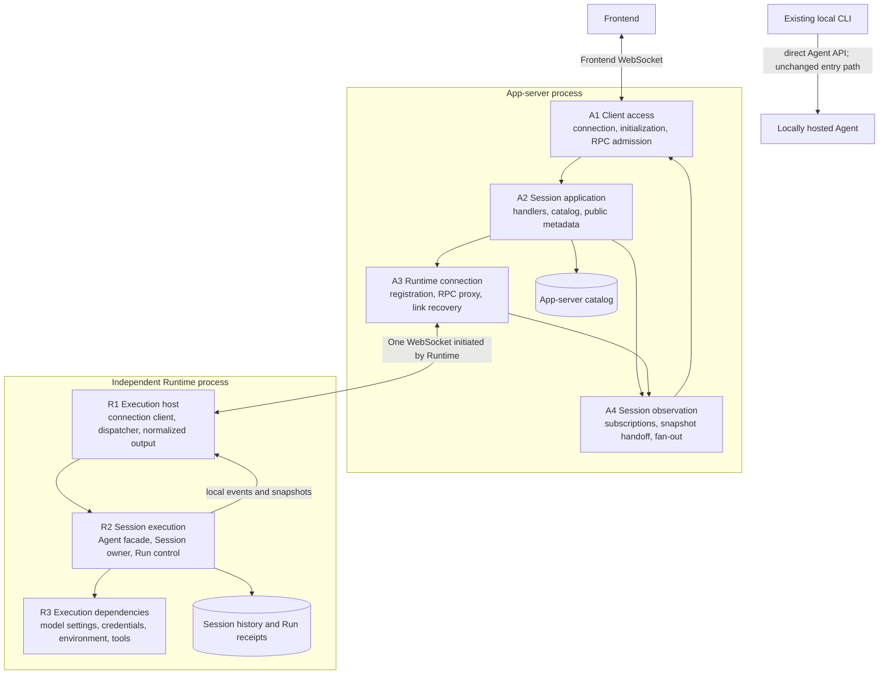
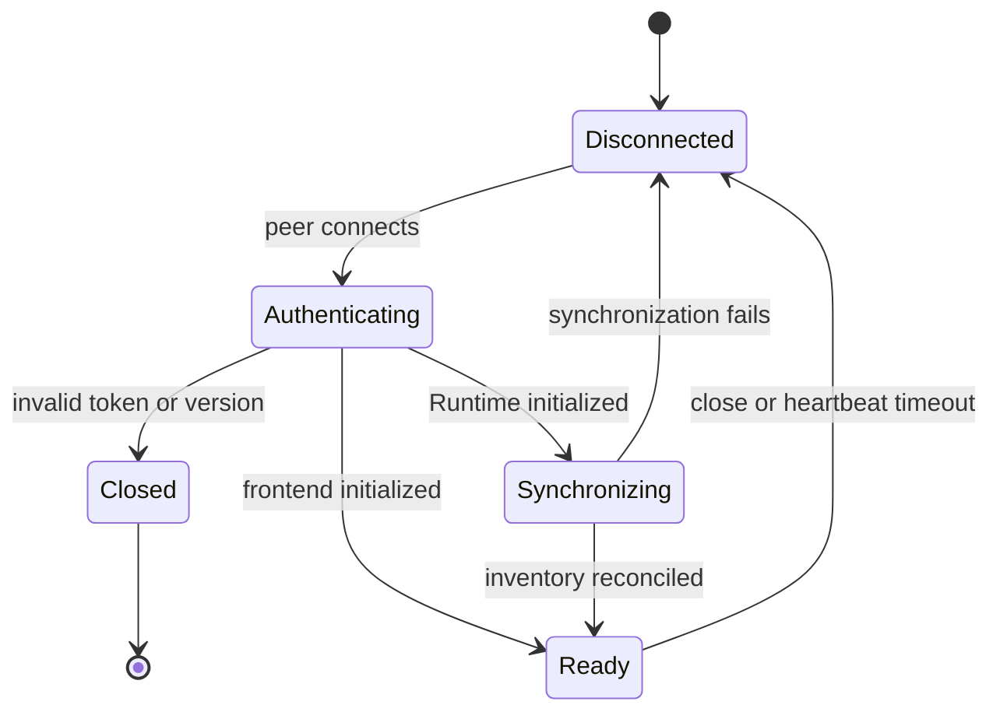
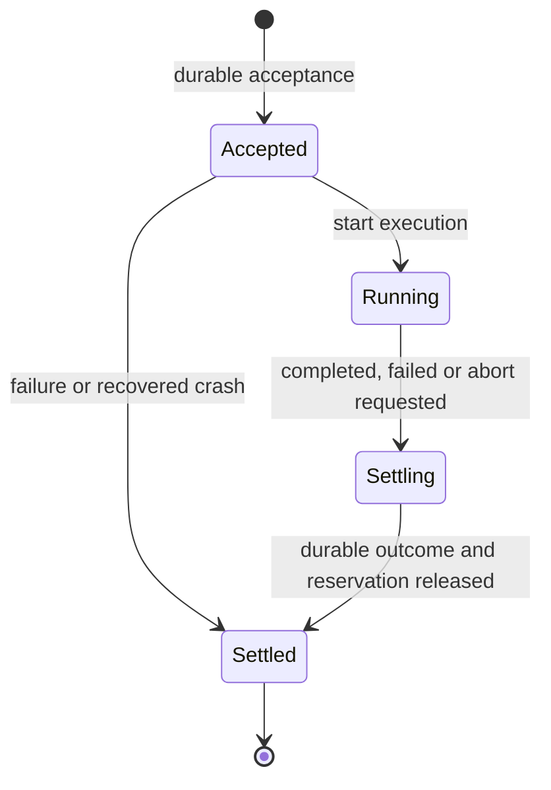
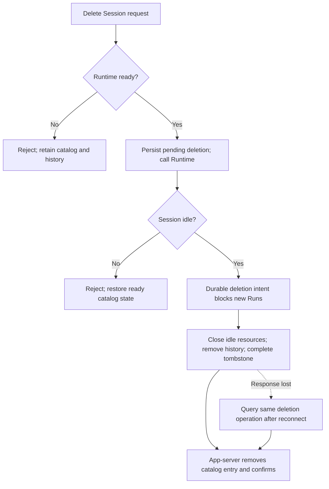

# App-server and Runtime Design

Status: Consolidated first-version development reference, 2026-10-07.
This specifies the target system; the refactor is not implemented.

Read the [Codex comparison](./codex-app-server-comparison.md) for the module,
feature, and scenario differences. The [decision log](./app-server-runtime-split.md)
retains C1–C27 and the inspected source evidence. This document supersedes that
log's earlier interface sketches where details differ.

The [implementation plan](./app-server-implementation/README.md) splits this
design into six ordered execution documents with source maps, work packages,
and acceptance cases. Those documents are planned work; this remains the target
behavior reference until implementation updates the code-coupled documentation.

## 1. Scope and Explicit Defaults

The system serves one user through an app-server and one independently running
LoopIQ Runtime service. Runtime can run on the same machine or a personal
computer elsewhere. Runtime initiates one WebSocket to app-server; every
Session shares it. Each frontend connection uses a separate WebSocket to
app-server. Neither frontend loss nor app-server loss stops a healthy Runtime.

Runtime owns execution, model context, tools, configuration, credentials, and
durable history. App-server owns the public Session catalog, Runtime bindings,
frontend connections, and subscriptions. It does not persist a second transcript.

The first version supports text input, concurrent Sessions, one active Run per
Session, steering, abort, history reads, reconnect recovery, and permanent
Session deletion. Closing a page only removes observation. A busy Session must
be stopped before deletion; project files are retained. Archive is excluded.
Runtime crash recovery marks unfinished Runs interrupted and requires a new
user submission; it never automatically repeats tools or continues the objective.

The following are **engineering defaults selected for a concrete design**,
not claims that the user separately approved each parameter. They can be
changed without moving the app-server/Runtime boundary.

| ID | Default | Reason and scope |
| --- | --- | --- |
| D1 | JSON-RPC 2.0 objects over WebSocket, no batches. | One request/response envelope for both links; notifications carry live updates. This is our protocol, not Codex protocol compatibility. |
| D2 | Public `sessionId` equals the Runtime Session UUID. Persist its `runtimeServiceId` binding. | One Runtime does not need a second chat-ID translation table. Never infer ownership from the socket. |
| D3 | Create with a Runtime-local default directory or an explicit existing absolute directory. Keep cwd fixed after creation. | Frontend may enter the execution-machine path; app-server does not resolve it against its own filesystem. |
| D4 | Allow different Sessions to use the same directory concurrently; no workspace lock or automatic worktree creation. | Preserves current LoopIQ behavior and avoids adding a scheduler. Context is separate; files are shared. |
| D5 | Runtime `maxActiveRuns = 4`, locally configurable. Reject excess new work without a waiting queue. | Bounds aggregate execution while retaining cross-Session concurrency. Accepted, running, and settling Runs occupy slots. |
| D6 | One configured frontend token and a separate Runtime token; authenticate in the initial RPC. | No accounts, enrollment UI, or roles. Public deployment uses WSS; loopback development may use WS. |
| D7 | App-server catalog is one atomically replaced JSON file. Runtime extends its Session JSONL format for durable Run records. | Reuse the current file-based architecture; no shared database or transcript replication. |
| D8 | Keep idle loaded Runtime Sessions until explicit Runtime shutdown or deletion; no subscriber-driven idle-unload timer in v1. | Page lifecycle cannot control execution-resource lifetime. An idle-unload policy can be added independently. |
| D9 | Create and delete require Runtime to be ready; rename and catalog reads work offline. | No offline mutation queue. Rename is app-server-owned metadata. |

Numeric limits below are configurable defaults, not protocol identities.
Feature discovery is complete enough to implement this baseline; optional
enhancements are listed in section 11.

## 2. Processes, Modules, and Dependencies



These are ownership boundaries, not seven new packages or services. A shared
protocol package P defines serializable types and validators for both endpoints.
P imports no provider SDK, `AgentSession`, or concrete store.

| Owner | Responsibilities and principal methods | Owned state |
| --- | --- | --- |
| A1 Client access | Upgrade, authenticate, validate envelope/params, admit work, dispatch responses, close client resources. `initialize`, `dispatch`, `send`, `close`. | `connectionId -> ClientConnection`; per-connection reader/writer queues and short-lived RPC IDs. |
| A2 Session application | Create/list/read/rename/delete Sessions; resolve binding; route Run commands; commit public metadata. | Durable catalog and lifecycle metadata; short per-Session catalog mutation gates. No loaded Agent objects. |
| A3 Runtime connection | Accept one Runtime, authenticate identity, replace stale link, proxy calls, correlate replies, synchronize catalog, report availability. | Current link, `runtimeBootId`, link generation, backend pending-call map. |
| A4 Session observation | Manage frontend-to-Session subscriptions; obtain Runtime snapshots; merge buffered updates; fan out notifications. | Bidirectional subscription indexes; observation generation, recovery buffers, last-known display state. All transient. |
| R1 Execution host | Own independent process lifecycle, initiate/reconnect socket, dispatch remote commands, publish normalized updates and snapshots. | Connection attempt state, RPC dispatcher, nonblocking delivery queue, Session view epochs. |
| R2 Session execution | Enforce single active Run and aggregate capacity; create/reopen; start/deduplicate/query/steer/abort; save history and outcomes. | Loaded Sessions, per-Session guards, execution handles, durable acceptance/settlement records, writer ownership. |
| R3 Execution dependencies | Resolve models and credentials, construct tools/environments, apply configuration, call providers. | Runtime-local configuration, secrets, tool resources, provider state. |

A2 knows a Runtime client port with methods such as `startRun` and `readSnapshot`.
It must not import `createAgent`, construct an execution environment, or parse
provider events. R1 normalizes execution semantics before sending them. A4
formats routing envelopes but does not reconstruct model state from provider data.

Existing implementation anchors: [server bootstrap][server],
[runtime construction][factory], [Agent facade][agent],
[Session execution][session], [store][store], and [current architecture][architecture].
These are migration evidence, not examples of an already deployed remote Runtime.

## 3. Identity, State, and Durable Storage

### 3.1 Identity and domain objects

| Field/object | Meaning | Lifetime |
| --- | --- | --- |
| RPC `id` | One request attempt on one connection. The two links use independent IDs. | Until response, timeout, or connection loss. |
| `runtimeServiceId` | The configured Runtime installation owning Sessions. | Persisted across process restarts. |
| `runtimeBootId` | One Runtime process start. | Changes after a process restart, not a socket reconnect. |
| `connectionId` / link generation | One accepted transport connection. | Changes on reconnect; rejects stale replies. |
| `sessionId` | One durable conversation and its fixed workspace. | Creation through deletion; never reused. |
| `submissionId` | One logical start submission, generated and retained by the frontend. | Survives either link reconnecting and app-server restart. |
| `runId` | One accepted user task, including its provider/tool iterations and steering. | Durable until Session deletion. |
| `itemId` | A display/history item: user input, assistant output, or tool execution/result. | Stable through streaming updates, commit, and history reads. |
| `toolCallId` | Joins a tool request to its result, independently of item ID. | Retained in history. |
| `viewEpoch` / `viewRevision` | One loaded Session view and an increasing revision within it. | May change/reset after reload; not a durable replay cursor. |
| `observationId` | One frontend subscription and snapshot-to-live handoff. | Replaced after reconnect or synchronization failure. |

LoopIQ's internal provider Turn is not a public Codex Turn. Our public `Run`
is the task controlled by start/steer/abort; it may contain several provider
calls. Never map Codex's `turnId` to an internal provider-iteration counter.

```ts
type RunRef = { sessionId: string; runId: string };
type RunIdentity = RunRef & { submissionId: string };
type RunOutcome =
  | { status: "completed" | "aborted" | "interrupted" }
  | { status: "failed"; error: { code: string; message: string } };
type RunView = RunIdentity & (
  | { state: "accepted" | "running" | "settling" }
  | { state: "settled"; outcome: RunOutcome; completedAt: string }
);
type RunLookup =
  | { kind: "known"; run: RunView }
  | { kind: "notAccepted" }
  | { kind: "unknown"; reason: "recordsUnavailable" | "legacyHistory" };
type SessionCatalogEntry = {
  sessionId: string;
  runtimeServiceId: string;
  name: string;
  workspaceDir?: string;
  createdAt: string;
  updatedAt: string;
  lastActivityAt?: string;
  lifecycle: "creating" | "ready" | "deleting" | "missing";
  metadataRevision: number;
};
type HistoryItem = {
  itemId: string;
  revision: number;
  runId: string | null;
  submissionId?: string;
  kind: "userMessage" | "assistantMessage" | "toolCall" | "toolResult";
  toolCallId?: string;
  timestamp: string;
  status?: "inProgress" | "completed" | "failed" | "interrupted";
  content: string;
};
type ResultDetails = {
  terminationReason: "stop" | "outputLimit" | "abort" | "error" | "unknown";
  usage: {
    completeness: "complete" | "partial" | "unavailable";
    inputTokens?: number;
    outputTokens?: number;
  };
};
type RunResultView = {
  run: RunView & { state: "settled" };
  finalItems: HistoryItem[];
  itemIds: string[];
  details: ResultDetails;
};
type SessionSnapshot = {
  sessionId: string;
  viewEpoch: string;
  boundaryRevision: number;
  currentRun: RunView | null;
  runs: RunView[];
  items: HistoryItem[];
  activeItems: HistoryItem[];
  uncommittedInputs: { runId: string; submissionId: string; text: string }[];
};
type SessionUpdate = {
  sessionId: string;
  viewEpoch: string;
  viewRevision: number;
  change:
    | { type: "run/state"; run: RunView }
    | { type: "item/upsert"; item: HistoryItem }
    | { type: "item/textDelta"; itemId: string; baseRevision: number; revision: number; delta: string };
};
```

`content` is display text. Tool arguments/results are represented as text or
serialized JSON text; provider-native objects and authorization headers never
cross this boundary. A tool error remains a tool result, while Run failure is
represented by `RunOutcome`. Result details preserve known termination and
usage information; unavailable information stays explicit rather than becoming
invented zero counts. Report partial usage coverage when not all provider calls,
including compaction, are accounted for.
Historical messages without a reliable task association use `runId: null`.
Item revisions are scoped to their view epoch. `uncommittedInputs` exposes
accepted input whose user message has not yet committed, including a Run
interrupted immediately after acceptance; it does not duplicate committed items.

### 3.2 Storage ownership

| Store | Contents | Excluded contents |
| --- | --- | --- |
| App-server `catalog.json` | Session bindings, names, timestamps, metadata revisions, create/delete reconciliation state. | Prompts, tool results, model context, credentials, durable deltas. |
| Runtime identity/configuration files | Stable service identity, app-server URL, connection secret, local model/tool settings and credentials. | Frontend subscriptions. |
| Runtime `sessions/<id>/session.jsonl` | Existing messages/configuration/compaction plus new Run acceptance and settlement records and stable output associations. | A replay journal of every token/progress update. |
| Runtime deletion ledger | Session ID, deletion operation ID, cleanup status/timestamp. No transcript. | Reusable Session IDs or saved copies of deleted messages. |
| Frontend pending-submission store | Session ID, submission ID, original text, and unresolved state for that user's pending input. | An app-server history replica. |

App-server serializes catalog writes, writes a temporary file, fsyncs it,
renames it atomically, and syncs the containing directory before acknowledging
metadata changes. Runtime uses a single writer per Session and durable append
for acceptance and settlement. Existing `appendFile` success is not by itself
the specified durability boundary; the file abstraction must expose flush/fsync.

Add a versioned Session format that reads existing files. A v2 header declares
the format; migration uses an atomic file replacement and preserves old entries
and IDs. Older logs do not gain invented Run histories. Current-source CLI
entry points continue to work with the upgraded shared library; compatibility
with an older separately installed binary reading v2 files is not promised.

Under exclusive writer ownership, v2 recovery may discard an incomplete final
JSONL line left by a torn append. A malformed complete record or corruption
inside the log fails recovery; do not silently skip it. The v2 header establishes
the submission-record namespace: new v2 submissions can have definitive absence,
while a legacy Run without lifecycle records remains unknown.

New records are `run_accepted` and `run_settled`. `run_accepted` contains
`submissionId`, reserved `runId`, boot ID, immutable submitted text, input
fingerprint, and acceptance time. Message records created during execution
carry `runId`; the initial user item also carries `submissionId`. Acceptance
records are not injected into model context as extra messages. The frontend
replaces its pending input bubble with the committed user item by submission ID.
`run_settled` includes the final outcome, completion time, final assistant item
IDs, output item references, and result details, so `run/result` remains usable
without a live execution handle. A terminal record is immutable; crash recovery
only appends interruption for an accepted Run lacking a terminal record.

Keep accepted submission mappings and terminal records for the Session's
lifetime. Deletion removes them and leaves a small deletion tombstone; requests
for a deleted Session fail with `SESSION_DELETED`. A duplicate cannot recreate
that Session. Do not garbage-collect these tombstones in v1.

### 3.3 Catalog synchronization and metadata authority

Runtime is authoritative for Session existence, cwd, execution status, and
history. App-server is authoritative for display names and frontend-specific
metadata. Rename only changes app-server's catalog, so it works offline and
does not change the prompt or model context. Direct CLI consumers need not
show that app-server title in v1.

After Runtime initializes, app-server calls `runtime/inventory`. The response
includes Session metadata and deletion tombstones, not conversation text.
Merge by Session ID: preserve app-server names, insert newly discovered Sessions
with a default title, complete confirmed deletions, and mark unexplained missing
Sessions `missing`. Do not silently discard metadata on a failed/incomplete scan.
The link is ready for new execution only after a successful inventory merge.
Direct CLI-created Sessions are discovered by inventory; v1 does not mirror
the CLI's live event stream. A Session with another live writer remains
unavailable to the execution host until that writer releases its lease.

Catalog revision is app-server-owned and increases on a committed change.
`updatedAt` dates that catalog change; `lastActivityAt` is Runtime-reported
execution metadata. Neither timestamp replaces view revisions for ordering.
`catalog/changed` tells authenticated frontends to refresh; it does not broadcast
transcripts or subscribe a client to every Session. Runtime status is current
only while the link is ready; cached execution state is labeled last-known.

## 4. Connections, Protocol, and Admission

### 4.1 Connection lifecycle

Frontend connects to `/ws/client`; Runtime connects to `/ws/runtime`. Each first
sends `connection/initialize`, with protocol version and its endpoint-specific
token. Runtime additionally supplies stable service ID and fresh boot ID.
App-server checks the configured Runtime identity; possession of a different
identity does not transfer existing Session bindings. Tokens are not URL
parameters and must be redacted in logs.



Initialization has one success response and no second `initialized` notification.
For a Runtime connection, that response accepts identity; `runtime/status`
subsequently reports `ready` after inventory reconciliation. Reject ordinary
execution commands before readiness. Response handling and initialization/control
messages always bypass Session mutation queues.

The accepting server sends WebSocket Ping every 15 seconds and closes a link
with no matching Pong for 45 seconds. Browser WebSocket implementations answer
control Ping automatically; frontend JavaScript need not implement a business
`ping` method. Reconnect uses jittered backoff from 1 to 15 seconds. Reset the
backoff after a stable ready period. All intervals are configurable.

Only one accepted execution link exists. A reconnect from the same boot replaces
the older socket and invalidates its pending RPCs. A different boot is admitted
after the old link is closed/stale; while a different boot remains live, reject
the newcomer. The execution host holds a host-service lock to exclude a second
host for the same Agent Home. Separate per-Session writer leases continue to
exclude simultaneous host/CLI writers of the same Session; the host-service
lock does not turn all direct CLI use into remote use. No active-active
execution, leader election, or Runtime selection UI.

### 4.2 Message envelope and request correlation

```json
{
  "jsonrpc": "2.0",
  "id": "client-17",
  "method": "run/start",
  "params": {
    "sessionId": "session-1",
    "submissionId": "submission-1",
    "input": { "text": "Fix the failing tests." }
  }
}
```

```json
{
  "jsonrpc": "2.0",
  "id": "client-17",
  "result": {
    "sessionId": "session-1",
    "submissionId": "submission-1",
    "runId": "run-1"
  }
}
```

IDs above are readable example values; generated domain IDs are UUIDs. The
backend attempt might use RPC ID `runtime-42`. A3 maps that attempt to
`(clientConnectionId, clientRpcId)` while forwarding the same submission ID.
That pending-call map is transient; Runtime's durable acceptance record is
what makes recovery possible after the map disappears.

A notification has `method` and `params` without `id`. Exactly one response
object, either `result` or `error`, is generated per accepted RPC attempt;
transport failure can prevent delivery. No response is required for a
notification. Domain events and task completion are independent of the start
response and may arrive earlier.

### 4.3 Ordering and queue limits

A1 validates authentication, protocol version, method schema, and server
admission state. A2 resolves catalog ownership. A3 requires a ready Runtime
for remote work. R2 validates the actual Session/Run, directory, execution
capacity, and tool/configuration policy. App-server checks improve feedback;
Runtime checks remain authoritative despite races.

Use short per-Session mutation gates and asynchronous handler tasks. A gate
covers validation/reservation and durable state transitions, never model/tool
execution or waiting for an abort result. Process RPC responses independently
of handlers awaiting them. Different Sessions can make progress concurrently.

Each endpoint has a method allowlist; initialization cannot promote a frontend
to a Runtime connection. Closing a connection discards its queued operations
that have not begun admission. Work already accepted by Runtime continues.
Replace-link checks invalidate obsolete RPC responses and queued commands;
the submission ledger resolves uncertainty about work admitted before closure.

| Limit | Initial value | Failure behavior |
| --- | --- | --- |
| Initialization deadline | 10 seconds | Close unauthenticated connection. |
| Ordinary RPC timeout | 30 seconds | Stop waiting; mutation outcome may be unknown. Do not cancel execution implicitly. |
| Text input | 64 KiB UTF-8 | Reject before acceptance with `INPUT_TOO_LARGE`. |
| JSON message / full snapshot | 32 MiB / 16 MiB encoded JSON | Reject oversized messages; return `SNAPSHOT_TOO_LARGE` rather than truncate history. |
| Writer queue per connection | 256 messages or 32 MiB, whichever comes first | Close the slow connection and require synchronization. |
| Recovering observation buffer | 2,048 updates or 8 MiB | Invalidate observation and request a fresh snapshot. |
| Snapshot-install deadline | 30 seconds | Invalidate observation; never pause the Run waiting for the frontend. |

R1 updates local state and commits required history independently of socket
writes. Delivery is a bounded handoff. Backend queue overflow closes the link
and recovers from state later; it cannot stall tools or create an unbounded
outage buffer. Frontend overflow affects that observer, not other clients.
While the execution link is down, Runtime updates local state/history and skips
network enqueueing. Reconnection obtains a fresh view; it does not drain an
accumulated queue of all outage events.

## 5. Operations and Success Semantics

Wire names use slashes; client-port names may use `startRun`, `steerRun`,
`abortRun`, and `readRun`. Runtime commands are addressed through the binding
and never through a frontend-supplied server URL.

| Frontend method | Key parameters | Success meaning and owning work |
| --- | --- | --- |
| `connection/initialize` | Version, token | A1 has accepted the frontend connection. |
| `runtime/read` | None | A3 reports configured service identity and connection availability. |
| `session/list` | None | A2 returns the persisted public catalog, including offline/missing indicators. |
| `session/create` | Client-generated `sessionId`, optional absolute cwd and display name | Runtime created the durable Session; app-server committed its ready catalog entry. Does not start a Run or subscribe implicitly. |
| `session/read` | `sessionId` | Public metadata and availability. Does not open execution resources. |
| `session/rename` | `sessionId`, name | App-server durably saved a nonempty trimmed name and advanced metadata revision. |
| `session/observe` | `sessionId` | A recovering subscription exists and its Runtime snapshot is returned. The client must install it and send `session/ready`. |
| `session/ready` | `observationId`, epoch and snapshot boundary | A4 accepted the installed snapshot and queues later updates before switching to live delivery. |
| `session/unobserve` | `observationId` | This observation was removed; it neither stops execution nor deletes history. Repetition succeeds. |
| `session/delete` | `sessionId`, stable `operationId` | Runtime history removal completed and app-server catalog removal committed. Reject busy Sessions; preserve project files. |
| `session/delete/read` | `sessionId`, `operationId` | Runtime reports `notStarted`, `deleting`, or `deleted` from authoritative deletion state; unavailable knowledge is an error, not `notStarted`. |
| `run/start` | `sessionId`, `submissionId`, text | Runtime durably accepted or recognized this same submission and returns its Run identity. Completion is separate. |
| `run/read` | Session plus either Run ID or submission ID | Runtime returns known state, definitive not-accepted, or explicitly insufficient knowledge. |
| `run/steer` | Exact Session/Run ID, text, optional `interruptCurrentInference` | Additional input entered the active Run's steering queue; not a promise of model consumption or durable queue recovery. |
| `run/abort` | Exact Session/Run ID | The targeted Run has settled and released its reservation. Return the actual outcome, including normal completion if it won the race. |
| `run/result` | Session/Run ID | Returns `RunResultView`: retained terminal outcome, final assistant items, result details, and all output item IDs. A nonterminal Run returns `RUN_NOT_SETTLED`. |

Backend methods include `runtime/inventory`, `session/create`,
`session/readSnapshot`, `session/delete`, `session/delete/read`, and the Run operations above. Backend
`session/create` does not receive the app-server display name. There is no
backend rename call in D9. Frontend `session/observe` is A4's orchestration of
the backend snapshot operation, not a second subscription inside Core.

R1 publishes normalized `session/update` events for loaded Sessions over the
one execution link, whether or not a frontend currently subscribes. A4 routes
them only to appropriate observers. Runtime-local listeners remain installed
while the backend link is down so the current view stays correct. This makes
frontend subscription lifetime independent of Runtime event production.

### 5.1 Creation and deletion consistency

For create, check Runtime readiness, durably write a `creating` catalog row,
then call Runtime with the supplied Session UUID. Runtime stores the immutable
creation parameters/fingerprint with the Session. Repeating the same ID and
parameters returns the same Session; different parameters conflict. After the
reply, A2 writes `ready` and returns success. Lost replies leave reconciliation
work, not permission to create a new UUID automatically. An inventory entry
completes a matching pending create; definitive absence allows manual retry.

For delete, A2 records `deleting` and forwards the operation ID. Under its
Session gate, Runtime rejects an active Run before writing a deletion intent.
Once it writes a durable deletion intent, it admits no new work for that
Session, closes idle resources, removes history, and marks the tombstone
complete. Interrupted cleanup resumes on Runtime startup. Only completed
tombstones permit A2 to remove the catalog entry and report success. A busy
rejection restores the catalog row to ready. A lost reply is queried by
operation ID; a user retry reuses that ID. Runtime offline means no new delete
attempt, and pending deletion remains visible until reconciled.

Inventory reconciliation must not downgrade pending deletion to an ordinary
ready Session without a definitive operation outcome. No filesystem operation
in this flow recursively removes the Session's workspace directory.

### 5.2 Errors

Use JSON-RPC parse/invalid-request/method-not-found/invalid-params errors for
protocol failures. Business errors use `-32000` and an `error.data.reason`
string from the table. The caller's delivery classification is separate:
`rejected`, `uncertain`, or `confirmed`.

| Reason | Meaning / caller action |
| --- | --- |
| `NOT_INITIALIZED`, `UNAUTHORIZED`, `VERSION_UNSUPPORTED` | Establish an allowed connection before using application methods. |
| `RUNTIME_ALREADY_CONNECTED` | A different live Runtime boot owns the configured service connection; do not replace it as if it were the same process. |
| `RUNTIME_OFFLINE`, `RUNTIME_SYNCING` | This new attempt was not forwarded. It says nothing about an earlier attempt with the same submission ID. |
| `SESSION_BUSY`, `CAPACITY_EXCEEDED` | Runtime rejected new work before durable acceptance. No queue was created. |
| `STALE_RUN` | Control request targets a different Run from the active one. Never retarget silently. |
| `RUN_NOT_SETTLED` | The requested final result does not yet exist; use `run/read` or observation. |
| `SUBMISSION_CONFLICT` | Submission ID is already bound to different input. |
| `CREATION_CONFLICT`, `CONFIGURATION_INVALID` | Creation ID has different immutable parameters, or Runtime cannot resolve valid local execution settings. |
| `SESSION_NOT_FOUND`, `SESSION_DELETED`, `WORKSPACE_INVALID` | Correct the target or environment; do not create a replacement implicitly. |
| `SESSION_LOCKED` | Another live writer, such as a direct CLI Session, owns this history. Do not claim control of its active task. |
| `STORAGE_UNAVAILABLE`, `RECOVERY_REQUIRED` | Runtime cannot establish safe authoritative state; do not guess a terminal outcome or retry execution automatically. |
| `SNAPSHOT_TOO_LARGE`, `INPUT_TOO_LARGE` | Explicit supported-size boundary; no silent truncation. |
| `OBSERVATION_EXPIRED` | Reattach with a new snapshot and observation ID. |
| `INTERACTION_UNSUPPORTED` | Runtime-local tool policy required an interaction excluded from v1; do not implicitly approve it. |

Transport loss and RPC timeout are local uncertain outcomes, not fabricated
Runtime business rejections. A3 must not translate them into `SESSION_BUSY`,
`failed`, or `aborted`.

## 6. Run Acceptance and Lost Acknowledgments

### 6.1 Atomic acceptance

The frontend saves the Session ID, submission ID, and original input before
sending. Runtime handles a start in this order:

1. Under the Session gate, look up the submission before checking busy state.
   An existing equal input returns its original Run even if another Run is now
   active or aggregate capacity is full. Different input returns conflict.
2. For a new ID, validate input/configuration, reject a deleted/busy Session,
   and reserve one aggregate execution slot. Session gate then capacity guard
   is the consistent lock order; no path waits for a Session while holding the
   capacity guard.
3. Allocate `runId`; append and fsync `run_accepted` before launching execution.
   A failed/ambiguous durable write blocks that Session for reconciliation;
   it must not be reported as definitive non-acceptance.
4. Install the active reservation, schedule the Run, and return identity without
   awaiting completion. Execution/events may happen before the reply arrives.

The existing [startRun][session] allocates an ID and starts work in memory.
Implementation must add this durable reservation boundary inside the Session
owner, not merely wrap the current call with a receipt written afterward.

### 6.2 Queries and retries

```mermaid
sequenceDiagram
    participant UI as Frontend
    participant APP as App-server
    participant RT as Runtime
    UI->>UI: Persist pending submission S1
    UI->>APP: run/start, RPC C1, submission S1
    APP->>RT: run/start, RPC B1, submission S1
    RT->>RT: Persist S1 to R1; begin execution
    RT--xAPP: Acceptance response lost
    Note over UI: Display Confirming submission
    UI->>APP: run/read by S1 after reconnect
    APP->>RT: Query S1
    RT-->>APP: Known R1 and current state
    APP-->>UI: Restore existing R1
    Note over UI,RT: No new execution submission
```

`notAccepted` is permitted only for a submission lookup in a complete,
authoritative retained namespace, serialized with acceptance. An absent Run ID
or an unavailable/corrupt/legacy ledger is insufficient; return `unknown` or a
storage error. A delayed original request can arrive after a negative query,
so a manual retry always reuses the same submission ID and immutable input.

| Query result | Frontend behavior |
| --- | --- |
| Known accepted/running/settling Run | Attach observation to that Run. |
| Known settled Run | Display its actual outcome and recorded output. |
| Definitively not accepted | Offer manual retry with the same submission ID and input; use a new RPC ID. |
| Runtime unreachable or knowledge insufficient | Keep Confirming submission / status unknown; retry queries after reconnection. |
| Known interrupted Run | Offer an explicit new Run with a new submission ID, under crash policy. |

Accepted mappings remain for the Session's lifetime. This is durable submission
deduplication, not exactly-once tool effects. No automatic execution resend,
including after app-server restart. Lost steering acknowledgments remain
uncertain; v1 does not automatically retry steering because its queue has no
equivalent durable deduplication contract.

### 6.3 Settlement and stopping



After model/tool work finishes, Runtime flushes committed messages and pending
Session state, completes execution cleanup, durably records the outcome, and
releases the active reservation under Session ordering. Only then expose
`state: settled`, resolve remote abort waiters, and publish final settlement.
This is later than the existing internal `run_settled` callback, which currently
precedes handle release. Do not rename that callback into the public guarantee.

An outcome-persistence failure marks the Session storage-faulted and blocks new
Runs until recovery; it cannot announce durable success. Known terminal records
survive a crash; any nonterminal accepted record from a lost boot becomes
interrupted. A process crash after acceptance but before model execution still
produces an interrupted accepted Run, without automatic rescheduling.

`run/abort` signals the exact active Run and waits outside the gate for settled
state. Multiple abort waiters may observe the same result. A query/abort for an
already settled known Run returns its retained outcome; it does not target a
newer Run. An RPC timeout detaches that waiter but does not reverse the abort.

## 7. Observation and Reconnect Recovery

Runtime owns the canonical active item view, Run state, and history boundary.
R1 translates local events into updates with Session ID, view epoch, and
increasing revision. The same item keeps its ID while streaming and when saved.
App-server keeps only the transient state required to serve observers.

Update payloads are `run/state`, `item/upsert`, or `item/textDelta`. A delta
identifies its item and base item revision; applying it requires the matching
base content. A complete upsert replaces older content for the same item.
Final items are durable before their committed update is published. Missing
revisions, a changed view epoch, or an unknown delta base require resynchronization.

### 7.1 Snapshot-to-live handoff

```mermaid
sequenceDiagram
    participant UI as Frontend
    participant OBS as App-server observation
    participant RT as Runtime
    UI->>OBS: session/observe
    OBS->>OBS: Register recovering observation; buffer Session updates
    OBS->>RT: session/readSnapshot
    RT->>RT: Capture view W and committed history boundary under Session ordering
    Note over RT: Execution continues; read bounded history outside the gate
    RT-->>OBS: Snapshot at W, including active item content
    OBS-->>UI: Snapshot, epoch, W, observation ID
    UI->>UI: Install history and current view
    UI->>OBS: session/ready with same observation ID, epoch and W
    OBS->>OBS: Discard buffered updates through W
    OBS-->>UI: Flush updates after W, then continue live output
```

The Runtime snapshot captures an immutable view and a committed log boundary
in the same short ordering operation used for view updates. Read only history
through that boundary. An existing whole-file reader must be adapted to respect
the boundary; calling a normal mutable history read afterward is insufficient.
Loading an idle Session can happen before capture. It does not start a Run.
The history reader returns recorded display messages, including older messages
retained behind compaction, rather than the compacted model-context array.

A4 registers buffering before requesting the snapshot. Backend messages are
processed in received order; a replaced link invalidates every associated
recovery attempt. Within one observation, A4 flushes buffered updates before
switching to live mode, so newer events cannot overtake the flush. Include
`observationId` on every frontend update and reject obsolete observations.

If epoch changes during recovery, buffering overflows, or the install deadline
expires, discard that attempt and start a new snapshot. Never continue with
missing deltas. A completion racing the snapshot is either included at W or
arrives as an update after W. Installing a snapshot never resubmits work.

### 7.2 Three different failures

| Failure | Lost state | Recovery |
| --- | --- | --- |
| Frontend connection lost | That connection's RPC waiters and observations. | New initialization, query pending submissions, new Session observations. Runtime continues. |
| Backend connection or app-server process lost | Backend pending calls, app-server transient views/subscriptions; catalog survives process loss. | Runtime reconnects; reconcile inventory; read current state/history for clients. Runtime continues independently. |
| Runtime process lost | Live execution stack, streaming provider state, transient steering queue and active partial items. | Reacquire execution ownership, restore durable records, preserve terminals, mark unfinished accepted Runs interrupted, wait for a new user Run. |

All saved messages/tool results remain Runtime-owned. Recovery restores recorded
items and final state, not every missed token delta. If a healthy Runtime is
still streaming, include accumulated active text before applying suffix deltas.
After a Runtime crash, partial text not committed to history may be absent.

The baseline reads a whole snapshot within the declared 16 MiB bound. Oversize
history returns an explicit error and leaves the conversation saved; it is not
silently cut down. `run/read` still reports latest status; `run/result` can
return final assistant items without loading the full conversation. Result
responses have the same explicit 16 MiB bound. Arbitrarily large history/content
access is optional O1, not a claim of unbounded first-version recovery. No SQL
index or cursor API is required.

### 7.3 Runtime process ownership and crash cleanup

The process supervisor must not tie Runtime shutdown to app-server exit.
Runtime owns managed tool subprocess groups and records enough ownership to
identify leftovers. On startup, establish exclusive Runtime/Session ownership
before accepting work. Current stale `runtime.lock` files require a recovery
path: verify the previous owner is dead and reacquire atomically; never remove
a live writer's lease. PID alone is insufficient proof across PID reuse. Store
process-start identity with new leases; ambiguous legacy leases require local
cleanup rather than automatic removal.

If subprocess ownership or Session storage cannot be reconciled, return
`RECOVERY_REQUIRED` for that Session and require local operator cleanup.
Do not rerun tools or assume files were rolled back. A platform-specific
supervisor/locking implementation must prove these properties in crash tests;
there is no distributed lock service in this design.

## 8. Scenario Flows

### 8.1 Create and run

```mermaid
sequenceDiagram
    participant UI as Frontend
    participant APP as App-server
    participant RT as Runtime
    UI->>APP: session/create with stable Session ID and cwd
    APP->>APP: Persist creating row and display name
    APP->>RT: Create Session with same ID and cwd
    RT->>RT: Validate local directory/config; persist Session
    RT-->>APP: Actual cwd and effective nonsecret settings
    APP->>APP: Commit ready catalog row
    APP-->>UI: Session created
    UI->>APP: session/observe then session/ready
    UI->>APP: run/start with stable submission ID
    APP->>RT: startRun
    RT->>RT: Deduplicate and durably reserve Run
    RT-->>APP: Run identity
    APP-->>UI: Accepted
    RT-->>APP: Normalized updates during execution
    APP-->>UI: Updates for this observation
```

Creation has no implicit model call. If Runtime lacks a valid default model,
creation fails with a configuration error; v1 fixes it locally. A2 stores
actual Runtime-reported cwd rather than treating the frontend string as an
already validated execution directory.

### 8.2 Steer and stop

```mermaid
sequenceDiagram
    participant UI as Frontend
    participant APP as App-server
    participant RT as Runtime Session owner
    UI->>APP: run/steer for Session S, Run R
    APP->>RT: steerRun(S, R, text)
    RT->>RT: Validate current R and enqueue input
    RT-->>APP: Accepted into steering queue
    APP-->>UI: Steering accepted
    UI->>APP: run/abort for the same R
    APP->>RT: abortRun(S, R)
    RT->>RT: Signal cancellation; wait outside Session gate
    Note over APP: Connection dispatcher and other Sessions remain usable
    RT->>RT: Settle, persist outcome and release reservation
    RT-->>APP: Actual terminal outcome
    APP-->>UI: Abort response
    RT-->>APP: Terminal update, independently routed
    APP-->>UI: Final view for every observer of S
```

Normal completion may beat abort. The response reports the actual outcome;
it never promises an aborted outcome merely because cancellation was requested.
Terminal events may precede the RPC response. Frontends merge by identity and
revision instead of assuming the diagram is a total order across tasks.

### 8.3 Delete



Project directories and files are outside this cleanup scope. Closing a
browser tab never enters this flow.

## 9. Implementation Placement and Migration

Use feature-owned folders and keep the existing public Agent facade as the
execution boundary. The following layout is a target, not existing files:

| Placement | Changes |
| --- | --- |
| `packages/server/src/client-access/` | WebSocket endpoints, authentication and RPC admission. |
| `packages/server/src/sessions/` | Session application handlers and catalog storage. |
| `packages/server/src/execution-connection/` | The one Runtime connection, correlation and reconnection reconciliation. |
| `packages/server/src/session-observation/` | Frontend subscriptions and snapshot/live handoff. |
| `packages/execution-host/` | Independent executable hosting `Agent`; Runtime connection client and protocol adapter. |
| `packages/app-protocol/` | Dependency-leaf wire types, validators, error and event schemas. |
| Existing `packages/agent/src/session/` | Submission-aware durable acceptance, history/result queries, terminal persistence, crash recovery. |
| Existing `packages/agent/src/model/` and `configuration/` | Retain execution settings/credentials and model ownership. |
| Existing `packages/devui/public/` | Replace REST/SSE operations with the frontend RPC client, pending-submission recovery and observation logic. |

Do not export `AgentSession` or move engine internals into app-server.
Add submission-aware commands/queries through the Agent facade while retaining
the CLI's existing direct `run`/`steer`/`abort` entry points. Shared storage and
lifecycle improvements may change their internals; no CLI transport migration.
`packages/ai` remains read-only. The execution host depends on the facade and
P; app-server depends on P and its Runtime port, not on the concrete Agent.

Implement in this order:

1. Add v2 durable Run records, query APIs, atomic admission, settlement ordering,
   and crash recovery inside the Session owner. Keep current execution tests.
2. Build the independent host and typed remote protocol with one authenticated
   link, readiness and inventory reconciliation. Verify process separation.
3. Replace server-owned Agent construction with A2/A3; add catalog persistence
   and create/delete reconciliation. Runtime must survive server restart.
4. Add normalized output and atomic snapshot capture in Runtime, then A4's
   observation handoff and bounded delivery. Verify reconnect races.
5. Migrate DevUI to WebSocket and pending-submission storage. Remove obsolete
   frontend REST/SSE paths only after equivalent flows pass. Static assets and
   HTTP health endpoints remain ordinary HTTP.
6. Document old HTTP endpoints as unsupported in the new mode. The separate
   `devui-control` HTTP client is not covered by CLI compatibility; migrating
   that tool is optional, and the new server must report the change clearly.

When implementation begins, update `docs/architect.md` and its code-coupled
Session/runtime/storage documents alongside code. This proposal-only change
does not relabel the current REST/SSE implementation as migrated.

## 10. Acceptance Criteria

Use fake providers and temporary directories. No real paid model calls are
needed to prove transport, durability, or lifecycle behavior.

| Scenario | Required observation |
| --- | --- |
| Same-host and remote-host deployment | Same wire contract and ownership; only configured address/path differ. |
| Concurrent Sessions, including the same cwd | Different Sessions progress concurrently; fifth active Run hits the default capacity cap. Same-directory files are shared. |
| Two starts on one Session | One new submission accepted; distinct second submission busy; equal duplicate returns original Run. |
| Lost response on either link | Reconnect by original submission ID recovers exactly the accepted Run, without another model/tool start. |
| Negative lookup races delayed original | Manual same-ID retry and delayed original converge to one accepted Run. |
| Changed input under an accepted ID | Conflict; original Run unchanged. |
| App-server SIGKILL while tools execute | Runtime continues; restarted app-server recovers catalog and final output. |
| Runtime SIGKILL before/after acceptance and before/after settlement persistence | No unrecorded execution starts; known terminals preserved; accepted nonterminals interrupted; no automatic replay. |
| Completion between snapshot capture and frontend readiness | Terminal appears in snapshot or buffered updates, with no gap or duplicate item. |
| Active text during recovery | Full base restored before suffix delta; epoch/base mismatch forces fresh snapshot. |
| Slow frontend or backend delivery | Buffers remain bounded; healthy execution continues; observation/link recovers explicitly. |
| Page close and explicit stop | Page close preserves Run; abort targets exact Run and returns actual settled outcome. |
| Lost steering response | UI retains uncertainty; no automatic duplicate steering input. |
| Busy, offline, and interrupted deletion | Busy/offline rejects new delete; durable delete intent resumes cleanup; catalog disappears only after confirmed history removal. |
| Session deleted then delayed Run retry arrives | `SESSION_DELETED`, no Session recreation or tool invocation. |
| Inventory failure or missing Session | Preserve catalog evidence; do not infer successful deletion. |
| Old history and large snapshot | Existing history readable without invented Run IDs; oversize is explicit, never silent data loss. |
| Existing local CLI | Direct-host behavior, machine output, completion ordering, and current tests continue to pass. |

Protocol schemas, process-level failure tests, and persistence fault injection
are release checks. A diagram or in-process test alone does not establish the
cross-process guarantees above.

## 11. Optional Features and Deliberate Limits

| Feature | Status |
| --- | --- |
| O1 large-Session pagination / indexed history / large-item loading | [Separate optional design](./optional-session-history-pagination.md). Baseline has explicit full-snapshot size limits. |
| O2 frontend editing of models, keys and tools | Desired, low priority. Runtime remains owner and applies changes. |
| O3 image/file attachment input | Excluded from v1. Runtime filesystem tools still work. |
| O4 interactive tool approval | Excluded from v1; local tool policy decides allowed operations, otherwise return unsupported/denied. |
| O5 Runtime-initiated structured user questions | Excluded from v1. Normal text replies and user-initiated steering remain available. |
| Archive, forks, shared-history deletion graphs | Excluded from v1. |
| Multiple Runtime instances or implementations | Deferred. No scheduling registry or Codex SDK adapter. |
| Runtime migration between machines, automatic worktrees, directory reservations | Deferred. Existing binding is never silently reassigned. |
| Durable token-event replay, automatic mutation retries, execution checkpoint restore | Excluded. Recover recorded state/results and let the user decide new execution. |

The design adds two failure-independent processes, not a distributed agent
scheduler. Its essential new guarantees are stable execution ownership,
durable submission identity, and a consistent transition from saved state to
live observation.

[server]: ../../packages/server/src/server.ts
[factory]: ../../packages/server/src/runtime-factory.ts
[agent]: ../../packages/agent/src/agent.ts
[session]: ../../packages/agent/src/session/agent-session.ts
[store]: ../../packages/agent/src/session/storage/jsonl-session-store.ts
[architecture]: ../architect.md
