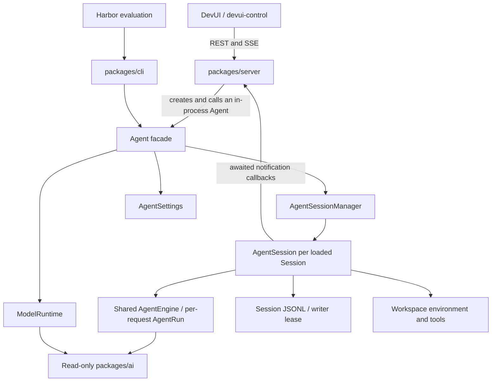
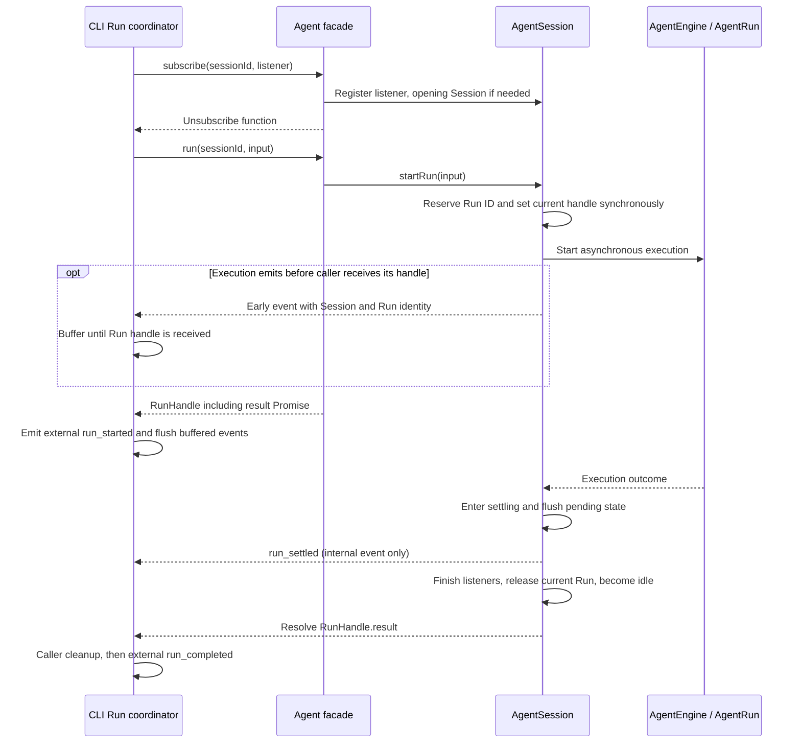
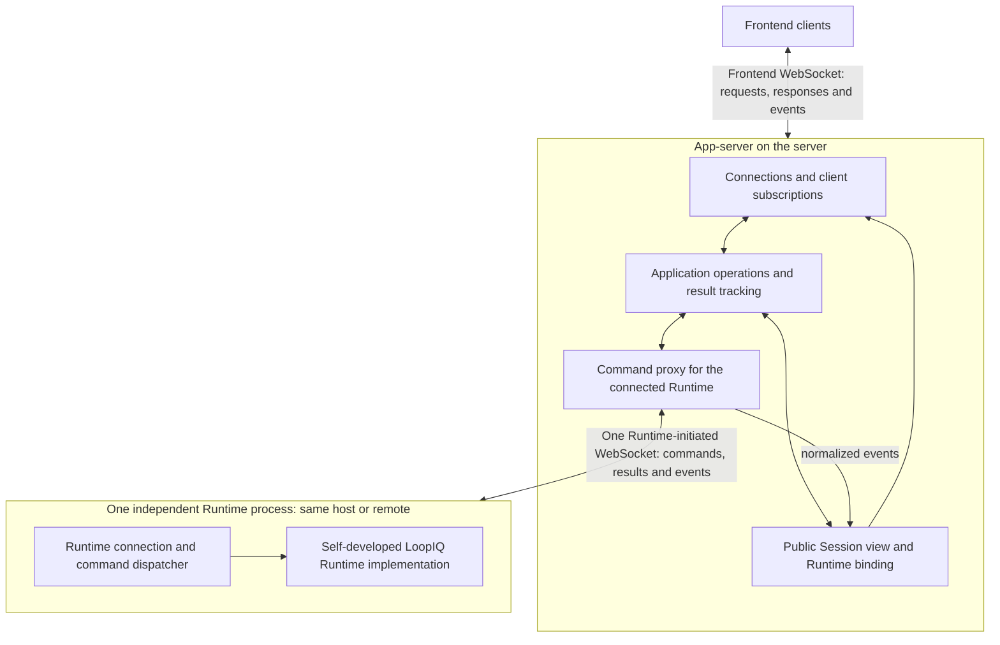

# App-server and Agent Runtime Separation

Status: Decision and research log. The consolidated development reference is
[App-server and Runtime Design](./app-server-runtime-design.md), with a
[module, feature, and flow comparison against Codex](./codex-app-server-comparison.md).
Earlier candidate sections below preserve the discovery reasoning. Use the
consolidated design for implementation defaults and final contract choices;
none of these documents claims that the refactor is already implemented.

Source baseline: `43f8e3194b627de1d1d640183a0a20f349e26bc7`, inspected on
2026-10-07. The checkout was clean before this document was added. Source
observations below describe that revision; proposed ownership is separate.

## Purpose

Refactor LoopIQ into an app-server and an independently deployable Agent
Runtime. The first version uses the self-developed LoopIQ Runtime and connects
one Runtime service instance. Multiple implementations and multiple service
instances are deferred. Use the existing execution behavior to inform the
contract, and decide first-version functionality with the user before fixing
the complete API or migration plan.

The current change covers app-server, its frontend, and the independently
hosted Runtime. The CLI continues to run Runtime locally; CLI adaptation and
remote-CLI support are outside this change (C21).

The earlier Codex study supplies design examples, not a requirement to copy its
seven teaching modules, JSON-RPC protocol, or lifecycle policies.

## Confirmed Requirements

| ID | User decision | Consequence |
| --- | --- | --- |
| C1 | The first version is single-user. | Multi-user ownership and collaborative authorization are not required by the current brief. C25 keeps connection authentication minimal. |
| C2 | The app-server runs on a server. | Its lifecycle and resources must be distinct from a frontend window. |
| C3 | The execution machine may be the app-server host or another machine. | The execution boundary must support remote communication; same-host deployment must not require business logic to change. |
| C4 | The first version manages one execution machine. | Multi-machine scheduling is outside this version. C14 separately permits concurrency across Sessions on that machine. |
| C5 | Use one Runtime implementation in the first version; defer support for multiple implementations. | The earlier requirement to support both LoopIQ and a Codex-SDK-based Runtime is deferred. Define the execution boundary around LoopIQ without requiring a cross-implementation capability matrix. |
| C6 | The design is intended to refactor this repository. | Account for existing Server, Agent, DevUI, and persistence behavior. CLI and evaluation consumers supply compatibility context; C21 excludes their migration from the current change. |
| C7 | Discuss choices one question at a time. | Record decisions as they arrive. Proposed choices and unresolved semantics must not be presented as approved. |
| C8 | Retain in-flight steering in the first version. | Include an operation that adds input to the identified active Run. Canceling that Run and starting another is not an equivalent implementation. |
| C9 | Codex integration has not started; defer SDK-specific investigation for now. | Use LoopIQ's execution behavior to develop the contract. A package/version choice or verified Codex capability matrix is not a prerequisite for this design stage. |
| C10 | Continue active work when the frontend disconnects while app-server and Runtime remain healthy. | Frontend connection and subscription cleanup must not cancel the Run. Reconnecting clients can retrieve its state and result. C11 addresses loss of the app-server connection. |
| C11 | Continue active work when app-server restarts or loses its connection to a healthy Runtime; synchronize state and results after reconnection. | Runtime needs an independent process lifecycle, including on the app-server host. It retains execution state/results independently of app-server memory. Recovery attaches to existing work rather than submitting it again. |
| C12 | Connect one independent Runtime service instance in the first version, while retaining stable Runtime identity and recoverable Session ownership. | Keep Session references scoped to their owning Runtime. Multiple-instance connections, target selection, and aggregation are deferred. C14 permits this one Runtime to execute work concurrently across Sessions. |
| C13 | After Runtime crashes or the execution machine restarts, restore saved Sessions, mark unfinished Runs interrupted, and wait for the user to continue. | Continuing creates a new Run in the restored Session. Do not automatically continue the objective, replay tool calls, or claim to restore an execution checkpoint. Distinguish confirmed loss of execution from temporary connection loss under C11. |
| C14 | Allow different Sessions to execute concurrently, with at most one active Run per Session. | Preserve LoopIQ's existing concurrency boundary. Additional input targets the current Run through `steer`; another `startRun` on a busy Session is rejected. Do not impose a Runtime-wide single-Run gate. |
| C15 | Runtime initiates the connection to app-server, including in same-host deployments. | App-server accepts the execution link; Runtime connects to its configured app-server address. The execution machine does not need an inbound service port for this link. Commands and events travel in both directions after connection establishment. C19 selects one shared WebSocket. |
| C16 | Runtime stores Session history; app-server retains only the Session catalog metadata and Runtime ownership needed for discovery and routing. | Runtime is the durable source for conversation and execution history. App-server queries it for history and does not maintain a durable chat-history replica in the first version. When Runtime is offline, the frontend can show the saved catalog, but loading history waits for Runtime to return. |
| C17 | After reconnection, restore recorded messages, tool results, and the latest Run state, then receive new output. If the Run completed during the outage, show its completed result directly. | Recover from Runtime history and current state. The first version does not retain and replay every missed streaming delta or transient progress event. Establish a consistent transition from restored state to live observation without resubmitting execution. |
| C18 | List Session history pagination separately as an optional enhancement. | Basic Runtime history reads and C17 recovery remain required. Cursor pagination, the indexed history reader, and associated large-content loading are tracked under O1 and do not block the first version. |
| C19 | Use one Runtime-initiated WebSocket between Runtime and app-server, shared by all Sessions. | Commands, responses, and live events share this execution connection. Route Session/Run work by explicit identity rather than opening a socket per Session. Reconnection follows C17. C20 separately selects the frontend transport. |
| C20 | Change frontend-to-app-server communication to WebSocket. | Frontend operation requests, responses, and live output use the frontend WebSocket. This connection is separate from the shared Runtime WebSocket; app-server owns request routing and client subscriptions. |
| C21 | Keep the CLI running Runtime directly on the local machine and leave CLI changes outside this change. | Do not migrate the CLI to app-server or make CLI/Harbor adaptation a prerequisite. Shared Runtime changes should preserve the existing local entry points without introducing a new CLI transport. |
| C22 | Frontend editing of models, credentials, and tool configuration is desired but is a low-priority optional feature. | Runtime owns configuration and its local persistence. Local management is sufficient for the baseline; O2 can expose editing through app-server without moving execution configuration into app-server. |
| C23 | Image/file inputs, tool-execution approvals, and Runtime-initiated user questions are optional and excluded from the first version. | The baseline accepts text and retains C8 steering. O3 tracks attachment input, O4 approvals, and O5 questions independently. This does not remove ordinary Runtime filesystem tools. |
| C24 | Reject new task submissions when Runtime is known to be offline. | App-server has no offline execution queue. Losing a connection after forwarding a request leaves an uncertain outcome, not a confirmed rejection. |
| C25 | Use the simplest practical frontend and Runtime authentication; defer complex identity management. | Accounts, OAuth login, roles, and machine-enrollment workflows are outside the first version. A preconfigured-secret mechanism is the candidate below, not a confirmed wire protocol. |
| C26 | Closing a Session page removes its subscription and preserves active work and history. Stopping a task calls `abortRun` and preserves the Session and history. Deleting a Session removes Runtime history and the app-server catalog entry, while preserving project files; an active Run must be stopped first. Archive is excluded from the first version. | Keep page closure, Run cancellation, and permanent deletion as separate actions. Runtime must reject deletion while work is active. Deletion sequencing and failure recovery still need an implementation contract. |
| C27 | Adopt the proposed lost-acknowledgment policy: the frontend retains a submission ID, Runtime durably deduplicates accepted submissions, reconnect queries the original submission, and execution retries are manual with the same ID. | Apply the identity across both WebSocket links. A timeout is uncertain, not rejection. Reattach known Runs; retain uncertainty while Runtime is unavailable or records are insufficient. Never automatically retry steering or replay tool work. |

Session API details, Workspace policy, capacity limits, and recovery protocol
details still require specification. C19 and C20 select WebSocket for both
links. C22 and C23 defer remote configuration editing and richer interaction
features; C24 rejects known-offline submissions; C25 limits authentication
scope; C26 defines closure, cancellation, and deletion and excludes archive.
Codex integration is outside the first-version scope.
C10 and C11 establish execution continuity while Runtime stays healthy; C13
selects manual continuation after Runtime crashes. C17 selects history and
latest-state recovery after a connection gap. C20 replaces REST/SSE as the
frontend's operation and live-output channel; C21 defers CLI changes.

## Current Architecture

This diagram describes the inspected implementation before migration. The
target ownership diagram below reflects the WebSocket choices in C19 and C20.



The high-level source reference is [the architecture document](../architect.md).
The following observations were also checked against implementation files.

| Capability | Current owner and evidence | Implication for the split |
| --- | --- | --- |
| HTTP routing, SSE connections, slow-client disconnection, event redaction | [server.ts](../../packages/server/src/server.ts), `sseResponse` and `Bun.serve` | Provides the starting point for the app-server-facing transport. There is no separate network Runtime connection in this path. |
| Agent construction and DevUI default Session selection | [runtime-factory.ts](../../packages/server/src/runtime-factory.ts), `createDefaultRuntime` | Construction currently happens inside the Server process and examines its local Workspace and Agent Home. Remote deployment needs explicit execution-target configuration. |
| Adapter-facing commands | [agent.ts](../../packages/agent/src/agent.ts), `Agent` | A useful existing application boundary, but its callback and handle contracts are not a wire protocol. |
| Session identity, create/open/list/close/delete, loaded instances, single-flight open, Workspace validation, writer leases | [agent-session-manager.ts](../../packages/agent/src/session/agent-session-manager.ts), `AgentSessionManager` | Most of this manages execution-side resources. Moving the entire class into app-server would move engine and filesystem coupling with it. |
| Loaded context, Session configuration, tools, steering, Run reservation and settlement | [agent-session.ts](../../packages/agent/src/session/agent-session.ts), `AgentSession` | Already a substantial part of a stateful Runtime. |
| Model/tool loop and context maintenance | [agent-run.ts](../../packages/agent/src/engine/agent-run.ts), [agent-engine.ts](../../packages/agent/src/engine/agent-engine.ts), and [context design](../techniquedocs/context-management.md) | Keep execution mechanics within the Runtime implementation. |
| Durable execution history | [Session design](../session.md) and [jsonl-session-store.ts](../../packages/agent/src/session/storage/jsonl-session-store.ts) | Complete messages and compaction checkpoints have append-before-install ordering. UI history and transport replay are separate requirements. |
| Provider/model discovery, credential operations, runtime settings | [Agent facade](../../packages/agent/src/agent.ts), [provider types](../../packages/agent/src/model/provider-types.ts), and [model design](../techniquedocs/model-runtime-design.md) | C22 keeps configuration in Runtime; frontend editing is optional O2. Decide read-only settings needed for baseline display separately. |
| Interactive provider login | [provider-credential-jobs.ts](../../packages/server/src/provider-credential-jobs.ts), `ProviderCredentialJobs` | Existing service-side prompt/result bridging is useful evidence. It does not implement tool-execution approval. |
| Direct execution without HTTP Server | [cli.ts](../../packages/cli/src/cli.ts) and [CLI contract](../features/cli-headless-readiness.md) | C21 retains the CLI's direct local hosting and excludes CLI migration. Harbor relies on its existing machine output and process boundary. |

### Existing public API and consumers

The `Agent` facade declares 19 methods. This is a migration inventory, not a
decision that all 19 must become remotely exposed operations. Server callers
include its bootstrap and credential-job adapter; CLI callers include its
interactive and administrative commands.

| Current method | Verified consumer | Behavior to account for |
| --- | --- | --- |
| `createSession` | Server, CLI | Validates the execution Workspace and creates durable Session resources. |
| `getSession` | Server, CLI | Opens an unloaded Session before returning its snapshot. |
| `listSessions` | Server, CLI | Discovers durable Sessions and combines metadata with loaded state. |
| `updateSession` | Server, CLI | Updates model/thinking selection; running changes are buffered for a save point. |
| `closeSession` | CLI | Unloads the execution instance and releases its writer lease; rejects a busy Session. |
| `deleteSession` | Server, CLI | Closes execution resources and removes durable Session data; Server additionally protects the DevUI default Session. |
| `run` | Server, CLI | Reserves a unique Run and returns a handle before execution finishes. |
| `steer` | Server | Adds input to the active Run; can optionally interrupt the current inference. |
| `abort` | Server, CLI | Targets the exact active Run, clears steering, and waits for settlement. |
| `subscribe` | Server, CLI | Opens the Session and registers an in-process listener. |
| `listProviders` | Server, CLI | Lists registered providers and credential status, with optional validation. |
| `listModels` | Server, CLI | Queries the model catalog under provider-specific discovery rules. |
| `getProviderStatus` | CLI | Reads credential state used in interactive configuration. |
| `addProviderCredential` | Server credential jobs, CLI | Runs an interactive authentication flow and validates before replacing credentials. |
| `validateProviderCredential` | CLI | Performs explicit online credential validation. |
| `removeProviderCredential` | Server, CLI | Removes credentials while retaining provider registration and Session selections. |
| `getConfiguration` | Server, CLI | Reads Agent-wide defaults and provider request policy. |
| `updateConfiguration` | Server, CLI | Persists supported Agent-wide setting updates. |
| `shutdown` | CLI | Closes loaded Sessions and may first abort active Runs. |

The implementation references are [the Agent facade](../../packages/agent/src/agent.ts),
[Server routes](../../packages/server/src/server.ts),
[Server bootstrap](../../packages/server/src/runtime-factory.ts),
[credential jobs](../../packages/server/src/provider-credential-jobs.ts), and
[CLI commands](../../packages/cli/src/cli.ts). Method-name searches were checked
against their receivers: credential-job `subscribe()` and `AbortController.abort()`
are not calls to the corresponding `Agent` methods.

### Consumer-visible completion and data requirements

| Consumer | Existing contract | Consequence for migration |
| --- | --- | --- |
| HTTP Run submission | Returns 202 with `sessionId` and `runId`. | Preserve the difference between acceptance and completion if this API remains supported. |
| DevUI | Reads the selected Session through `/api/runtime`, consumes message events, and uses `run_settled` to update Run state. | A protocol migration must update bootstrap, event interpretation, and Run controls together. |
| `devui-control send` | Subscribes before submitting, may steer an already-active Run, and stops on its correlated `run_settled`. | Changes to steering semantics or subscription readiness affect this existing consumer. |
| CLI Run coordinator | Subscribes before `run()`, buffers early events, then awaits `RunHandle.result`. | Useful evidence for remote correlation and completion ordering; C21 retains this local path without adapting the CLI. |
| CLI machine output | Emits `loopiq.cli.event` version 1, suppresses internal `run_settled`, and produces one `run_completed` under normal process control. | Keep the existing CLI behavior outside the current migration. Shared Runtime changes must not force a new CLI event protocol. |
| Harbor supervisor and trajectory conversion | Validate CLI schema/version, Session/Run identity, event order, terminal status, and tool/message correlation. | Existing compatibility context; CLI/Harbor protocol migration is outside C21's scope. |

Sources: [DevUI](../../packages/devui/public/app.js),
[devui-control](../../.github/agent-tools/devui-control/devctl.mjs),
[CLI mapping and execution](../../packages/cli/src/cli.ts),
[Harbor supervisor](../../integrations/harbor/supervisor.py), and
[trajectory conversion](../../integrations/harbor/trajectory.py).

The inventory also records an existing difference: the CLI converts a final
Provider `stopReason: length` into failed completion, while the
Agent result can report `completed`. CLI aggregate usage is labelled `partial`
because it excludes context-compaction inference. The common Runtime result
must not erase the stop reason or relabel partial usage as complete.
Resolving the CLI's presentation of those fields is outside this change.

The CLI excluded by C21 is `packages/cli`. `devui-control` is a separate
app-server API consumer; its compatibility with C20's frontend protocol still
needs a migration decision if that tool is retained.

## Existing Behavior That the Contract Must Address

### Session and Run ownership

`AgentSession` already owns model-visible context. It restores the validated
JSONL state once, maintains messages incrementally, and supplies context to a
Run. The earlier proposal to submit a Session ID plus new input is consistent
with this implementation. Requiring app-server to resend all model messages
would change the current context and compaction ownership.

`AgentSession.startRun()` reserves a Run synchronously, sets the current handle,
and rejects another structural Run while the Session is busy. Different
Sessions can execute concurrently. `steer()` adds input to the current Run;
its optional inference interruption differs from whole-Run abort.

`getSession()` and `subscribe()` call the manager's `open()` path. They can load
a Session, validate its Workspace, and acquire a writer lease. They are not
pure metadata reads. The new contract must distinguish discovery, loading,
observation, and execution rather than retain ambiguous method names.

### Completion and observer delivery

The current `run()` result is a `RunHandle` containing
`result: Promise<RunResult>`. The HTTP adapter already returns only Session and
Run IDs with status 202. The CLI, however, awaits the local Promise.

The Runtime enters `settling`, flushes pending state, and emits `run_settled`.
It becomes idle and resolves the handle after terminal listeners finish.
`abort()` clears steering, requests cancellation, and awaits the result;
returning only a cancellation receipt would be a change in its current
completion contract.

Event dispatch awaits listeners serially. A network adapter must not naively
turn each listener into an awaited write to a remote client. Transport buffering,
delivery failure, and execution progress need explicit boundaries. Current
slow-SSE-client disconnection protects that adapter but does not establish a
general Runtime event-delivery policy.

### Identity, observation, and recovery

`AgentEventEnvelope.runtimeId` identifies one loaded `AgentSession` lifetime.
It is generated by that Session instance, and its sequence starts again on
reopen. It is not a machine ID, a stable Runtime endpoint ID, or a durable event
cursor.

The Session snapshot currently contains status, active Run ID, Workspace, model,
and thinking level. It contains neither the complete transcript nor an atomic
snapshot/event position. SSE subscribes to live events and has no event replay
or snapshot catch-up protocol. Sequence fields alone cannot recover missed
messages.

The runtime documentation explicitly excludes in-flight recovery after process
crash and stale writer-lock recovery. Existing durable messages can be restored;
an interrupted tool invocation or transient steering queue cannot be assumed
to continue.

### Wire-format gaps

The following in-process values need explicit protocol representations:

| Current value | Required design work |
| --- | --- |
| `RunHandle.result` Promise | Serializable acceptance and separately observable/queryable settlement; define retained results and unknown outcomes. |
| Event listener and unsubscribe callback | Subscription identity or a stream contract, cancellation, ordering, and failure semantics. |
| `ProviderLoginInteraction.prompt/notify` and `AbortSignal` | Correlated interaction messages and explicit cancellation, if remote credential management is retained. |
| `RunResult.error: Error` | A stable error envelope with code, message, and bounded details. |
| `AgentMessage` / `AssistantMessage` types from `@loopiq/ai` | A deliberate shared data schema or translation layer. Serializable JSON alone does not make provider-shaped types independent of the execution implementation. |
| Server-derived `workspaceDir` | An execution-machine Workspace reference whose path is interpreted and checked by that machine. |

The inspected Agent/Server sources contain provider-login interactions but no
general tool-approval request/response contract. C23 defers interactive
execution approval to O4. Provider login does not supply that capability.

### Run acceptance and observation ordering

The existing CLI coordinator provides a concrete ordering to preserve or
replace deliberately. The same issue applies when app-server becomes a remote
Runtime consumer.



The diagram describes this in-process path. It does not promise that a remote
client receives events in relation to RPC responses at the same times. A
network contract needs an explicit observation-readiness boundary and must
correlate early events even if the acceptance response has not arrived.

## Failure Cases for the Network Boundary

These scenarios distinguish frontend observation from the execution link.
The last column records confirmed behavior and remaining design work. C17
selects recovery from history and current state; complete missed-event replay
is outside the first version. C24 rejects known-offline submissions; the
[lost-acknowledgment proposal](#lost-acknowledgments-proposed-policy) separates
that case from an uncertain request outcome.

| Scenario | What the caller actually knows | Policy / remaining design work |
| --- | --- | --- |
| The frontend disconnects while both backends remain healthy. | Client observation has stopped; the Run may still be progressing or may finish before reconnection. | C10 preserves execution. C17 restores recorded history and the latest Run state, then resumes new output; an already completed Run shows its result directly. Define retention and the snapshot-to-stream boundary. |
| A new submission arrives while Runtime is already known to be offline. | App-server has not forwarded this attempt. | C24: reject immediately; do not enqueue it for later execution. This does not establish the outcome of an earlier attempt with the same submission ID. |
| Either start response is lost: app-server to frontend, or Runtime to app-server. | The Run may exist even though the frontend or app-server has no returned Run ID. | Proposed: preserve a frontend-generated submission ID through both links, query Runtime, and retry only under durable deduplication. Show an uncertain outcome until reconciled. |
| An execution event arrives before the start response. | Correlated work may already be progressing. | Establish observation before submission or provide a defined catch-up mechanism. Buffer and associate events by identity. |
| The Runtime-to-app-server event link closes before the terminal event is received. | Lost communication does not prove failed or canceled execution. | C11 preserves execution; C17 recovers the authoritative Run state and recorded result after reconnection. Receiving the original terminal event is unnecessary. Current Session snapshots alone do not return a past Run result. |
| app-server restarts while Runtime remains alive. | Frontend connections and service memory are gone; execution continues in Runtime. | C11 requires reconnection to existing work. Restore public Session bindings or rediscover them, recover Run states/results, and reestablish observation without resubmitting execution. |
| Runtime restarts during a tool call. | Committed Session history may survive; live agent execution and loaded-lifetime sequence do not. Tool side effects may already exist. | C13 requires restoring saved Sessions, reporting recoverable unfinished Runs as interrupted, and waiting for a user-started new Run. Preserve known terminal results. Specify durable Run records, restart detection, stale writer leases, and treatment of external tool processes. Do not automatically repeat tools. |
| A network observer is slow or disappears. | The current callback model can delay execution while awaiting a listener. | Define the execution-to-delivery handoff, bounded buffering, and overload behavior. User think-time and network writes must not accidentally become execution barriers. |
| A delayed control request names a previous Run. | A newer Run may already be active in the same Session. | Preserve explicit Run targeting and stale-command rejection for any retained control operation. |
| A remote execution Workspace is missing. | A matching path on the app-server host proves nothing about the execution machine. | Validate on the execution machine and return a structured error tied to that target. |

Acceptance tests must exercise these cases over an actual process/network
boundary after the corresponding behavior is selected. In-process Session
tests remain regression evidence for the implementation, not proof of remote
delivery or recovery.

## Candidate Ownership

This section proposes module ownership within the confirmed deployment scope.
Detailed ownership and interfaces remain open for discussion.



- App-server owns client observation and application-facing operations. Its
  Session view references execution state rather than holding `AgentSession`
  instances or constructing `NodeExecutionEnv` for remote work. C20 connects
  frontend clients over WebSocket; these client links and subscriptions are
  separate from C19's single shared Runtime connection.
- Runtime owns execution Sessions, context, tool operations, native history,
  cancellation, and execution-side configuration. Existing
  `AgentSessionManager` and `AgentSession` largely belong here. C11 requires
  this execution owner to survive app-server restarts.
- The Runtime protocol defines externally meaningful operations, results, and
  events. LoopIQ's adapter translates internal types to that contract.
- Runtime initiates the connection to app-server in both same-host and remote
  deployments (C15). C19 selects one WebSocket shared by all Sessions.
  App-server sends commands back over that established link.
  A caller-facing Runtime client port does not imply that app-server initiates
  the network connection. Authentication, protocol compatibility, heartbeat,
  and reconnection details still require specification.
- The internal `AgentRunPort` remains between LoopIQ's Session and execution
  loop. Operations such as `commitCompaction()` and `createTurnSnapshot()` are
  engine internals, not candidate app-server RPCs.
- C5 and C12 limit the first version to one implementation and one service
  instance. Runtime identity and Session ownership remain explicit so that
  execution commands do not depend on a process-global, implicitly selected
  Agent. A multi-instance registry and cross-implementation adapters are not
  first-version requirements.

C16 assigns durable Session history to Runtime and the public Session catalog
and ownership bindings to app-server. C22 also keeps execution configuration
and provider credentials in Runtime. The catalog schema and metadata
synchronization remain to be specified; frontend configuration editing is O2.

### Session history ownership

Runtime owns the durable conversation and execution history. App-server reads
history through the Runtime protocol and translates or forwards it for the
frontend. It does not independently edit that history or persist a second
chat transcript. Model context, compaction records, and execution-side history
remain within Runtime's storage boundary.

App-server persists the small Session catalog and Runtime bindings needed to
list and route Sessions. When Runtime is unavailable, that saved catalog can
remain visible, with its owner shown as offline. Fresh history reads wait for
Runtime to reconnect. Content already displayed in an open frontend need not
be removed; it is not a promise of durable offline history access. Cached Run
state must be identified as last known rather than treated as current truth.

This decision removes durable chat-replica synchronization from the first
version. It does not remove catalog reconciliation, Run state queries, or the
need to connect a history read consistently to live observation. C17 selects
recovery of recorded history and the latest Run state. Retention, active-Run
snapshot fields, and the transition to live observation remain contract design
work. C11 still requires Runtime to retain state and results independently
while the execution link is unavailable.

The baseline needs a history-read operation on Runtime, independent of starting
execution. Its exact response schema and supported size limits remain to be
specified. C18 makes large-Session pagination optional; the detailed proposal
is recorded as [optional issue O1](./optional-session-history-pagination.md).
Basic reads and reconnect recovery do not depend on a cursor API or a SQLite
history index. Any size limit must be explicit rather than silently discarding
recorded messages or tool results.

### Runtime identity and Session ownership

C12 requires a stable service identity, separate from a transport connection
ID and from `AgentEventEnvelope.runtimeId`, which identifies one loaded
Session lifetime. A proposed name for the service identity is
`runtimeServiceId`; its wire representation and process-restart detection
remain to be specified.

A recoverable public Session binding identifies the owning Runtime service
and that service's Session ID. Reconnecting app-server uses this ownership to
query existing work and restore observation. A disconnected owner must not
cause the binding to switch to a different service or cause execution to be
submitted again. C16 places these bindings with the persisted app-server
catalog; the schema, initial registration, and reconciliation mechanism remain
to be specified.

The first version needs one configured target, not a multi-instance scheduler.
Supporting more instances later would add target selection, separate
connection lifecycles, and aggregate views. It would also require explicit
ownership of each instance's data directory: current `createAgent()` uses the
single per-user `~/.loopiq` store. Stable service identity alone does not
isolate storage or transfer execution state between instances.

## Revisions to the Earlier Interface Sketch

The earlier seven-method sketch was a starting point. Inspection adds several
decisions that must precede final TypeScript and wire schemas:

| Family | Existing behavior / required choice |
| --- | --- |
| Runtime identity and connection | C19 selects one Runtime-initiated WebSocket for all Sessions. Identify the configured Runtime service and define protocol compatibility, connection replacement, and process-restart detection. Dynamic discovery of multiple instances is deferred. |
| Session lifecycle | C26 defines page closure, Run cancellation, and permanent deletion. Do not map page closure to the existing execution-resource `close` operation. Creation, naming, and deletion failure handling still need final API contracts. |
| Run control | Steering and cross-Session concurrency are retained. Start, steer, inference interruption, whole-Run abort, and settlement have distinct meanings; specify their timing and wire behavior separately. |
| Observation and history | C17 requires basic history reads and latest-state recovery followed by new output. Define final schemas, revisions, and the snapshot-to-stream boundary. O1 separately proposes optional cursor pagination and large-content loading. The existing event stream has no recovery protocol. |
| Interaction | C23 excludes attachments, execution approvals, and Runtime-initiated questions from the baseline. O3–O5 track them separately; text steering remains required. |
| Runtime management | C22 retains local Runtime configuration and makes frontend editing optional O2. Exposing current configuration for display is separate from allowing writes. |
| Shutdown | Distinguish frontend disconnect, app-server exit, execution-link loss, Runtime shutdown, Session unload, and Run cancellation. |

### Concrete Run-interface sketch

The following proposal makes the Run boundary concrete while feature discovery
continues. It describes the app-server's TypeScript client port. In production,
its proxy addresses an independent Runtime process, including on the same host
(C11). An in-process adapter remains useful for tests. Only request, result,
error, and event data cross the execution boundary. The `Promise` belongs to the
caller's process. No SDK instance or `RunHandle.result` is serialized.

This excerpt covers execution control for an existing Session. Session
creation, output items, and subscription establishment still require contracts.
History paging is optional O1; basic history reads and observation handoff
remain required by C16 and C17. C23 selects text input for the baseline;
frontend configuration writes and richer inputs/interactions are O2–O5.

```ts
type SessionRef = { sessionId: string };
type RunRef = SessionRef & { runId: string };
type RunIdentity = RunRef & { submissionId: string };

type RuntimeFault = {
  code: string;
  message: string;
};

type RunOutcome =
  | { status: "completed" }
  | { status: "aborted" }
  | { status: "interrupted" }
  | { status: "failed"; error: RuntimeFault };

type SettledRun = RunIdentity & {
  state: "settled";
  outcome: RunOutcome;
};

type RunView =
  | (RunIdentity & { state: "accepted" | "running" | "settling" })
  | SettledRun;

type RunLookup =
  | { kind: "known"; run: RunView }
  | { kind: "notAccepted" }
  | { kind: "unknown" };

type RunQuery = SessionRef &
  (
    | { runId: string; submissionId?: never }
    | { submissionId: string; runId?: never }
  );

type StartRunCommand = SessionRef & {
  submissionId: string;
  input: { text: string };
};

type SteerRunCommand = RunRef & {
  input: { text: string };
  interruptCurrentInference?: boolean;
};

type SteerAccepted = RunRef & { status: "accepted" };

interface RuntimeRunClient {
  startRun(command: StartRunCommand): Promise<RunIdentity>;
  steerRun(command: SteerRunCommand): Promise<SteerAccepted>;
  readRun(query: RunQuery): Promise<RunLookup>;
  abortRun(ref: RunRef): Promise<SettledRun>;
}

type RunLifecycleEvent = {
  type: "run.state";
  run: RunView;
};
```

`RuntimeRunClient` addresses the one configured Runtime service over its
established connection. Its Session and Run references are scoped to that
service. An app-server public Session
binding identifies the owning Runtime service separately; a public chat ID
need not equal a Runtime Session ID. A replacement connection to the same
service preserves this ownership. Switching the configured target does not
transfer the original service's Sessions or active Runs.

In the revised proposal, the frontend generates `submissionId` before its first
send and retains it across reconnects. App-server forwards it unchanged to
Runtime. Runtime durably associates it with the reserved Run before execution
and includes it in replies and lifecycle events. This permits correlation of
early events and recovery when either response is lost. A transport request ID
identifies one request attempt; `submissionId` identifies the logical
submission. C27 confirms this policy; exact wire shapes and implementation
defaults are consolidated in the development reference.

| Operation | Proposed success meaning | Work required in the LoopIQ adapter |
| --- | --- | --- |
| `startRun` | Runtime has durably reserved the identified Run. Completion may happen before or after the caller receives this reply. | Atomically deduplicate the submission and reserve its Run identity before execution. Adapt the current internal Run allocation to use that reservation; persist acceptance before starting model/tool work. Preserve busy-Session rejection for a different submission. |
| `steerRun` | Additional input has been accepted for the identified active Run. This acknowledges acceptance, not consumption by the model or completion of the instruction. | Call `Agent.steer` with the exact Session/Run identity. Keep the input queue and safe-point consumption in Runtime. Preserve stale-Run rejection and translate acceptance to the shared response. |
| `readRun` | Return a known Run, a definitive `notAccepted` for a submission, or `unknown` when retained records cannot establish the outcome. Reading does not start or reopen execution. | Add durable submission and result tracking; current Session snapshots and live events cannot answer these queries. A missing Run ID alone cannot establish that a submission was never accepted. |
| `abortRun` | The specifically targeted Run has settled and its execution reservation has been released. The returned outcome is authoritative, including when normal completion wins the race. | Preserve the current wait-for-settlement behavior, correlate the retained handle, and map the result. Decide already-settled/stale request behavior explicitly. The current HTTP `clearedSteering` response needs a compatibility decision. |
| `run.state` event | The Runtime reports the identified Run's state. | Translate internal notifications and final handle resolution; publish final settlement only after cleanup releases the Run. Establish observation readiness and delivery policy separately. |

Steering support is confirmed; the command shape above is a proposal based on
LoopIQ's existing behavior. By default, Runtime consumes additional input at a
safe point in the same Run. The optional `interruptCurrentInference` requests
interruption of the current model call so execution can incorporate the input;
it does not cancel the whole Run or a running tool. The option mirrors LoopIQ's
existing control API. A future adapter must report its actual support for
inference interruption separately from support for queued input.

App-server routes the command and represents pending input for the client.
Runtime owns when input enters model context. Steering acceptance alone
promises neither durable storage nor eventual consumption: an abort can clear queued input.
The complete protocol still needs input identities, consumed/discarded events,
and rules for steering that races with settlement. App-server must not silently
turn such input into a new Run.

The proposed `SettledRun` boundary is later than LoopIQ's current internal
`run_settled` callback: that callback runs before the Session releases its active
handle. A remote adapter therefore cannot rename the callback and claim that
another Run can already start. Final state publication should follow internal
settlement, with network delivery handled independently of the execution loop.

`accepted` means the reservation is durable but execution has not started yet;
it does not introduce an offline queue or promise automatic continuation after
a Runtime crash. `notAccepted` is valid only for a submission lookup in a
complete retained submission namespace. A delayed start request can still
arrive afterward, so any retry must preserve the submission ID.

`unknown` is a successful query with insufficient retained knowledge. A lost
connection is a transport error. Neither means the Run failed or was canceled.
The error envelope must distinguish a Runtime rejection from a request whose
delivery or outcome the caller cannot establish.

`interrupted` represents a recovered unfinished Run whose previous execution
has been lost, as selected in C13. It differs from an explicit user abort and
must not be inferred from a disconnected transport alone. A previously saved
terminal outcome remains authoritative; insufficient retained knowledge still
requires `unknown`, not an invented outcome.

`RunOutcome` above is a lifecycle summary. The complete result contract must
also preserve normalized output/message and tool identities, termination
reason, and usage completeness. Keeping these fields explicit lets the
frontend interpret the result without changing the CLI's existing length-limit
or usage reporting under C21. The excerpt is not a replacement for those fields.

LoopIQ's adapter can start from its existing handle and Session lifecycle.
Support for other implementations and Codex SDK mapping is deferred by C5 and
C9. Queued input and inference interruption are distinct capabilities;
canceling a Run and starting another does not implement either.

### Lost acknowledgments: proposed policy

C24 decides one case: if Runtime is known to be offline before forwarding a
new submission, app-server rejects it without queuing. A timeout after sending
is different: execution may already exist. C27 confirms the following policy
for both WebSocket links.

1. Before sending, the frontend saves a new `submissionId` and its Session
   identity locally so a page reload can recover the pending submission.
   App-server forwards that ID; it does not replace it on reconnect.
2. Runtime atomically records `(sessionId, submissionId)`, an input fingerprint,
   and the reserved `runId` before any model/tool work starts. These records
   belong to the stable Runtime service, not to a socket or process lifetime.
   A concurrent duplicate with the same input returns the existing Run;
   different input under the same ID returns a conflict.
3. If the reply disappears, the frontend shows **Confirming submission**.
   Once connected, app-server queries Runtime by the original submission ID.
   Automatic status queries are safe; automatic execution retries are excluded
   from the first-version policy.
4. A known Run is reattached and displayed through C17. A definitive
   `notAccepted` lets the user retry the same input with the same submission ID
   and a new transport request ID. Runtime deduplication handles a delayed
   original request racing that retry.
5. If Runtime is offline or cannot establish the outcome, keep it unresolved.
   Do not label it failed or create a fresh submission automatically. An
   interrupted Run is already accepted work: continuing it is a deliberate
   new Run under C13, not a retry of the old submission.

```mermaid
sequenceDiagram
    participant UI as Frontend
    participant APP as App-server
    participant RT as Runtime
    UI->>UI: Save pending submission S1
    UI->>APP: Start Session work with S1
    APP->>RT: Start with the same S1
    RT->>RT: Persist S1 to R1 mapping, then start R1
    RT--xAPP: Acceptance reply lost
    Note over UI,APP: Show uncertain submission; do not send new work
    UI->>APP: Query submission S1 after reconnect
    APP->>RT: Read submission S1
    RT-->>APP: R1 and latest state
    APP-->>UI: Restore R1 and its recorded output
```

The same query works if Runtime's reply reaches app-server but the frontend
reply is lost, including across an app-server restart. The frontend retains
the submission identity; Runtime retains the authoritative receipt. App-server
does not need a durable copy of the prompt or conversation for this mechanism.

For a simple initial retention rule, keep accepted submission mappings for the
Session's lifetime and never reuse deleted Session IDs. Unknown or expired
records must not be treated as permission to execute again. Session deletion
and deduplication retention therefore need compatible rules. This provides
deduplication of accepted submissions within the stated storage guarantees;
it does not guarantee exactly-once external tool effects.

A crash after durable reservation follows C13: an unfinished accepted Run
becomes interrupted, even if model execution had not yet started. Acceptance
persistence ordering and the current internal Run-ID allocation require
implementation changes; the existing JSONL history alone is insufficient.
Lost `steerRun` replies also remain uncertain. Do not automatically retry
steering: retryable steering needs its own input ID and deduplication contract.

### Session concurrency

C14 preserves concurrent execution across different Sessions within the one
Runtime service. Runtime remains the authority for reserving a Run and
rejecting a second `startRun` while that Session is busy. A `steerRun` command
adds input to the identified active Run; it does not create a second Run.

App-server and the Runtime endpoint must allow independent requests to make
progress over their shared connection. Ordering Session mutations must not
hold a gate for the full Run lifetime and thereby block `steerRun` or
`abortRun`. A running task in one Session must not prevent another Session
from starting solely because both use the same Runtime. Aggregate capacity
limits, overload behavior, and Workspace isolation remain separate design
topics; C14 does not promise unlimited concurrency or isolated working files.

The [Codex lifecycle and Workspace study](./session-lifecycle-and-workspace-decisions.md)
compares closing, archiving, deleting, directory selection, and concurrency.
It records C26's confirmed lifecycle policy separately from the remaining
Workspace and capacity proposals.

### Frontend connection lifetime

C20 replaces the frontend's operation requests and SSE output stream with a
WebSocket initiated by the frontend. App-server accepts that connection,
handles application requests, and delivers events for its subscriptions.
It routes execution work through the separate Runtime WebSocket selected in
C19. A frontend connection does not connect directly to Runtime or take
ownership of the backend socket.

The protocol still needs request/response envelopes, subscription operations,
and connection initialization. Static asset delivery and compatibility of
existing HTTP endpoints are separate migration details. WebSocket selection
alone does not select JSON-RPC.

C10 makes Run lifetime independent of frontend observation. Closing a page,
losing its connection, or removing its subscription must not invoke
`abortRun`, unload the active execution Session, or shut down Runtime. A Run
can finish with no connected frontend. App-server must retain access to the
state and result needed when the user returns.

Reconnection reads the existing Run and reestablishes observation; it does not
resubmit the original `startRun` or `steerRun` command. C17 restores recorded
messages, tool results, and the latest Run state before continuing live output.
C16 makes Runtime the source for history reads; when Runtime is unavailable,
loading history waits for its return. Result retention and the exact
snapshot-to-stream contract remain to be specified. Backend continuity is
specified separately by C11.

### App-server and Runtime connection lifetime

C19 selects one long-lived WebSocket initiated by Runtime and accepted by
app-server. All Sessions use that connection, including when both services
run on the same host. Creating, opening, or closing a Session does not create
or close the shared socket.

Session-scoped requests and events carry the relevant Session identity;
Run-scoped operations additionally identify their Run. Request IDs correlate
commands with responses independently of those business identities. The
existing concurrency rule still applies: multiple Sessions can make progress
over one connection, with at most one active Run per Session. A handler must
not hold the connection's dispatcher until an entire Run finishes.

The configured Runtime retains its stable service identity across replacement
connections. A reconnect establishes a new connection identity and restores
observation under C17. App-server must identify the current accepted link and
reject stale traffic from a replaced link. Registration fields, message
envelopes, heartbeat intervals, reconnect backoff, and duplicate-connection
handling remain implementation design work. C20 selects a separate frontend
WebSocket. The two links still need explicit message envelopes and identity
scopes; their transport choice alone does not select JSON-RPC.

C11 requires a healthy Runtime to continue executing when its app-server
connection disappears. A transport close must not abort Runs, clear steering
input, or release active execution Sessions. Network delivery therefore cannot
be an awaited dependency of continued model/tool execution. Runtime needs
independently retained state and results that app-server can query after an
outage; simply dropping events when the observer disappears is insufficient.

The existing Server constructs Agent inside its own process. That deployment
cannot survive a Server-process restart and must change for the target design,
even when both services run on one machine. Their supervisors and shutdown
paths must preserve Runtime when only app-server restarts.

On reconnection, app-server restores or rediscovers Session bindings, queries
existing Runs, and resumes observation. It must not infer failure from the
outage or automatically resend an execution command. Result-retention periods,
snapshot-to-stream handoff, and the precise reconciliation protocol remain
design work within C17's selected recovery behavior. This continuity decision
assumes Runtime remains alive. C13 governs recovery when that execution process
has been lost.

### Reconnection: history and latest-state recovery

C17 defines what the returning user sees: recorded conversation and tool
results, the latest known execution outcome from Runtime, and new output if
work is still running. A Run that completed while the client was away appears
completed with its final result. The client does not play back its earlier
typing animation or each temporary progress update.

| Runtime state when observation recovers | Frontend behavior |
| --- | --- |
| Run completed, failed, or was aborted during the gap | Restore the recorded outcome and available result/error. Display the final answer directly, with tool records available through Runtime history reads. |
| Run is still running or settling | Restore recorded items and current Run state, reconcile any active output, then apply new updates to the same Run. |
| Runtime is still unreachable | Show owner unavailability and label cached Run information as last known. Retry synchronization after the link returns; do not infer a Run outcome from the outage. |
| Runtime restarted and lost an unfinished Run | Apply C13: restore saved items and mark the recoverable unfinished Run interrupted. Wait for the user to start a new Run. |

Complete recorded results remain available through Runtime history and result
queries. Restoring the latest Run state and displaying its final answer do not
depend on implementing pagination. App-server can request the relevant final
output directly or include it in the restored Run view; the exact result
schema remains to be defined. O1 can later optimize large-history access
without changing this recovery behavior.

The implementation must close the gap between reading state and subscribing
to future output. Simply fetching history and subscribing afterward can miss
a message or completion that occurs between those steps. The following is a
proposed coordination mechanism, independent of the selected transport:

```mermaid
sequenceDiagram
    participant UI as Returning frontend
    participant APP as App-server
    participant RT as Runtime
    UI->>APP: Restore observation for this Session
    APP->>APP: Resolve binding and wait for Runtime availability
    APP->>RT: Attach observation and request current view
    RT->>RT: Register observer and capture boundary W together
    Note over RT: Execution continues; later updates enter a bounded buffer
    RT-->>APP: Run state, history boundary, active output view, W
    APP->>RT: Read recorded history and the relevant Run result
    RT-->>APP: Messages, tool results and recorded output
    APP-->>UI: Restore history and current Run view
    APP-->>UI: Deliver updates after W, then continue live output
    Note over UI,RT: No execution command is resubmitted
```

Register the observer and capture its initial view at one short Session
ordering boundary. File reads and network delivery happen outside that
boundary. Buffer subsequent updates only until the receiver has installed
the initial view; this buffer covers the new synchronization attempt, not the
entire preceding outage. If a Run finishes during synchronization, its outcome
must appear either in the initial view or in a subsequent update.

The same rule applies when app-server installs a frontend subscription: it
must account for events that arrive before that frontend has installed its
restored view. History reads may overlap live updates, so merge by stable item
identity and comparable revision rather than blindly appending duplicate
messages or replacing newer content. If O1 is adopted, its page cursors remain
separate from observation boundaries; neither can substitute for the other.

For a still-streaming item, continuing with suffix deltas requires the current
item content as a base. A healthy Runtime can provide its accumulated active
view through the recovery contract. If that view is unavailable,
the frontend must refetch the recorded item when it commits instead of
appending a suffix to stale partial text. Transient active output is not
promised to survive a Runtime crash.

Runtime and app-server use bounded delivery buffers. A synchronization timeout,
buffer overflow, or another disconnect invalidates that observation attempt
and requires a fresh state read. It must not block Agent execution or silently
continue a stream with missing updates. Observation identities must reject
late messages from an obsolete connection or synchronization attempt. Exact
token, revision, buffer-limit, and readiness schemas remain implementation
design work.

C17 therefore requires queryable messages, tool results, durable Run outcomes,
and a consistent observation handoff. It does not require a durable journal of
every token delta, percentage update, or transport notification. C16 continues
to place authoritative history in Runtime; app-server needs only transient
delivery state in addition to its saved catalog and ownership bindings.

Acceptance scenarios must include a Run that completes entirely during the
outage, a Run that completes between snapshot capture and live delivery, a
still-running Run, overlap between history reads and live updates, and an
overflow that restarts observation without canceling execution. Verify both a
frontend reconnect and an app-server restart with Runtime remaining alive.

### Runtime crash recovery

C13 selects recovery of saved context followed by manual continuation. After
Runtime crashes or the execution machine restarts, restore the durable Session
history and reconcile retained Run records. Preserve saved terminal outcomes;
mark recoverable unfinished Runs from the lost execution as `interrupted`.
Expose the recovered state to app-server and wait for the user to start a new
Run in that Session. The new Run has a new ID and uses the saved context and
the execution environment as it exists at that time.

The recovery contract requires enough durable Run identity and outcome data to
distinguish unfinished work from completed work. Current Session JSONL history
alone does not establish this guarantee. The record format, persistence
ordering, retention, process-restart detection, and stale writer-lease recovery
remain implementation design work. A temporary network outage continues to
follow C11 and must not settle a healthy Run as interrupted.

An interrupted Run does not imply that earlier file changes were rolled back
or that an external tool process stopped with Runtime. Define how recovery
handles such resources before allowing new execution. Recovery itself does
not replay tools, automatically start another Run, or restore an old model
stream, transient steering queue, or tool execution stack.

### Minimal authentication direction

C25 defers identity-management infrastructure. A small candidate is one
preconfigured frontend access secret and one preconfigured Runtime connection
secret on app-server. Runtime proves possession when establishing its shared
connection and supplies its configured stable service ID. No enrollment UI or
multi-machine registry is required.

For the browser, an initial WebSocket authentication message can carry the
frontend secret; the connection stays unauthenticated until it succeeds, with
no Session requests or events allowed beforehand. This avoids assuming that a
browser WebSocket can set an arbitrary `Authorization` header. Exact secret
storage, authentication messages, and deployment setup remain a small protocol
task; this candidate has not been selected as the final scheme.

## Migration and Verification Work to Specify

This revision records investigation and candidate boundaries. Migration details
will follow the feature decisions made with the user. The eventual development
specification must cover:

1. First-version feature decisions and the retained LoopIQ Runtime operations.
2. Ownership, dependency direction, data schemas, error contracts, and identity
   scopes without references to concrete SDK objects.
3. Both client/app-server and app-server/Runtime message flows, including
   initialization, observation, Run control, and disconnects. O2–O5 add their
   own configuration and interaction contracts only when selected.
4. Retry and idempotency behavior when a mutation succeeds but its reply is
   lost; an RPC ID alone is not a deduplication guarantee.
5. Storage and recovery guarantees, including the difference between durable
   context, public display history, transient events, and live execution.
6. Migrate DevUI operations and output from REST/SSE to WebSocket, and decide
   compatibility for existing app-server API consumers such as devui-control.
   Keep CLI/Harbor migration outside this change under C21.
7. A staged migration and acceptance tests that exercise same-host and remote
   deployment of the single Runtime instance, recoverable Session ownership,
   and the chosen failure policies.

Existing tests provide useful regression anchors for busy reservation, stale
Run rejection, concurrent Session isolation, inference-only steering,
append-before-context-update, and writer leases. They do not prove a future
network contract.

### Verification performed during discovery

On 2026-10-07, the existing Session, Session-manager, and JSONL-store suites were
run against the inspected checkout:

```sh
cd packages/agent
../../node_modules/.bin/vitest run \
  src/session/agent-session.test.ts \
  src/session/agent-session-manager.test.ts \
  src/session/storage/jsonl-session-store.test.ts
```

All 24 tests in these three files passed. Their fixtures use a faux Provider
and temporary Session/Workspace directories. They cover current context and
storage invariants, Run identity and busy reservation, concurrent Sessions,
steering, Workspace validation, and writer exclusion. This was a targeted
baseline check, not the full repository test suite, a remote integration test,
or a Codex-SDK conformance test. No real model-provider execution was performed.

The TypeScript example is checked in strict mode. Local links, Markdown
fences, and embedded JSON are checked separately; Mermaid additions are
reviewed manually. These checks do not establish that the proposed
architecture has been implemented.

## Optional Enhancements

These issues are optional additions to the baseline and do not block its
implementation or release. Their detailed designs and acceptance checks apply
when the option is selected.

| Issue | Status | Scope and baseline boundary |
| --- | --- | --- |
| [O1: Session history pagination](./optional-session-history-pagination.md) | Optional, per C18; not a first-version prerequisite. | Run/item cursor pages, a local query index, large-content loading, and frontend loading on demand. C16 history ownership and C17 recovery remain required without these optimizations. |
| O2: Frontend Runtime configuration | Desired, low priority under C22; not required for the first version. | Edit models, credentials, and tool configuration through app-server; Runtime validates and persists changes. Baseline configuration is managed locally. Define which changes affect new Runs or Sessions before enabling writes. |
| O3: Image and file input | Optional; excluded from the first version by C23. | Attachment transfer, Runtime-local storage, input references, and supported model formats. Baseline input is text; ordinary tool access to workspace files remains available. |
| O4: Tool-execution approval | Optional; excluded from the first version by C23. | Correlated approval requests and responses, pending state, expiry, and reconnect behavior. Baseline tools follow Runtime's local policy; an action requiring an unavailable approval interaction must return an explicit unsupported/denied result. |
| O5: Runtime-initiated user questions | Optional; excluded from the first version by C23. | Structured questions, answers, pending state, and cancellation. A normal assistant message and user-initiated steering are already possible and do not require this interaction workflow. |

O1 preserves the Codex source investigation, diagrams, JSON examples, and
implementation notes in its own document. Basic history/result reads, durable
Run records, and the transition to live observation remain in the main design.

## Consolidation Status

C1–C27 are recorded above. The user requested a complete design and a strict
comparison with the Codex overview after confirming lost-acknowledgment handling.

The [development reference](./app-server-runtime-design.md) now defines module
ownership, identities, storage, protocol, operation semantics, acceptance and
settlement, snapshot/live handoff, reconnection, deletion, and migration checks.
It selects explicit engineering defaults for Workspace policy, capacity,
authentication, and limits, separately from user-confirmed requirements.

The [comparison](./codex-app-server-comparison.md) maps all seven teaching
modules, the feature set, and the overview's six scenarios. The
[lifecycle study](./session-lifecycle-and-workspace-decisions.md) retains its
source observations and earlier alternatives. Earlier open questions in this
research log should be read against the consolidated reference, not treated as
new approval requirements. Codex SDK integration remains deferred by C9.
