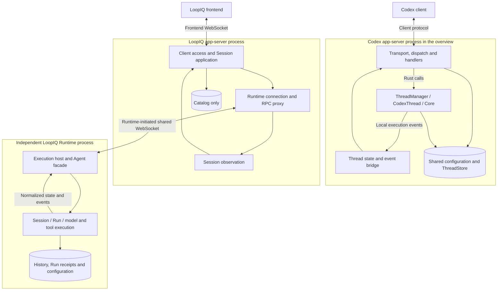
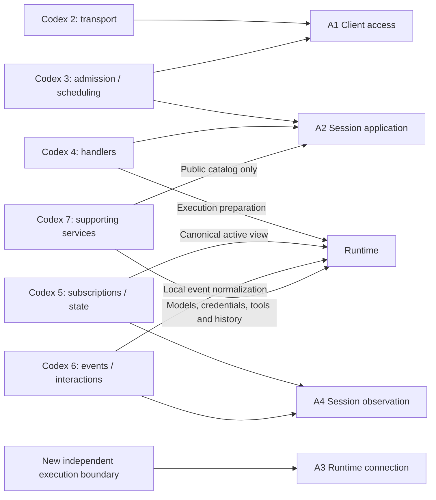

# LoopIQ Design Compared with Codex App-server

This compares the [consolidated LoopIQ design](./app-server-runtime-design.md)
with the requested [Codex overview][overview], section by section. Codex facts
refer to revision `5b1d6560181680f95cde95c14ed042acc02248ed`; LoopIQ describes a
target design, not implemented parity. The existing LoopIQ source baseline is
`43f8e3194b627de1d1d640183a0a20f349e26bc7`.

The overview's modules are teaching boundaries. They are not seven Rust crates,
seven standalone services, or seven classes. LoopIQ's four app-server modules
also group responsibilities; comparing file counts would miss the real change.

## 1. The Boundary That Changes Everything Else

The overview examines Codex's direct-client path: app-server and Core are in
the same process. Its handlers call `ThreadManager` and `CodexThread`; execution
events return through local listeners. Config/model/environment services and
ThreadStore are shared injected dependencies. This does not mean every tool
must execute locally; it identifies where the conversation execution owner
lives in this particular architecture. [Evidence: dependency assembly][assembly]

LoopIQ deliberately puts that execution owner in a separate process and gives
it its own lifecycle. The app-server addresses it through a serializable remote
contract. The direction of connection establishment is reversed relative to a
normal frontend connection: Runtime dials app-server, which subsequently sends
commands over the established bidirectional socket.



This changes three contracts:

1. A local function result becomes a remote acceptance/result that can be lost.
2. A process-local active view becomes authoritative Runtime state that must
   be queried across another connection.
3. Shared storage access becomes a protocol operation against the machine
   owning the data.

It does not remove request admission, Session subscriptions, event routing, or
execution control. It redistributes those responsibilities and introduces a
second independently failing link.

## 2. Module-by-Module Mapping

LoopIQ labels are P (protocol), A1 (client access), A2 (Session application),
A3 (Runtime connection), A4 (Session observation), R1 (execution host), R2
(Session execution), and R3 (execution dependencies). These are defined in
[design section 2](./app-server-runtime-design.md#2-processes-modules-and-dependencies).

| Codex overview module | Codex responsibilities and objects | LoopIQ destination | Exact change |
| --- | --- | --- | --- |
| 1. Protocol, referenced by the overview | Typed Request/Response/Notification; Thread/Turn/Item; client commands and server interactions. | P, used by both links. | Retain typed business messages. Define Session/Run/Item and separate connection, submission, and observation identity. Publish a backend protocol as well as a frontend protocol. No wire compatibility claim. |
| 2. Connection and transport | Readers/writers, message classification, `ConnectionId`, shared message/control queues and per-connection sending. | A1 for frontend; A3/R1 for execution link. | Retain connection-local resources and bounded delivery. Add Runtime registration, link replacement and reconnection. A socket still does not own a Session or Run. [Source][transport] |
| 3. Admission and scheduling | Initialize/capability checks, `ConnectionRpcGate`, `RequestSerializationQueues`, resource-scoped handler ordering, shutdown admission. | A1/A2 for application admission; R1/R2 for execution admission. | Split checks across the process boundary. App-server checks authenticated target/routing; Runtime authoritatively checks busy state, deduplication and capacity. Short handler ordering stays; no lock spans a whole Run. [Sources][dispatch] [and queues][queues] |
| 4. Operation handlers | Locate target, load effective configuration, call Core, stage metadata, attach observation, choose immediate/deferred response. | A2 plus remote execution in R2/R3. | A2 retains application orchestration, catalog/name handling and reply ownership. Model/config/environment construction moves to Runtime. `startRun` acceptance and settlement semantics belong to Runtime's contract, not inferred from an event name. [Source][create] |
| 5. Session subscriptions and public state | `ThreadStateManager` bidirectional indexes; `ThreadState` active view, listener generation, pending interrupts; `ThreadWatchManager` summaries and idle unloading. | A4 for frontend observation; R1/R2 for canonical execution view and resource lifecycle. | Retain client-to-Session indexes. Move authoritative active output and task state to Runtime. App-server's view is transient and potentially stale. Omit subscriber-driven idle unloading in v1 (D8). [Source][thread-state] |
| 6. Events and interaction bridge | Interpret Core events; emit public notifications; hold server-request callbacks; bridge approval decisions; finish delayed interrupt responses. | R1 normalizes local events; A4 routes output; A3 correlates backend calls. | Event normalization moves next to execution. App-server still routes updates. Frontend approval/question callback machinery is optional O4/O5 and absent in v1. Backend RPC callbacks remain essential. [Sources][listener] [and callbacks][callbacks] |
| 7. Configuration and supporting services | Config, provider/account auth, models, environments, skills/plugins/MCP, process-scoped shared ThreadStore. | R3 and Runtime-owned history; A2 owns only catalog storage; A1/A3 own connection authentication. | Split execution dependencies from application data. No shared filesystem/database requirement across hosts. Model credentials and connection tokens are distinct concerns. [Source][assembly] |

### 2.1 What the four app-server modules retain



A2 remains an operation coordinator, not a container for every object it uses.
A4 still owns observation relationships; moving execution out of process does
not make subscription management a WebSocket transport responsibility.
A3 is the main new app-server capability: it converts a configured execution
owner into a usable, reconnectable remote service.

### 2.2 Where complexity goes

| Treatment | Concrete responsibilities |
| --- | --- |
| Retained in app-server | Frontend initialization, typed dispatch, Session application handlers, public catalog, subscription indexes, targeted/broadcast notification routing. |
| Moved to Runtime | Effective model/tool configuration, credentials, environment construction, tool execution, authoritative Run state, history reads/writes, local event interpretation. |
| Deferred from the first version | Attachments, tool approvals, structured user questions, remote config editing, paging/indexed history, archive. |
| Newly required by the split | Runtime identity/boot/link distinction, backend pending RPCs, catalog reconciliation, durable submission deduplication, backend-disconnect recovery, two-link observation consistency. |

Removing a responsibility from app-server does not necessarily remove it from
the system. In particular, durable Run receipts and crash reconciliation are
additional Runtime work; a thin server cannot manufacture those guarantees.

## 3. Object, Storage, and Lifetime Comparison

| Concern | Codex in the overview | LoopIQ target |
| --- | --- | --- |
| Conversation identity | `ThreadId`; loaded `CodexThread` accessed through ThreadManager. | Stable Session ID plus persisted Runtime-service binding; no `AgentSession` in app-server. |
| Controlled task | Public Turn, distinct from the RPC. | Public Run, distinct from internal provider iterations and the RPC. |
| Observation identity | Client connection and Thread membership; listener generation guards replacements. | Connection, Session subscription, observation ID, view epoch and revision. |
| Active output | App-server `ThreadState` builds the public active view from Core events. | Runtime maintains the canonical view; app-server holds transient delivery/recovery state. |
| RPC identity | Connection-scoped requests; outgoing server requests have callback records. | Independent IDs on each link; A3 maps live attempts. Submission ID survives that map's loss. |
| Durable history | Core and handlers use an injected ThreadStore; Local may persist files/SQLite, InMemory does not survive restart. | Runtime alone owns durable history and Run receipts. App-server calls it remotely. |
| Public names/metadata | Stored through ThreadStore metadata paths, also available to Codex's shared storage consumers. | App-server owns names and binding metadata; Runtime owns cwd/existence/activity. Direct CLI need not see app-server titles. |
| Unobserved idle execution | Eligible for unload after no subscribers and inactive status persist; configured delay defaults to 60 seconds. | No automatic idle-unload timer in v1; a future policy belongs to Runtime. |
| App-server process restart | Loses this process's Core execution state, listeners, subscriptions and callback state; saved history depends on storage backend. | Loses application connections and transient views; healthy independent Runtime continues. |

Sources: [overview 1.2 and 2.6][overview], [ThreadState][thread-state],
[shared store assembly][assembly], [unload condition][unload-state],
[default unload delay][unload-config].

The largest persistence difference is **where authoritative data lives**, not
JSONL versus SQLite. Copying Codex's shared ThreadStore into the cloud server
would conflict with the selected Runtime-owned history model. Conversely,
keeping all app-server catalog data only in memory would break discovery and
binding recovery after its restart.

## 4. Feature Comparison

| Feature | Codex evidence / behavior | LoopIQ first version |
| --- | --- | --- |
| Frontend connection | The overview chooses direct WebSocket; module 2 also studies other hosting/transport paths. | Frontend WebSocket plus one separate Runtime-initiated WebSocket. No additional public transports required. |
| Initialization | `initialize` establishes protocol context; later `initialized` currently logs rather than adding a second gate. [Source][initialized] | One authenticated initialize RPC; Runtime additionally reconciles inventory before readiness. |
| Configuration on creation | Handler loads effective Codex configuration and passes dependencies into Core. [Source][create] | Runtime resolves local configuration; frontend edits optional O2. |
| Project association | Overview 2.2 includes `projectId` validation and staged Thread-to-project metadata. | No separate Project object in v1. Session cwd is an execution-machine directory; it is not a substitute implementation of Codex project metadata. |
| Create and reopen | `thread/start` and `thread/resume` create/access running objects and observation paths. | `session/create` persists; `session/observe` explicitly restores view and observation. Merely reading metadata does not load execution. |
| Start while already active | The cited `turn/start` path may return Core disposition Started or Steered, both wrapped as a Turn response. [Source][input] | A different `run/start` on a busy Session is rejected; `run/steer` explicitly adds input to the existing Run. |
| Start reply | Returns Turn identity/status; does not imply task completion or peer receipt. | Returns a durably accepted submission/Run identity; duplicate same-ID input returns the original Run. |
| Submission acknowledgment recovery | The cited normal turn path does not establish our persistent frontend-submission deduplication contract. RPC IDs alone do not provide it. | C27 requires durable ID mapping, status queries and manual same-ID retry across both links. |
| Abort | Ordinary `turn/interrupt` waits via `pending_interrupts`, then returns an empty success result when the terminal event is handled. Actual final status is in the event. [Sources][interrupt] [and completion][interrupt-response] | Runtime waits for settled state and returns the actual outcome; app-server has no copy of Core interrupt bookkeeping. |
| Terminal status vocabulary | The overview's user-interruption path produces a public Turn status of `interrupted`. | User abort is `aborted`; loss of unfinished execution after Runtime crash is `interrupted`. Matching enum text across systems would hide this semantic difference. |
| Frontend disconnect | Removes connection resources/subscriptions; it does not directly interrupt an active Thread. | Same execution continuity; remove only that frontend's observation. |
| App-server failure | In the overview's same-process arrangement, the execution owner is lost with the process. | Healthy Runtime remains alive and completes tasks; recover by queries and snapshots. |
| Return after an outage | History plus available active view; no blanket promise to replay every missed delta. | Same product goal, extended across an independently reconnecting backend link. |
| Approval / structured questions | Ordinary approval has app-server callback state plus Core's own execution wait. [Source][approval] | O4/O5 deferred. Runtime policy cannot silently treat an unavailable approval UI as consent. |
| Image/file input | Codex's protocol exposes richer input types; this is beyond the six overview flows. | O3 deferred; text and normal filesystem tools retained. |
| Names | `thread/name/set` updates shared stored metadata. [Source][name] | App-server catalog rename; no backend model/context change. |
| Archive | Retains history and performs loaded-thread removal preparation. [Source][archive] | Excluded. |
| Delete | Handles spawned descendants and checks external fork-history references; removes saved Thread data, not cwd files. [Source][delete] | No fork graph; reject active Run, delete Runtime history, then clean catalog with reconcilable deletion state. |
| Working directory | Explicit cwd, saved fallback on resume, then process fallback in the ordinary local path; overrides are supported. [Source][cwd] | Runtime-local default or explicit absolute cwd on create; fixed for the Session in v1. |
| Same-directory Sessions | Thread-ID ownership does not impose a cwd mutex in the inspected admission path. [Source][thread-map] | Allowed under D4; no automatic file isolation. |
| Aggregate concurrency | No fixed top-level chat cap identified in the cited start/registration path; subagent spawn capacity is a different setting. [Source][agent-limit] | D5 specifies four active Runs by default, configurable locally; reject overflow, no queue. |
| History pagination | Separate turn/item paging APIs exist in the pinned study. | O1 optional; baseline whole snapshots have an explicit supported-size bound. |
| Persistent queue facilities | Dependency assembly can add SQLite-backed queue services; that alone does not establish an offline-task contract for every API. [Source][assembly] | No offline task queue. |
| CLI | Codex has multiple consumers/hosting paths; the overview is not their complete inventory. | Existing direct local CLI retained; frontend migration does not route CLI through app-server. |

The comparison is scoped to the pinned paths. It does not claim that all Codex
remote-control, cloud, queue, or future SDK features share these exact policies.
It also does not count optional LoopIQ plans as implemented functionality.

## 5. Strict Comparison of the Overview's Six Scenarios

### 5.1 Overview 2.1: Connect and initialize

| Step | Codex | LoopIQ | Consequence |
| --- | --- | --- | --- |
| Establish transport | Client WebSocket creates connection resources. | Frontend does the same; Runtime independently dials the backend endpoint. | Two connection lifecycles rather than one client-to-host boundary. |
| Initialize | Record client information and protocol capabilities. | Validate endpoint-specific token, version and identity; no second initialized message. | Simple v1 access control and protocol version replace a broad capability negotiation surface. |
| Make execution available | Core dependencies already live in the process. | Reconcile Runtime inventory and mark the link ready. | An initialized frontend can list catalog while execution remains offline. |
| Establish observation | Initialization does not subscribe to every Thread. | Initialization does not subscribe to every Session. | This separation is retained. |

Source: [overview 2.1][overview], [initialization handler][initialize].

### 5.2 Overview 2.2: Create a conversation in a project

Codex's selected path is:

```text
Handler validates project -> background task loads configuration
-> reserve Thread ID -> stage project metadata -> call Core to create
-> build public Thread -> attempt subscription/listener attachment
-> send creation response -> broadcast thread/started
```

LoopIQ's path is:

```text
Handler verifies ready Runtime -> persist creating catalog row
-> remote create with stable Session ID -> Runtime validates cwd/config
-> Runtime persists Session -> app-server commits ready catalog row
-> return metadata -> frontend separately requests observation
```

| Difference | Why it matters |
| --- | --- |
| No Project object in LoopIQ v1 | Do not port Codex's project-staging logic under a renamed cwd field. |
| Execution configuration is resolved remotely | App-server has no provider/model/environment construction dependency. |
| Catalog success has an explicit durable commit | Codex's creation response alone does not prove its staged project association is already saved. Our public creation success requires both Runtime creation and catalog confirmation. |
| Observation is a separate operation | Creating a Session does not imply this frontend is already receiving output. DevUI attaches before starting its first Run. |
| Creation can succeed while its response is lost | Stable Session ID and catalog reconciliation handle this; no implicit compensating history deletion on client disconnect. |

Sources: [overview 2.2][overview], [create path][create],
[attachment handling][attach], [staged metadata][metadata].

### 5.3 Overview 2.3: Submit input and stream execution

Both systems distinguish short request handling from long execution. Neither
should hold its Session/Thread operation gate until the model finishes, because
that would prevent steering and stopping the active task.

| Phase | Codex | LoopIQ |
| --- | --- | --- |
| Admit | Connection/protocol checks, Thread-scoped request ordering. | Frontend admission and binding lookup, then authoritative Runtime busy/capacity/deduplication checks. |
| Submit | Handler calls `start_or_steer_turn`; Core returns Started/Steered/NotSubmitted. | Runtime `run/start` durably reserves a new Run; only explicit `run/steer` appends active input. |
| Acknowledge | Return actual Turn ID with in-progress status and items not loaded. | Return submission ID and Run ID; state queried independently and output may already exist. |
| Generate output | Core emits internal execution events. | Runtime emits internal events locally and normalizes them before transport. |
| Update public view | Modules 5/6 build active items and route notifications. | Runtime maintains canonical items; A4 manages client view installation and fan-out. |
| Complete | Event path builds public terminal status and completes pending work. | Runtime persists settlement after cleanup; response waiters and events both expose that outcome. |

Both permit response/event interleaving. LoopIQ adds a persistent submission
identity because either network leg can lose acceptance knowledge. It does not
infer acceptance from receiving a token or wait for the final answer to reply.
Sources: [overview 2.3][overview], [turn input disposition][input],
[current LoopIQ reservation and settlement][loop-session].

### 5.4 Overview 2.4: Tool approval

Codex keeps two waits: Core suspends the relevant execution point, while
app-server holds an outgoing RPC callback awaiting a client's decision.
An independent wait task bridges the decision back to Core. The listener stays
able to process other events. Ordinary pending approval can be resent on hot
resume with its original request ID. `serverRequest/resolved` ends the client
interaction; it does not prove that the tool ran successfully.

LoopIQ v1 has no corresponding frontend interaction flow. R3 applies local
tool policy. If it requires unavailable interactive approval, execution receives
an explicit unsupported/denied result. A user can still type ordinary steering
input, which does not constitute a typed tool-approval response.

If O4 is later implemented, Runtime must own the approval ID and actual wait;
app-server must route the question/answer and recover pending interaction state.
That would be additional protocol/state design, not merely a confirmation modal.
Sources: [overview 2.4][overview], [approval bridge][approval],
[response callback removal][take-callback].

### 5.5 Overview 2.5: Stop the active task

```mermaid
sequenceDiagram
    participant C as Client
    participant CH as Codex handler and ThreadState
    participant CR as Codex Core and event bridge
    C->>CH: turn/interrupt with RPC ID
    CH->>CH: Save pending interrupt response identity
    CH->>CR: Submit interruption; release handler slot
    CR-->>CH: Terminal event completes pending response
    CH-->>C: Empty success response; terminal status via notification
    participant UI as LoopIQ frontend
    participant APP as LoopIQ app-server
    participant RT as Independent Runtime
    UI->>APP: run/abort for exact Run
    APP->>RT: Remote abort; keep backend RPC correlation
    RT->>RT: Cancel, settle, persist outcome, release reservation
    RT-->>APP: Actual settled outcome
    APP-->>UI: Same outcome, plus separately routed final update
```

Codex's `pending_interrupts` belongs to its app-server ThreadState; it waits
for a Core event. LoopIQ's execution waiter belongs to Runtime and waits for
the execution owner's settlement. A3 still has a normal remote RPC pending
entry, but it does not keep a second authoritative interrupt state machine.

If the app-server connection disappears, that RPC waiter can disappear while
the cancellation already submitted to Runtime continues. A later `run/read`
recovers the outcome. Both systems must handle normal completion winning the
race; an accepted stop request alone does not establish an aborted result.
Sources: [overview 2.5][overview], [interrupt handler][interrupt],
[terminal response completion][interrupt-response].

### 5.6 Overview 2.6: Disconnect and resume

| Event | Codex's selected path | LoopIQ target |
| --- | --- | --- |
| Client closes | Clean connection/gate/queued work, remove Thread subscriptions; active Core execution is not directly canceled. | Clean frontend RPCs/observations; Runtime execution unaffected. |
| No observers remain | Active Thread remains; idle Thread may unload after configured delay. | Runtime keeps loaded idle Sessions under D8; no subscription-driven unload. |
| Client returns, task still live | `thread/resume` reuses running object, combines saved/active view in listener, attaches subscriber. | `session/observe` obtains Runtime snapshot at W; A4 buffers updates until frontend installs it. |
| Pending approval exists | Resend still-valid replayable server requests on the cited hot-resume path. | No such requests in v1. |
| Task finished while client absent | Restore recorded result/state rather than every intermediate delta. | Same user-visible goal. |
| App-server restarts | Same-process Core state is also lost; cold restore depends on saved history. | Independent Runtime keeps running; inventory/state queries restore app-server access. |
| Execution process restarts | Cold restoration cannot promise old tool/approval continuation. | Explicitly mark unfinished accepted Runs interrupted; require a new user Run. |

Codex coordinates resume in the existing Thread listener. LoopIQ needs a
boundary across Runtime, app-server, and frontend: capture a Runtime view at W,
buffer later updates in app-server, wait for frontend installation, then flush
and go live. Merely reading history and subsequently adding a subscription
leaves a gap in which completion can be missed.

Sources: [overview 2.6][overview], [disconnect cleanup][disconnect],
[listener ordering][listener], [unload condition][unload-state].

## 6. Additional Flows Introduced by Our Requirements

These are not extra steps hidden inside Codex's six overview diagrams.

| New flow | Initiator and owner | Failure it addresses |
| --- | --- | --- |
| Runtime registration and inventory reconciliation | Runtime connects; A3 authenticates and A2 merges inventory. | Independent host/restart and saved bindings without shared storage. |
| Frontend-submission lookup after lost acceptance | Frontend retains submission ID; Runtime retains authoritative receipt. | Either response hop disappears while work may already be executing. |
| Runtime local acceptance/settlement recovery | R2 replays durable Run lifecycle records, not tool invocations. | Distinguish never accepted, accepted unfinished, and already terminal across crashes. |
| Runtime deletion then catalog cleanup | Runtime deletion intent/tombstone and A2 pending state. | History and public catalog cannot be updated by one local transaction. |
| Backend link loss during observation | A3 invalidates link-bound state; A4 reacquires snapshots for observers. | Runtime remains healthy while the intermediary is gone. |

The extra complexity is concentrated in A3, A4, and Runtime durability, but it
is **not completely independent of other modules**. Handlers need uncertain
outcomes, the protocol needs stable business IDs and snapshots, and storage
must record acceptance before execution. Transport reconnection alone cannot
provide those guarantees.

## 7. What This Means for Implementation

The useful Codex ideas to retain are its separation of connection identity from
conversation identity, short resource-scoped operation ordering, explicit
subscription ownership, response-versus-terminal distinction, and coordinated
snapshot/live handoff.

The parts to relocate are effective execution configuration, engine-specific
event interpretation, model/tool dependencies, authoritative running state,
and history access. These belong on the execution machine in this design.

The parts to add are an independent execution service lifecycle, one reconnectable
backend link, durable submission and outcome records, and reconciliation for
metadata and deletion. The parts deferred from the first version are enumerated
in [design section 11](./app-server-runtime-design.md#11-optional-features-and-deliberate-limits).

A practical dependency check is simple: app-server should compile against the
protocol and a fake Runtime port without importing the Agent implementation or
accessing its history files. Runtime should continue and durably finish an
accepted task with app-server stopped. Both checks must pass; either one alone
only proves half of the intended separation.

[overview]: ../../../blogs/codex-app-server-daemon/.draft/overview.md
[loop-session]: ../../packages/agent/src/session/agent-session.ts
[assembly]: https://github.com/openai/codex/blob/5b1d6560181680f95cde95c14ed042acc02248ed/codex-rs/app-server/src/message_processor.rs#L273
[transport]: https://github.com/openai/codex/blob/5b1d6560181680f95cde95c14ed042acc02248ed/codex-rs/app-server/src/transport.rs#L66
[dispatch]: https://github.com/openai/codex/blob/5b1d6560181680f95cde95c14ed042acc02248ed/codex-rs/app-server/src/message_processor.rs#L960
[queues]: https://github.com/openai/codex/blob/5b1d6560181680f95cde95c14ed042acc02248ed/codex-rs/app-server/src/request_serialization.rs#L194
[create]: https://github.com/openai/codex/blob/5b1d6560181680f95cde95c14ed042acc02248ed/codex-rs/app-server/src/request_processors/thread_processor.rs#L1455
[thread-state]: https://github.com/openai/codex/blob/5b1d6560181680f95cde95c14ed042acc02248ed/codex-rs/app-server/src/thread_state.rs#L99
[listener]: https://github.com/openai/codex/blob/5b1d6560181680f95cde95c14ed042acc02248ed/codex-rs/app-server/src/request_processors/thread_lifecycle.rs#L277
[callbacks]: https://github.com/openai/codex/blob/5b1d6560181680f95cde95c14ed042acc02248ed/codex-rs/app-server/src/outgoing_message.rs#L326
[initialized]: https://github.com/openai/codex/blob/5b1d6560181680f95cde95c14ed042acc02248ed/codex-rs/app-server/src/message_processor.rs#L734
[initialize]: https://github.com/openai/codex/blob/5b1d6560181680f95cde95c14ed042acc02248ed/codex-rs/app-server/src/request_processors/initialize_processor.rs#L50
[attach]: https://github.com/openai/codex/blob/5b1d6560181680f95cde95c14ed042acc02248ed/codex-rs/app-server/src/request_processors/thread_lifecycle.rs#L190
[metadata]: https://github.com/openai/codex/blob/5b1d6560181680f95cde95c14ed042acc02248ed/codex-rs/thread-store/src/local/update_thread_metadata.rs#L38
[input]: https://github.com/openai/codex/blob/5b1d6560181680f95cde95c14ed042acc02248ed/codex-rs/app-server/src/request_processors/turn_processor.rs#L648
[approval]: https://github.com/openai/codex/blob/5b1d6560181680f95cde95c14ed042acc02248ed/codex-rs/app-server/src/bespoke_event_handling.rs#L662
[take-callback]: https://github.com/openai/codex/blob/5b1d6560181680f95cde95c14ed042acc02248ed/codex-rs/app-server/src/outgoing_message.rs#L557
[interrupt]: https://github.com/openai/codex/blob/5b1d6560181680f95cde95c14ed042acc02248ed/codex-rs/app-server/src/request_processors/turn_processor.rs#L1597
[interrupt-response]: https://github.com/openai/codex/blob/5b1d6560181680f95cde95c14ed042acc02248ed/codex-rs/app-server/src/bespoke_event_handling.rs#L1545
[name]: https://github.com/openai/codex/blob/5b1d6560181680f95cde95c14ed042acc02248ed/codex-rs/app-server/src/request_processors/thread_processor.rs#L1808
[archive]: https://github.com/openai/codex/blob/5b1d6560181680f95cde95c14ed042acc02248ed/codex-rs/thread-store/src/local/archive_thread.rs#L67
[delete]: https://github.com/openai/codex/blob/5b1d6560181680f95cde95c14ed042acc02248ed/codex-rs/app-server/src/request_processors/thread_delete.rs#L31
[cwd]: https://github.com/openai/codex/blob/5b1d6560181680f95cde95c14ed042acc02248ed/codex-rs/core/src/config/mod.rs#L1451
[thread-map]: https://github.com/openai/codex/blob/5b1d6560181680f95cde95c14ed042acc02248ed/codex-rs/core/src/thread_manager.rs#L374
[agent-limit]: https://github.com/openai/codex/blob/5b1d6560181680f95cde95c14ed042acc02248ed/codex-rs/core/src/config/mod.rs#L1572
[disconnect]: https://github.com/openai/codex/blob/5b1d6560181680f95cde95c14ed042acc02248ed/codex-rs/app-server/src/message_processor.rs#L856
[unload-state]: https://github.com/openai/codex/blob/5b1d6560181680f95cde95c14ed042acc02248ed/codex-rs/app-server/src/request_processors/thread_lifecycle.rs#L56
[unload-config]: https://github.com/openai/codex/blob/5b1d6560181680f95cde95c14ed042acc02248ed/codex-rs/core/src/config/mod.rs#L3782
