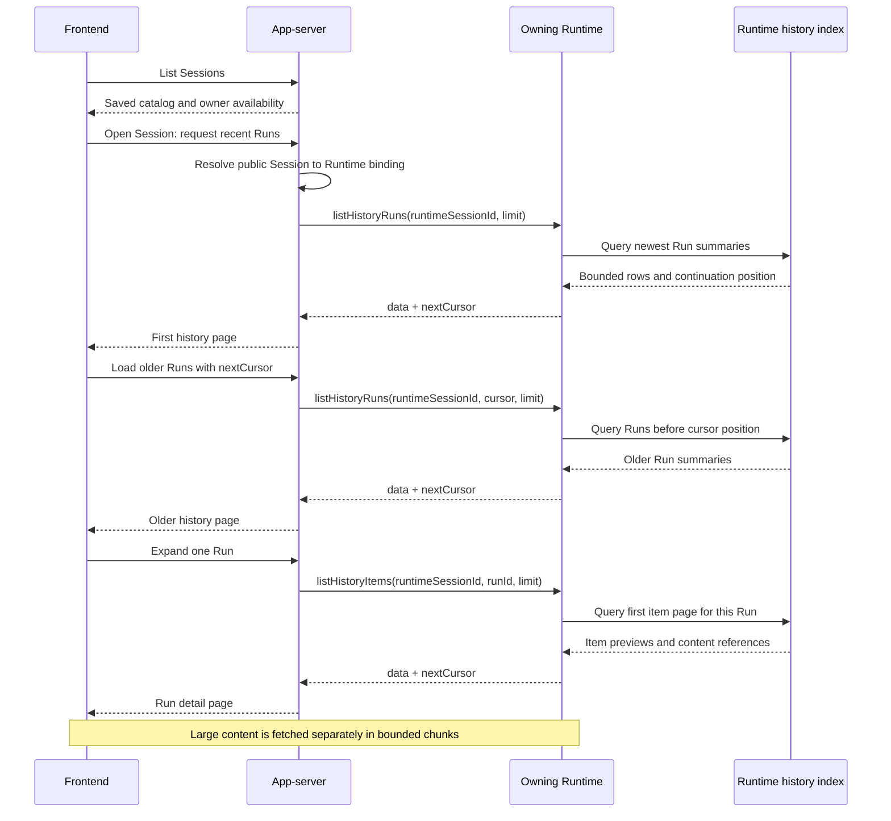
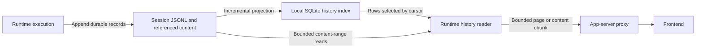

# Optional Issue O1: Session History Pagination

Status: Optional enhancement. It is not a prerequisite or release blocker for
app-server/Runtime separation, basic history reads, or reconnect recovery.
Implementation timing and the final API remain open.

Parent: [App-server and Agent Runtime Separation](./app-server-runtime-split.md),
confirmed scope decision C18.

## Problem and scope

Very large Sessions can make whole-history reads expensive in storage I/O,
network transfer, and frontend memory. O1 retains the Codex investigation and
proposes progressive reading for that scale. The baseline design can proceed
without implementing this optimization.

| Scope | Required behavior or optional work |
| --- | --- |
| Baseline, even without O1 | Runtime stores and exposes recorded history; app-server routes reads using its saved Session binding (C16). Reconnection restores recorded messages, tool results, and the latest Run state before continuing new output (C17). Durable Run identity and outcomes support crash recovery (C13). |
| Optional O1 | Cursor pagination of Run summaries and items, a local history query index with incremental projection, bounded previews and separate large-content reads, and frontend loading on demand. |
| Still to specify for the baseline | The basic history-read/result schema, supported response sizes, and explicit behavior for an oversized history. Skipping O1 does not permit silent truncation or reporting incomplete recovery as complete. |

Ownership stays the same whether this option is selected: Runtime owns durable
history and any local query index; app-server owns the catalog, bindings, and
request forwarding. O1 does not introduce a cloud transcript replica.

## Design notes

Runtime should query and return one bounded history page at a time. App-server
resolves the Session's owner and forwards that query; it must not fetch the
whole transcript and slice it locally. Opening the Session catalog reads only
app-server metadata. Opening a conversation requests its recent history from
Runtime without loading an execution Session or resolving a model.

The behavior below applies if O1 is implemented. Operation names, limits, and
storage schema are working recommendations, not confirmed API decisions. C19
selects the shared Runtime-to-app-server WebSocket; these history operations
can use that link. C20 selects a separate frontend-to-app-server WebSocket.
The message envelopes on both links remain to be specified.

## What Codex implements

These observations describe Codex revision
`5b1d6560181680f95cde95c14ed042acc02248ed`. Its public Thread corresponds to our
Session. Its public Turn groups a user request and the resulting Agent work;
our corresponding browsing group is a **Run**. LoopIQ's internal Turn means
one model iteration, so copying Codex's names would confuse these boundaries.

| Reading task | Codex interface and behavior | Design lesson |
| --- | --- | --- |
| Read metadata | `thread/read` with `includeTurns: false` avoids loading the whole public history. | Keep metadata reads separate from transcript reads and execution resume. |
| Browse recent work | `thread/turns/list` accepts `threadId`, `cursor`, `limit`, `sortDirection`, and `itemsView`. Defaults: newest first, 25 turns, summary items. The limit is clamped to 1–100. | Page task groups and load older groups on demand. |
| Choose detail | `itemsView: "notLoaded"` returns an intentionally empty item array; `"summary"` selects display items; `"full"` loads every persisted item in each returned turn. In the indexed path, summary items are the first user item and final Agent item, when available. | A display summary is selected history, not a newly generated model summary. Loading all items can make even a one-turn page large. |
| Expand a long task | `thread/items/list` pages items across a thread or within an optional `turnId`. Defaults: oldest first, 25 items; limit clamped to 1–100. Each result includes its `turnId`. | A second paging level handles a task containing many tool calls and messages. |
| Resume execution | `thread/resume` can set `excludeTurns: true`, then the client pages history separately. Experimental `initialTurnsPage` can bundle a first page into resume. | Resuming execution need not serialize the entire conversation into the response. |

The [public paging types][codex-history-protocol],
[item-view definitions][codex-history-views],
[page-size constants][codex-history-limits], and
[resume options][codex-history-resume] define these behaviors. `full` means
items available in persisted app-server history, not every transient streaming
event emitted during execution. Summary items can themselves have large
bodies: selecting fewer items does not by itself bound response bytes.

There are two materially different implementations behind the turn API:

- **Legacy history:** app-server reads and replays the entire rollout on each
  page request, builds all turns, and then selects a page. The source explicitly
  describes this as a network-transfer optimization. It does not bound the
  history reconstruction work.
- **Paginated history:** app-server calls `ThreadStore.list_turns` or
  `list_items`. The local store queries SQLite projections of the rollout.
  New non-ephemeral threads default to this mode when the store supports it;
  old threads and unsupported stores still require compatibility handling.
  `thread/items/list` reports an unsupported-method error when the store cannot
  provide it; it has no equivalent full-rollout fallback.

See the [mode selection][codex-history-mode] and
[read implementations][codex-history-reads]. Even in paginated mode,
`itemsView: "full"` fetches every item page for the selected turns, and a
full-history read fetches every turn page. Those compatibility paths can still
produce large responses.

The indexed path uses a rollout ordinal as its continuation position. SQL
selects rows before or after that position and fetches up to `limit + 1` rows to
detect another page. `nextCursor` excludes the last returned row;
`backwardsCursor` anchors the first row, includes it again, and is used with
the opposite direction. Repeated items therefore need merging by identity.
The token is opaque to clients; at this revision it is a serialized JSON
structure validated against the requested thread and cursor kind. See
[cursor construction][codex-history-cursors] and
[cursor validation][codex-history-cursor-validation]. This is position-based
paging, not an offset into a changing array or an immutable snapshot of all
future reads.

## Proposed read path and operations if adopted

Keep three independent size boundaries: the number of Runs, the number of
items inside a Run, and the bytes inside one item. A Session with ten thousand
short Runs stresses the first boundary. A single Run with thousands of tool
calls stresses the second. One large command output stresses the third.



Requests to an unavailable owner return an explicit `RUNTIME_OFFLINE` result;
the frontend can retry after reconnection. This is how new history loads wait
for Runtime, without retaining an unbounded queue of pending reads. An empty
page must not stand in for an unavailable Runtime.

| Proposed operation | Input and result | Behavior if adopted |
| --- | --- | --- |
| `listHistoryRuns` | Runtime `sessionId`, optional `cursor` and `limit` → Run summaries and `nextCursor`. | Newest first by stable Run-start position. Each summary includes Run identity, recorded lifecycle state, and bounded input/output previews. Opening a Run loads its items separately. |
| `listHistoryItems` | Runtime `sessionId`, `runId`, optional `cursor` and `limit` → history items and `nextCursor`. | Oldest first by item creation position. All input consumed through `steer` remains in the same Run. Items retain stable IDs and their message/tool relationships. |
| `readHistoryContent` | Runtime `sessionId`, `contentId`, and a bounded content-range request → a chunk and continuation information. | Loads content omitted from a preview. Content references identify an immutable stored body or version, scoped to the owning Session. Exact range encoding remains to be specified. |

Recommended starting limits are 25 entries by default and at most 100, as in
Codex. Also impose a response byte budget and bounded previews: candidate
starting values are 256 KiB per serialized page and 4 KiB per text preview,
to be checked against representative histories. A page may contain fewer than
`limit` entries because of its byte budget. A preview explicitly reports
truncation, and large text, images, or tool output use content references.
Codex's count-based APIs above are not evidence of these proposed byte limits.

App-server forwards only the page requested by the frontend. It may validate
limits and translate public IDs, but Runtime enforces limits before reading
and serializing large bodies. Pagination also requires the frontend to load
on demand and virtualize or discard distant rendered pages; automatically
fetching every page would recreate the original memory problem.

## Example: opening a Session and expanding a Run

These examples show Runtime request parameters and response bodies, without
choosing a transport envelope. App-server has already mapped public Session
`chat_17` to Runtime Session `session_42`. Cursor strings are illustrative
tokens to pass back unchanged.

Parameters for `listHistoryRuns`:

```json
{ "sessionId": "session_42", "limit": 1 }
```

```json
{
  "data": [
    {
      "runId": "run_1000",
      "state": "settled",
      "outcome": { "status": "completed" },
      "inputPreview": { "text": "Inspect the test failures.", "truncated": false },
      "outputPreview": { "text": "Two failures need attention.", "truncated": false }
    }
  ],
  "nextCursor": "runs_cursor_a"
}
```

Loading older Runs passes
`{ "sessionId": "session_42", "cursor": "runs_cursor_a", "limit": 25 }` to
the same operation. Expanding `run_1000` starts an independent item cursor:

```json
{ "sessionId": "session_42", "runId": "run_1000", "limit": 1 }
```

```json
{
  "data": [
    {
      "itemId": "item_9000",
      "runId": "run_1000",
      "kind": "userMessage",
      "body": { "type": "inline", "text": "Inspect the test failures." }
    }
  ],
  "nextCursor": "items_cursor_b"
}
```

A later item page can contain a large tool result in this form:

```json
{
  "itemId": "item_9004",
  "runId": "run_1000",
  "kind": "toolResult",
  "toolCallId": "call_12",
  "body": {
    "type": "reference",
    "preview": "Test runner output...",
    "truncated": true,
    "contentId": "content_9004_v1",
    "byteLength": 5242880
  }
}
```

The client requests `content_9004_v1` only when the user expands that output.
The complete item union, range schema, error envelope, and reconciliation
version fields remain API design work; these payloads illustrate paging and
identity. The [Run-interface sketch](./app-server-runtime-split.md#concrete-run-interface-sketch)
in the parent proposal defines the related execution-control boundary.

## Cursor and concurrent-write rules

Use a durable, increasing position for each Run start and item creation.
Physical append order can supply that position; timestamps need not be unique
or monotonic. Updating a Run's status or an item's content must not move its
creation position. A cursor resumes from the last **returned** row, including
when byte limits stop a page before all queried rows have been returned.

Runtime creates and validates the cursor. Scope it to the Runtime service,
Session, history generation, query kind, optional Run filter, and fixed sort
direction. App-server forwards it unchanged after resolving the public
Session. Reject cross-Session, cross-Run, or wrong-operation reuse with an
explicit `INVALID_CURSOR`; the token does not grant access on its own.
An ordinary service restart or index rebuild should preserve valid cursors
when the durable history and its positions are unchanged. History replacement
or incompatible migration requires a new generation and an explicit cursor
expiry result, followed by a fresh first-page read.

For an initial implementation of O1, prefer fixed directions and one
`nextCursor` per operation. Codex's reverse cursor is useful for bidirectional navigation but
is not necessary for loading older Runs and expanding their items. A new Run
appended while the client pages older Runs does not shift the existing cursor.
For example, after returning positions 1000 through 976, the next query reads
positions below 976; appending position 1001 does not change that boundary.
`nextCursor: null` means that this query found no further rows at read time;
an active Run can still append more items later. It does not mean execution
has completed.

These pages expose recorded data at each read, without promising an immutable
snapshot across requests. Refreshes and live observation must merge objects
by stable ID and use a defined revision rule so a late page cannot overwrite
newer live content. Creation-position cursors do not recover changes to
already returned objects. The observation contract still needs to specify
revisions, active-Run snapshots, and how a history read joins the live stream.
C17 selects state recovery followed by new output, without retaining every
missed streaming delta. The proposed synchronization steps appear under
[Reconnection: history and latest-state recovery](./app-server-runtime-split.md#reconnection-history-and-latest-state-recovery).

## Runtime storage and LoopIQ changes needed by this option

Codex maintains a local query projection beside its durable rollout.
Its [materializer][codex-history-projection] resumes from a saved byte offset
and ordinal, projects complete appended lines, and updates SQLite. That avoids
replaying the full rollout on each normal indexed page request, although a
missing projection still requires initial construction.

For LoopIQ, use the same ownership pattern: the Runtime's Session log remains
authoritative, and a rebuildable local SQLite index serves history queries.
Both live on the execution machine. This creates no cloud transcript replica
and requires no cross-machine history synchronization.



The projection needs Run rows ordered by start position, item rows indexed
by `(sessionId, runId, createdPosition)`, bounded display previews, content
locations, and a per-Session projection checkpoint. Store the checkpoint and
projected rows in one SQLite transaction. Commit the authoritative record
before advancing the projection; after a crash, catch up from the checkpoint
with idempotent updates. If content is externalized, make the local body
available before committing its reference.

Build a missing index once and process subsequent appends incrementally in
bounded batches. Reads must distinguish an index still being built from a
complete empty history, for example with `HISTORY_INDEXING`. Before serving a
page, catch up through a captured complete-log boundary or explicitly report
that history is not ready; do not silently present projection lag as complete
history. Validate query plans so selecting an old page does not scan every
earlier record. Bound metadata and reference sizes so even one oversized item
can produce a valid preview row and the cursor can always advance.

The inspected LoopIQ implementation needs these changes to implement O1.
Durable Run identity and outcomes are shared prerequisites for C13 and C17,
so they remain baseline work even when this option is deferred:

1. **Add an independent history reader.**
   [JsonlSessionStore.open](../../packages/agent/src/session/storage/jsonl-session-store.ts)
   currently calls `readTextFile`, parses the whole file, and retains every
   entry in memory. `readMetadata` also reads the whole file. Adding `slice()`
   around either path would reproduce Codex's legacy limitation. The new
   reader needs indexed lookups and bounded filesystem reads without opening
   `AgentSession` or requiring Workspace/model initialization.
2. **Persist browsing identities and Run boundaries.** The current JSONL
   envelope stores an entry ID and timestamp but no `runId` or durable Run
   lifecycle records. A user message cannot reliably start a new group because
   `steer` adds input to the existing Run. Persist Run-start/settlement records,
   associate items with their Run, and preserve tool-call/result relationships.
   Historical files without this information need an explicit legacy view or
   migration policy; do not fabricate accurate past Run identities or outcomes.
3. **Separate transcript browsing from model-context restoration.**
   `restore()` applies compaction records to produce the current model context.
   The historical messages still exist in the append-only log. The history
   reader should page those recorded items independently of the context
   replacement. Context compaction must not silently delete older UI history.
4. **Add bounded content access.** The current file interface exposes whole-file
   text reads. Large-output previews alone do not solve storage cost if each
   page first parses a multi-megabyte body. Use indexed bounded previews and
   seekable content locations or immutable local content files; select the
   detailed content format before implementing `readHistoryContent`.

This subsection bounds browsing cost. Loading execution context for a very
large Session remains a separate Runtime concern; a history page should not
trigger that work.

Proposed acceptance scenarios are: browse a large indexed Session without
opening execution or rereading the whole log; page through thousands of items
within one Run; keep a multi-megabyte tool result outside the page byte budget;
append new Runs without skipping older ones; reject a cursor reused for another
Session or Run; preserve cursors across an unchanged-history restart; recover
an index interrupted after a log append; and show the saved catalog with an
explicit unavailable-history state while Runtime is offline. Count and byte
limits must hold across both the Runtime link and the frontend response.
These are acceptance checks for O1 if implemented, not first-version release
requirements or tests passed by this proposal.

[codex-history-protocol]: https://github.com/openai/codex/blob/5b1d6560181680f95cde95c14ed042acc02248ed/codex-rs/app-server-protocol/src/protocol/v2/thread.rs#L1692-L1767
[codex-history-views]: https://github.com/openai/codex/blob/5b1d6560181680f95cde95c14ed042acc02248ed/codex-rs/app-server-protocol/src/protocol/v2/thread_data.rs#L386-L422
[codex-history-limits]: https://github.com/openai/codex/blob/5b1d6560181680f95cde95c14ed042acc02248ed/codex-rs/app-server/src/request_processors/thread_processor.rs#L5496-L5508
[codex-history-resume]: https://github.com/openai/codex/blob/5b1d6560181680f95cde95c14ed042acc02248ed/codex-rs/app-server-protocol/src/protocol/v2/thread.rs#L408-L420
[codex-history-mode]: https://github.com/openai/codex/blob/5b1d6560181680f95cde95c14ed042acc02248ed/codex-rs/app-server/src/request_processors/thread_processor.rs#L1447-L1450
[codex-history-reads]: https://github.com/openai/codex/blob/5b1d6560181680f95cde95c14ed042acc02248ed/codex-rs/app-server/src/request_processors/thread_processor.rs#L3015-L3432
[codex-history-cursors]: https://github.com/openai/codex/blob/5b1d6560181680f95cde95c14ed042acc02248ed/codex-rs/thread-store/src/local/thread_history/segment_paging.rs#L395-L474
[codex-history-cursor-validation]: https://github.com/openai/codex/blob/5b1d6560181680f95cde95c14ed042acc02248ed/codex-rs/thread-store/src/local/thread_history/read.rs#L249-L280
[codex-history-projection]: https://github.com/openai/codex/blob/5b1d6560181680f95cde95c14ed042acc02248ed/codex-rs/thread-store/src/local/thread_history_materialization.rs#L22-L135
