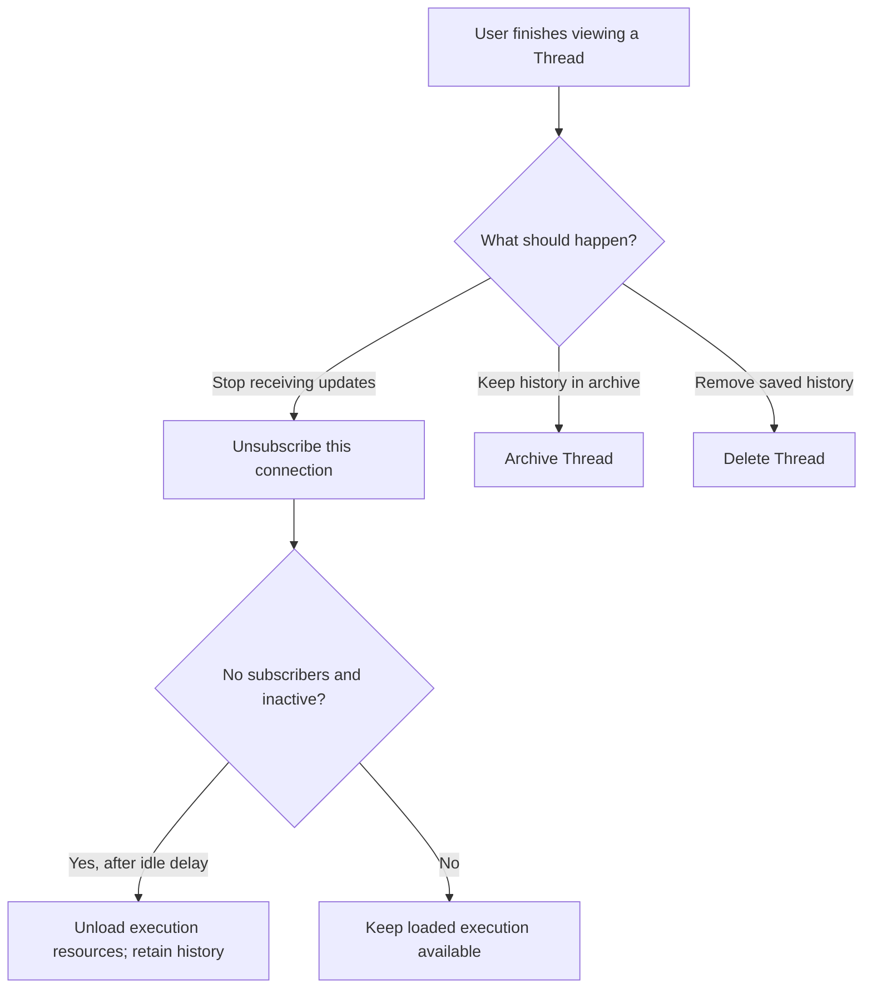
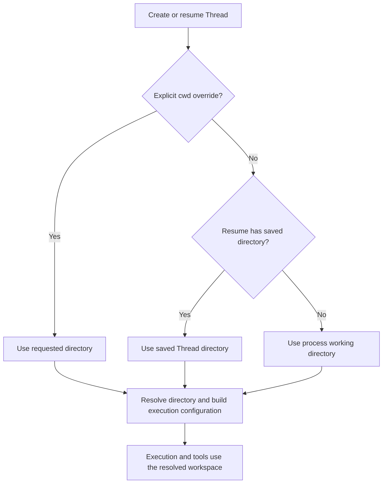

# Session Lifecycle and Workspace Decisions

Status: Source-backed discussion for the
[app-server/Runtime proposal](./app-server-runtime-split.md). Codex observations
are implementation facts at the revision below. C26 confirms LoopIQ's closure,
cancellation, and deletion behavior and excludes archive. Other recommendations
and implementation sketches remain proposals.

The [consolidated design](./app-server-runtime-design.md) now selects explicit
engineering defaults for Workspace, capacity, and deletion recovery. This
document retains the source investigation and the alternatives considered.

Codex revision: `5b1d6560181680f95cde95c14ed042acc02248ed`, inspected on
2026-10-07. Here, a Codex Thread is the closest counterpart of a LoopIQ Session;
the two products do not share an identical lifecycle contract.

## What Codex Does

### Creation, naming, closing, archiving, and deletion

Codex separates a persisted conversation, its loaded execution resources, and
each client's subscription. These have different lifetimes.

| User intent | Codex operation | Effect on execution and storage |
| --- | --- | --- |
| Create a conversation | `thread/start` | Creates a Thread with configuration, including optional `cwd`. It is separate from submitting a user turn. |
| Reopen a saved conversation | `thread/resume` | Loads or accesses the saved Thread for continued use. It is not automatic replay of unfinished tool work. |
| Rename | `thread/name/set` | Normalizes the name, rejects empty names, updates stored metadata, and produces `thread/name/updated`. |
| Stop observing from one connection | `thread/unsubscribe` | Removes that connection's subscription. It does not directly delete history or cancel an active turn. |
| Release unused execution resources | Internal idle unloading | A Thread becomes eligible only when it has no subscribers and is inactive for the configured delay. Persisted history remains available for later resume. |
| Archive | `thread/archive` | Prepares loaded Threads for removal, then moves their rollout files into archived storage and updates archive metadata. History is retained; `thread/unarchive` restores the archive state. |
| Permanently delete | `thread/delete` | Prepares Threads for removal, deletes persisted rollout/history data and associated metadata, and emits deletion notifications. The handler does not delete the project's working directory. |

The [protocol declarations][lifecycle-api], [unsubscribe handler][unsubscribe],
[idle-unload condition][idle], [name handler][name], [archive store][archive],
and [delete handler][delete-handler] establish these distinctions.



Archive and delete are more than view changes. Their shared
[removal preparation][removal] attempts to shut down loaded execution and
tears down listeners. A shutdown timeout is logged and the mutation can
proceed; this is not a guarantee that every external process has stopped.
Closing a page or removing a subscription must not be conflated with these
operations.

Deletion also handles spawned descendants. The store checks whether history
outside the deletion set still references the histories being removed and
rejects deletion if so. Its [cleanup implementation][delete-store] removes
rollout files, history projections, and name-index entries; the surrounding
store operation removes state rows. The filesystem cleanup is scoped to
Session-history storage, not the Thread's `cwd`. These details matter if a
future LoopIQ design adds shared fork histories; they are not requirements to
introduce forks in the first version.

### How a Thread gets its working directory

[`ThreadStartParams`][start-params] accepts an optional `cwd`. The request
processor passes this into execution configuration; a newly created Thread
without a directory override can fall back to the app-server process's working
directory in the inspected local execution path. The resolver also turns
relative paths into absolute paths.

Resume has an additional source: the saved Thread's directory. The
[resume implementation][resume-cwd] retrieves a same-Thread settings snapshot
or its saved Session directory as a fallback; an explicit resume override
takes precedence. The [configuration builder][cwd-config] selects the request
override, then the saved fallback, then the process directory. Additional
workspace roots and environment selection add other execution options; they
do not make `cwd` a conversation identity.



This diagram describes ordinary local cwd resolution, not every remote
environment mode. Supplying a path to `thread/start` does not itself create a
Git worktree or copy the project. A desktop client may prepare a worktree
before calling the API; that is a separate operation.

In LoopIQ's split deployment, the execution machine must resolve and validate
the directory. An app-server path such as `/projects/demo` says nothing about
whether that path exists on the personal computer running Runtime.

### Same-directory execution and concurrency limits

Codex's [loaded-Thread map][thread-map] is keyed by `ThreadId`. Its
[spawn finalization][thread-spawn] rejects duplicate loaded Thread IDs; it does
not use `cwd` as a uniqueness key. At the RPC boundary, `thread/start` has no
serialization scope, while many later mutations serialize by Thread identity.
The [request queue keys][queue-keys] include Thread IDs and saved-history paths,
not a mutex for every project's working directory.

Consequently, distinct Threads can target the same directory. Separate
conversation context does not isolate files: both can read and change the
same checkout. The inspected admission path does not impose a general
one-running-Thread-per-directory policy or allocate a worktree automatically.

There are three different concurrency questions:

| Resource | Source observation | Implication for LoopIQ |
| --- | --- | --- |
| Loaded top-level conversations | ThreadManager holds multiple independently identified Threads. No fixed process-wide count of active user conversations was found in the inspected start/registration path. | Choose aggregate capacity explicitly; do not infer unlimited practical capacity. |
| A conversation's active work | Execution has its own task lifecycle, separate from the short RPC serialization queue. | C14 already selects at most one active Run per Session and explicit steering. A queue mutex must not block control messages for the full Run lifetime. |
| Spawned Agent/subagent tree | [`effective_agent_max_threads`][agent-limit] and the [spawn reservation][agent-spawn] apply capacity rules to Agent spawning; V2 accounts for the root separately. | Settings such as the legacy default of six Agent slots do not mean app-server permits only six independent user chats. |

CPU, tool processes, memory, and provider limits still constrain execution.
The absence of a hard cap in this path is not an operational capacity promise.

## LoopIQ Decisions and Remaining Choices

App-server owns the public catalog and subscriptions; Runtime owns execution
and durable history. C26 confirms the lifecycle behaviors marked below;
directory and capacity choices remain open.

| Topic | Policy or candidate | Status and remaining detail |
| --- | --- | --- |
| Create and reopen | Runtime creates a saved Session; app-server records its binding and public metadata. Reopening reads history and attaches observation before further execution. | Confirm exposed operations and creation defaults. |
| Rename | App-server persists a display title in its catalog, independently of execution. It need not change model context. | Confirm whether titles must also be visible to direct local Runtime consumers. Avoid two competing authoritative title fields. |
| Close page | Remove this page's subscription; preserve history and any active Run. | Confirmed by C26. Existing `Agent.close()` must not be wired directly to page closure. |
| Stop task | Call `abortRun`; preserve the Session and its history. | Confirmed by C26. Stopping execution does not delete its saved conversation. |
| Archive | Excluded from the first version. | Confirmed by C26. |
| Delete | Remove Runtime history and the app-server catalog entry; preserve workspace files. Reject deletion while the Session has an active Run, requiring the user to stop it first. | Scope and busy behavior confirmed by C26. Cleanup sequencing, offline behavior, and lost-response recovery still need implementation contracts. |
| Directory selection | Use a Runtime-local default and allow creation with an existing directory on that machine. Keep a Session's directory fixed in the first version. | Confirm whether the frontend selects among configured workspaces or enters a path, and whether per-Session selection is required. |
| Shared-directory work | Different Sessions keep separate context but share files unless separate directories/worktrees are chosen. | Decide between allowing concurrent access and a Runtime-enforced workspace reservation. Do not infer isolation from Session IDs. |
| Aggregate capacity | Runtime can enforce a local `maxActiveRuns` setting and reject new work when full, with no waiting queue. Existing active Runs remain controllable. | Choose a value and whether this cap is needed initially. C14 requires cross-Session concurrency, so a permanent single-Run gate would contradict it. |

If workspace reservations are selected, the Runtime must define the resource
being reserved. Locking raw path strings is insufficient: relative paths,
symlinks, and overlapping directories can access the same files. Configured
workspace identities and canonical roots are one candidate; automatic Git
worktree allocation is a separate feature, not a free consequence of a lock.

### Deletion Implementation Sketch

The user has confirmed permanent deletion and rejection while a Run is active.
The following sequence is a proposed implementation of that policy.
App-server must not report complete deletion after removing only its own
catalog row. Runtime still owns the history and may rediscover it later.
The proposed sequence is:

```mermaid
sequenceDiagram
    participant UI as Frontend
    participant APP as App-server
    participant RT as Runtime
    UI->>APP: Delete Session
    APP->>RT: Delete bound Runtime Session
    RT->>RT: Atomically exclude new Runs and verify Session is idle
    alt Run active
        RT-->>APP: Session busy
        APP-->>UI: Stop the Run before deleting
    else Idle
        RT->>RT: Remove Session history; retain deletion evidence
        RT-->>APP: Deletion confirmed
        APP->>APP: Remove public catalog entry and binding
        APP-->>UI: Deletion complete
    end
```

The deletion operation must be retryable or queryable if its response is lost.
Runtime needs enough deletion evidence, or an equivalent authoritative absence
contract, for app-server to finish catalog cleanup after a restart. If Runtime
is offline, the simplest proposal is to reject deletion until it reconnects.
Deletion recovery and offline rejection remain implementation proposals under
the confirmed deletion policy.

The user subsequently accepted the lost-acknowledgment policy as C27. See the
consolidated design for current defaults and the original
[proposed policy](./app-server-runtime-split.md#lost-acknowledgments-proposed-policy).

[lifecycle-api]: https://github.com/openai/codex/blob/5b1d6560181680f95cde95c14ed042acc02248ed/codex-rs/app-server-protocol/src/protocol/common.rs#L559
[unsubscribe]: https://github.com/openai/codex/blob/5b1d6560181680f95cde95c14ed042acc02248ed/codex-rs/app-server/src/request_processors/thread_processor.rs#L1014
[idle]: https://github.com/openai/codex/blob/5b1d6560181680f95cde95c14ed042acc02248ed/codex-rs/app-server/src/request_processors/thread_lifecycle.rs#L56
[name]: https://github.com/openai/codex/blob/5b1d6560181680f95cde95c14ed042acc02248ed/codex-rs/app-server/src/request_processors/thread_processor.rs#L1808
[archive]: https://github.com/openai/codex/blob/5b1d6560181680f95cde95c14ed042acc02248ed/codex-rs/thread-store/src/local/archive_thread.rs#L67
[delete-handler]: https://github.com/openai/codex/blob/5b1d6560181680f95cde95c14ed042acc02248ed/codex-rs/app-server/src/request_processors/thread_delete.rs#L31
[removal]: https://github.com/openai/codex/blob/5b1d6560181680f95cde95c14ed042acc02248ed/codex-rs/app-server/src/request_processors/thread_processor.rs#L1050
[delete-store]: https://github.com/openai/codex/blob/5b1d6560181680f95cde95c14ed042acc02248ed/codex-rs/thread-store/src/local/delete_thread.rs#L65
[start-params]: https://github.com/openai/codex/blob/5b1d6560181680f95cde95c14ed042acc02248ed/codex-rs/app-server-protocol/src/protocol/v2/thread.rs#L62
[resume-cwd]: https://github.com/openai/codex/blob/5b1d6560181680f95cde95c14ed042acc02248ed/codex-rs/app-server/src/request_processors/thread_processor.rs#L3748
[cwd-config]: https://github.com/openai/codex/blob/5b1d6560181680f95cde95c14ed042acc02248ed/codex-rs/core/src/config/mod.rs#L1451
[thread-map]: https://github.com/openai/codex/blob/5b1d6560181680f95cde95c14ed042acc02248ed/codex-rs/core/src/thread_manager.rs#L374
[thread-spawn]: https://github.com/openai/codex/blob/5b1d6560181680f95cde95c14ed042acc02248ed/codex-rs/core/src/thread_manager.rs#L2180
[queue-keys]: https://github.com/openai/codex/blob/5b1d6560181680f95cde95c14ed042acc02248ed/codex-rs/app-server/src/request_serialization.rs#L25
[agent-limit]: https://github.com/openai/codex/blob/5b1d6560181680f95cde95c14ed042acc02248ed/codex-rs/core/src/config/mod.rs#L1572
[agent-spawn]: https://github.com/openai/codex/blob/5b1d6560181680f95cde95c14ed042acc02248ed/codex-rs/core/src/agent/control/spawn.rs#L628
